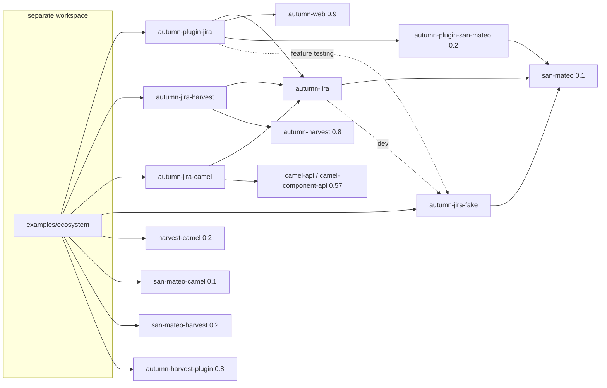
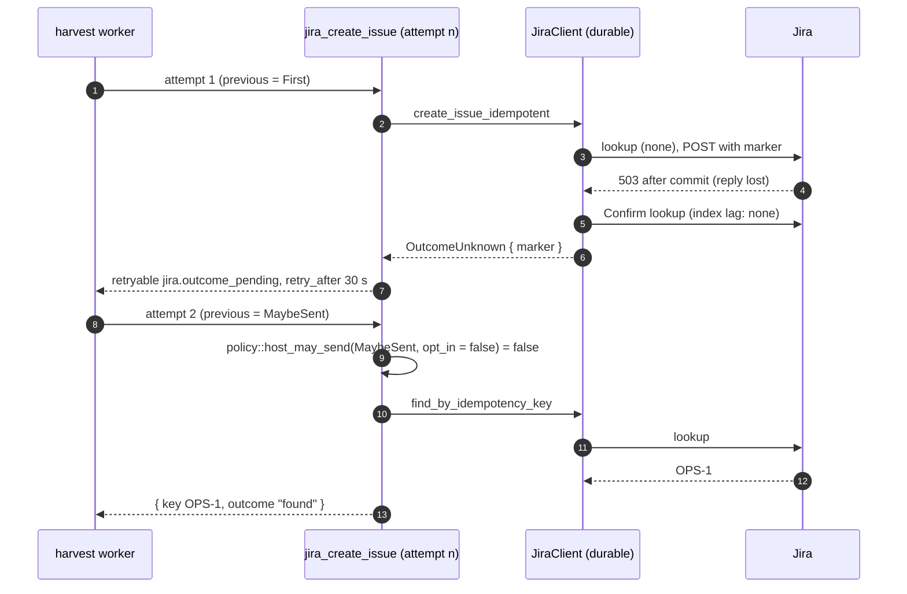
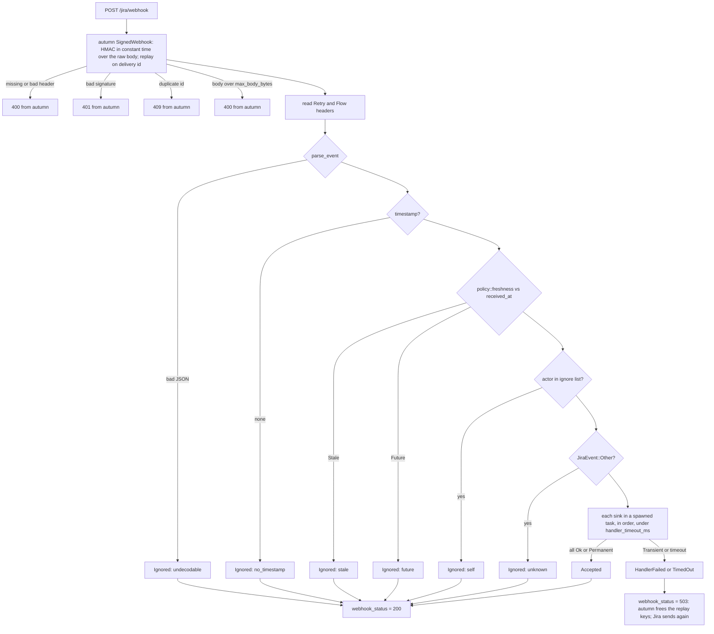
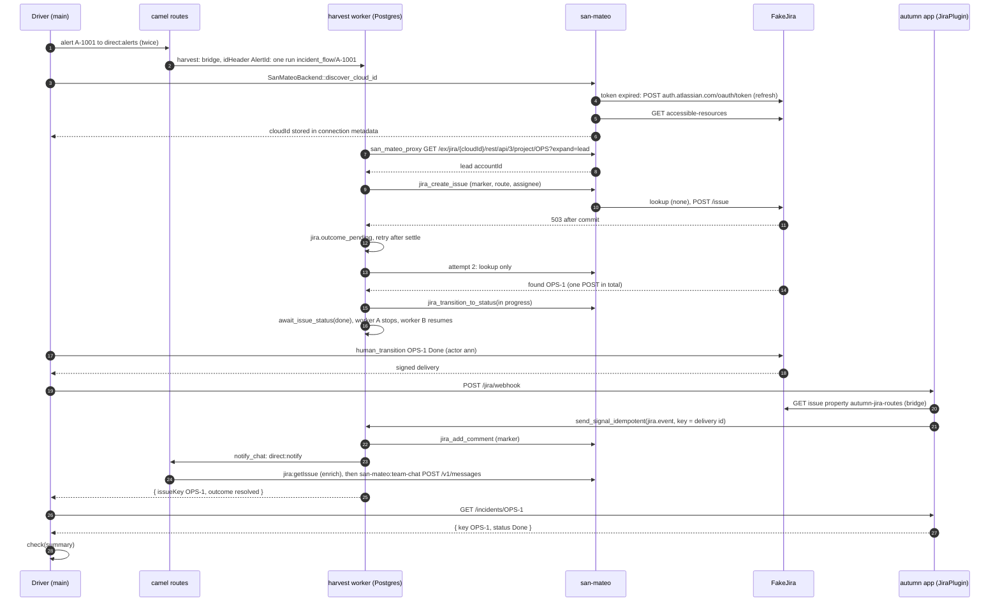
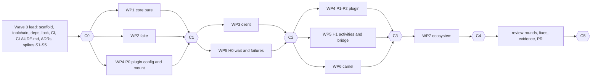

# Plan: autumn-plugin-jira and the ecosystem example

- Status: Accepted (design v2). This file is the only source for the
  implementers. Follow it literally. A change to a public signature changes
  this file in the same commit.
- Date: 2026-11-02
- Style: ASD-STE100. Short sentences. Active voice. Present tense.
- Inputs: `docs/planning/brainstorm.md`, `docs/planning/reverse-brainstorm.md`,
  `docs/planning/six-hats.md` (the resolution of every critique), the API
  notes of the planning session, the Jira Cloud REST v3 OpenAPI spec, and the
  san-mateo house style (`/home/user/san-mateo`).
- Marks: `[V]` is a fact that the planning team read in the published crate
  source (`~/.cargo/registry/src/*/`) or in the spec. `[U]` is an assumption
  that no source states. Section 15 lists each `[U]` and its check.
- Ids: `F01..F60` are failure modes in `planning/reverse-brainstorm.md`.
  `W`, `B`, `R`, `Y`, `G`, `L` are the white, black, red, yellow, green and
  blue hat points in `planning/six-hats.md`.

## Contents

1. Goals and non-goals
2. Decisions
3. Workspace and crates
4. Public API: `autumn-jira`
5. Public API: `autumn-jira-fake`
6. Verified core and Verus scope
7. Retry and idempotency design
8. Public API and design: `autumn-plugin-jira` (webhooks)
9. Public API and design: `autumn-jira-harvest`
10. Public API and design: `autumn-jira-camel`
11. The ecosystem example
12. Main-workspace examples
13. Test strategy
14. CI jobs
15. Risks and assumptions
16. Acceptance criteria
17. Work packages and file ownership
18. TDD order
19. Cut list
20. Later (not in v1)

---

## 1. Goals and non-goals

### 1.1 Goals

1. A typed, safe Jira Cloud REST v3 client for Rust. It creates, reads,
   edits, deletes, lists and searches issues. It also does transitions,
   comments, projects and issue types.
2. Safe writes. The client never sends a non-idempotent write a second time
   after a 5xx reply or a network error, unless a mechanism makes it safe.
   The mechanisms are a marker lookup (create issue, add comment) and a
   state check (transition to a status).
3. An autumn-web 0.9 plugin. One `.plugin(JiraPlugin::new())` call gives a
   `JiraService` extractor, a health indicator and a signed webhook route
   with typed event dispatch.
4. Two auth modes: a direct API token (Basic auth), and a san-mateo
   connection (`jira-basic` or the `atlassian` OAuth provider) through
   `autumn-plugin-san-mateo`.
5. autumn-harvest 0.8 activities, a durable "wait for a status" helper and a
   webhook-to-signal bridge.
6. A rust-camel 0.57 `jira:` producer component.
7. An independent, stateful fake Jira (`autumn-jira-fake`) for every test
   and example. No test calls a real Jira.
8. A small verified core (`policy.rs`) with a Verus mirror.
9. A runnable example of the whole ecosystem: autumn-web, san-mateo,
   autumn-plugin-san-mateo, autumn-harvest, san-mateo-harvest, rust-camel,
   san-mateo-camel, harvest-camel and the four crates of this repo.

### 1.2 Non-goals (v1)

- Jira Data Center or Server, `/rest/api/2`, Agile (`/rest/agile/1.0`),
  Jira Service Management, Forge and Connect apps.
- OAuth dynamic webhooks (JWT signed, 30-day expiry). v1 supports admin and
  REST webhooks with an HMAC secret only (F10, F27).
- Attachments, worklogs, issue links, watchers, bulk create, markdown to ADF,
  widgets, a CLI command, OpenAPI code generation.
- "Exactly once". Webhooks are at least once. Idempotent create is best
  effort with a documented residual window (ADR 0003).
- Section 20 lists the ideas that come after v1.

---

## 2. Decisions

Each row has an ADR. `planning/six-hats.md` gives the hat points behind each
row.

| # | Decision | ADR |
|---|---|---|
| D1 | Five crates in a star graph: `autumn-jira` (core), `autumn-jira-fake`, `autumn-plugin-jira`, `autumn-jira-harvest`, `autumn-jira-camel`. No adapter crate depends on another adapter crate. | 0001 |
| D2 | The core depends on `san-mateo 0.1`. It reuses `HttpTransport`, `ReqwestTransport` (no redirects, body cap) [V], `Secret`, `Entropy` and the `SanMateo` facade. `SanMateoBackend` lives in the core. | 0001, 0002 |
| D3 | One seam: `trait JiraBackend` sends one attempt. `DirectBackend` (Basic auth over `HttpTransport`) and `SanMateoBackend` (`SanMateo::proxy` with `retries = 0`) implement it. The client does all retries with the verified policy. | 0002 |
| D4 | Fixed hosts only: `https://{subdomain}.atlassian.net` or `https://api.atlassian.com/ex/jira/{cloudId}`. No free base URL. No redirects. Path segments are percent-encoded. | 0002 |
| D5 | An unsafe write is sent at most once in a client call. After a 5xx or a "maybe sent" network error, a marked write does a positive lookup only (`Confirm`). No lookup result ever causes a second send in the same call. | 0003 |
| D6 | Marker for create: label `autumn-idem-<26 lower base32>` plus issue property `autumn-jira` with the full key, in the same POST. Marker for comments: a last paragraph `autumn-ref: <26 lower base32>`. | 0003 |
| D7 | A durable host (harvest activity, camel route under harvest) re-sends a marked write after a "maybe sent" attempt only with an explicit opt-in (`resend_after_negative_lookup`). Default: lookup only, then fail closed with `outcome_unknown`. Verified fn `host_may_send`. | 0003 |
| D8 | Webhooks use autumn `SignedWebhook` (provider `generic`, header `X-Hub-Signature`, delivery id `X-Atlassian-Webhook-Identifier`) [V]. The plugin mounts the route at the full path with `merge`, not `nest` [V: `SignedWebhook` looks up the endpoint by `parts.uri.path()`, and `nest` strips the prefix]. | 0004 |
| D9 | After verification the route answers 200 (accepted or ignored) or 503 (handler fault or timeout). Never a 4xx from the plugin. A duplicate keeps autumn's 409 [V]. | 0004 |
| D10 | Event seam in the core: `trait EventSink` and `HandlerError`. The plugin calls sinks. The harvest bridge is a sink. | 0001, 0004 |
| D11 | Signal routing by issue property `autumn-jira-routes` (workflow name, workflow id, HMAC tag) plus one constant label `autumn-tracked`. The bridge reads the property with a strongly consistent GET and checks the tag in constant time. | 0006 |
| D12 | `await_issue_status` races the signal against a poll timer under one deadline. The deadline uses `ctx.system_now()` (recorded) [V], never `ctx.now()` (fixed start time) [V]. Webhooks speed up the wait. They are not required. | 0006 |
| D13 | The fake is its own crate. It shares no code with the client. It is sans-IO (`handle`) and implements `HttpTransport`. It has no network server. | 0007 |
| D14 | The ecosystem example is a separate cargo workspace `examples/ecosystem` with its own `Cargo.lock` and CI job. `harvest-camel` needs `autumn-harvest-plugin` with `connectors`, which turns on autumn-web default features and the C builds `pq-src` and `libsqlite3-sys` [V]. | 0008 |
| D15 | Verified pure core `autumn_jira::policy`, mirrored in `verus/policy.rs`. `verus_bodies_match` and a drift-completeness test. Verus runs in CI only. | 0005 |

---

## 3. Workspace and crates

### 3.1 Tree

```
autumn-plugin-jira/
  Cargo.toml                  # [workspace] members = ["crates/*"], exclude = ["examples/ecosystem"]
  Cargo.lock
  rust-toolchain.toml         # channel 1.99.0; components rustfmt, clippy, llvm-tools
  clippy.toml                 # allow-unwrap-in-tests, allow-expect-in-tests (san-mateo copy)
  CLAUDE.md  README.md  LICENSE
  verus/policy.rs             # spec and proofs for crates/autumn-jira/src/policy.rs
  scripts/
    smoke-autumn-example.sh   # boots the autumn_app binary (dev and prod), signed POST, SIGTERM
    coverage-gate.py          # per-crate src line coverage >= 85 from llvm-cov JSON
    extract-jira-schemas.py   # spec -> crates/autumn-jira-fake/tests/fixtures/schemas.json
    run-ecosystem.sh          # starts Postgres with compose when needed, runs the example
  docs/
    plan.md  examples-plan.md  ac-evidence.md
    adr/0001..0008-*.md
    planning/{brainstorm,reverse-brainstorm,six-hats}.md
  .github/workflows/ci.yml
  crates/
    autumn-jira/              # core client
      src/ tests/ examples/embedded.rs
    autumn-jira-fake/         # FakeJira
      src/ tests/ tests/fixtures/schemas.json
    autumn-plugin-jira/       # autumn-web 0.9 plugin
      src/ tests/ examples/autumn_app/{main.rs, autumn.toml, autumn-prod.toml}
    autumn-jira-harvest/      # harvest activities, wait helper, bridge
      src/ tests/ examples/harvest_workflow.rs
    autumn-jira-camel/        # jira: component
      src/ tests/ examples/camel_route.rs
  examples/
    ecosystem/                # SEPARATE workspace
      Cargo.toml  Cargo.lock  README.md  compose.yaml  autumn.toml
      src/{main.rs, app.rs, routes.rs, workflow.rs, transport.rs, summary.rs}
      tests/ (none: tests are #[cfg(test)] modules in src, house pattern)
```

### 3.2 Crates

| Crate | Purpose | Normal dependencies | Features |
|---|---|---|---|
| `autumn-jira` | Client, ids, models, ADF, JQL, errors, verified `policy`, `JiraBackend`, `DirectBackend`, `SanMateoBackend`, webhook types and signature check, `EventSink`, `WRITES`. | `san-mateo = "0.1"`, `async-trait 0.1`, `serde 1` (`derive`), `serde_json 1`, `chrono 0.4` (no default; `clock`, `serde`), `thiserror 2`, `tokio 1` (`time`, `sync`), `hmac 0.12`, `sha2 0.10`, `data-encoding 2`, `percent-encoding 2`, `tracing 0.1`. | none |
| `autumn-jira-fake` | `FakeJira`: a stateful in-memory Jira Cloud. | `san-mateo = "0.1"` (transport types only), `async-trait`, `serde_json`, `hmac`, `sha2`, `base64 0.22`, `tokio` (`time`, `sync`), `chrono`. NOT `autumn-jira` (guard test). | none |
| `autumn-plugin-jira` | autumn-web plugin: `[jira]` config, `JiraService`, health, webhook route, dispatch. | `autumn-jira`, `autumn-web = { version = "0.9", default-features = false }`, `autumn-plugin-san-mateo = "0.2"`, `san-mateo`, `async-trait`, `serde`, `serde_json`, `toml 0.9`, `thiserror`, `tracing`, `tokio`. | `testing`: optional dep `autumn-jira-fake`; test helpers. |
| `autumn-jira-harvest` | Activities, `await_issue_status`, `HarvestSignalBridge`. | `autumn-jira`, `autumn-harvest = "0.8.0"` (default features), `san-mateo`, `async-trait`, `serde`, `serde_json`, `thiserror`, `hmac`, `sha2`, `chrono`, `tracing`, `diesel-async 0.9` (`postgres`, `deadpool`), `deadpool 0.13`. | none |
| `autumn-jira-camel` | Producer-only `jira:` component. | `autumn-jira`, `camel-api = "0.57"`, `camel-component-api = "0.57"`, `async-trait`, `serde_json`, `tower 0.5` (`util`). | none |
| `ecosystem` (example, `publish = false`) | The full loop (section 11). | The four library crates by `path` (`autumn-plugin-jira` with `testing`), `autumn-jira-fake` by `path`, `san-mateo`, `autumn-plugin-san-mateo`, `san-mateo-harvest = "0.2"`, `san-mateo-camel = "0.1"`, `harvest-camel = "0.2.0"`, `autumn-harvest = "0.8.0"`, `autumn-harvest-plugin = "0.8.0"` (`connectors`), `autumn-web = "0.9"`, `camel-{api,builder,component-direct,core} = "0.57"`, `tokio`, `tokio-util`, `deadpool`, `diesel-async`, `serde_json`, `reqwest` (test only, inbound POST). | none |

Dev-dependencies (house pattern): `autumn-jira-fake` by path, `tokio`
(`macros`, `rt-multi-thread`, `test-util`), `proptest 1`, `tower` (`util`),
`autumn-harvest` (`testing`), `camel-core`, `camel-builder`,
`camel-component-direct`, `tracing-subscriber` (capture test), `reqwest`
(boot test only).

### 3.3 Crate graph



### 3.4 Workspace rules

- `[workspace.package]`: `edition = "2024"`, `rust-version = "1.89"`,
  `license = "Apache-2.0"`, `version = "0.1.0"`, `repository =
  "https://github.com/autumn-foundation/autumn-plugin-jira"`.
- All dependency versions live in `[workspace.dependencies]`. Crates use
  `{ workspace = true }`.
- `[workspace.lints.rust]`: `unsafe_code = "forbid"`, `missing_docs = "deny"`.
- `[workspace.lints.clippy]`: `pedantic = { level = "warn", priority = -1 }`,
  `nursery = { level = "warn", priority = -1 }`, `unwrap_used = "deny"`,
  `expect_used = "deny"`, `dbg_macro = "deny"`, `todo = "deny"`,
  `unimplemented = "deny"`, `print_stdout = "deny"`, `print_stderr = "deny"`.
  CI runs clippy with `-D warnings`. `clippy.toml` allows `unwrap`/`expect`
  in tests.
- Each `allow` has a `reason = "..."`. Examples that print a summary have
  `#![allow(clippy::print_stdout, reason = "the example prints its summary")]`.
- `autumn-jira-camel/src/lib.rs` has
  `#![allow(clippy::result_large_err, reason = "CamelError is 168 bytes")]` [V].
- `examples/ecosystem/Cargo.toml` copies the lints. A guard test compares them.
- The root `Cargo.lock` holds no `harvest-camel`, `autumn-harvest-plugin`,
  `pq-src` or `libsqlite3-sys` (guard test, F49).
- One version each of `autumn-web`, `san-mateo`, `autumn-harvest`,
  `camel-api`, `camel-core`, `camel-component-api` in both locks (CI, F29).
- Each crate `lib.rs` has a crate doc with one compiled example. The root
  `README.md` snippets compile as doctests through
  `#[cfg(doctest)] #[doc = include_str!("../../../README.md")] pub struct ReadmeDoctests;`
  in `crates/autumn-plugin-jira/src/lib.rs` (F47).

---

## 4. Public API: `autumn-jira`

All public items have doc comments. All public structs and enums that can
grow are `#[non_exhaustive]`. Builders return `Self` and are `#[must_use]`.
`Result<T, E = JiraError>` is `autumn_jira::Result`.

### 4.1 Modules

| Module | Contents |
|---|---|
| `ids` | Newtypes (4.2). |
| `site` | `JiraSite`, `BasicAuth`. |
| `model` | Response models: `Issue`, `IssueFields`, `Status`, `StatusCategory`, `StatusSummary`, `IssueSummary`, `IssueType`, `ProjectRef`, `Project`, `User`, `Comment`, `CommentPage`, `Transition`, `CreatedIssue`, `IssueRefs`, `ServerInfo`, `AccessibleResource`, `Page<T>`. |
| `request` | `NewIssue`, `IssueTypeRef`, `IssueEdit`, `EditOptions`, `FieldSet`, `SearchRequest`, `StatusTarget`, `TransitionFields`. |
| `adf` | `Adf`, `AdfBuilder`, `Span`. |
| `jql` | `Jql`, `JqlField`, `JqlClause`, `Order`. |
| `time` | `JiraTimestamp`. |
| `error` | `JiraError`, `Op`, `UnknownCause`, `ErrorClass`, `CamelKind`, `Result`. |
| `policy` | Verified pure core (section 6). |
| `backend` | `JiraBackend`, `ApiRequest`, `ApiResponse`, `Method`, `BackendError`, `BackendInfo`, `BackendMode`, `DirectBackend`, `SanMateoBackend`, `SanMateoTarget`, `resolve_cloud_id`. |
| `client` | `JiraClient`, `ClientSettings`, `SearchPager`, `CreateOutcome`, `CommentOutcome`, `TransitionOutcome`, `DeleteOutcome`, `IdempotencyKey`, `MarkerRef`. |
| `webhook` | `Delivery`, `DeliveryMeta`, `Flow`, `JiraEvent`, `IssueEvent`, `CommentEvent`, `WebhookIssue`, `WebhookFields`, `WebhookComment`, `ChangeItem`, `StatusChange`, `StatusRef`, `ParsedEvent`, `parse_event`, `verify_signature`, `sign`, header constants. |
| `sink` | `EventSink`, `HandlerError`. |
| `writes` | `JiraWrite`, `WriteKind`, `WRITES`. |

Crate root re-exports: `JiraClient`, `JiraError`, `Result`, `JiraSite`,
`BasicAuth`, `IssueKey`, `IssueId`, `IssueRef`, `ProjectKey`, `AccountId`,
`Adf`, `Jql`, `NewIssue`, `StatusTarget`, `IdempotencyKey`, `Delivery`,
`JiraEvent`, `EventSink`, `HandlerError`, `ClientSettings`, and
`pub use san_mateo;`.

### 4.2 Newtypes (`ids`)

Each newtype has `parse(&str) -> Result<Self>` (strict), `as_str(&self) ->
&str`, `Display`, `Serialize`, `Clone`, `Eq`, `Hash`, `Ord`, and a STRICT
`Deserialize` that calls `parse` (R7). So `Path<IssueKey>` in an autumn
handler rejects bad input with 400. Response models read Jira ids through
private wire types (`model::wire`) with `pub(crate) fn from_response(String)
-> Self` (lenient, F42). A response key such as `lower-7` is kept as given.

| Type | Strict input rule |
|---|---|
| `ProjectKey` | `^[A-Z][A-Z0-9_]{1,9}$` |
| `IssueKey` | `^[A-Z][A-Z0-9_]{1,9}-[1-9][0-9]{0,9}$`; `project(&self) -> ProjectKey`, `number(&self) -> u64` |
| `IssueId`, `ProjectId`, `StatusId`, `CommentId`, `TransitionId`, `IssueTypeId` | `^[1-9][0-9]{0,18}$` (a string, not a number) |
| `IssueRef` | enum `Id(IssueId)` or `Key(IssueKey)`. `IssueRef::parse` picks by shape. `From<IssueKey>`, `From<&IssueKey>`, `From<IssueId>`, `From<&IssueId>`. `path_segment(&self) -> &str`. |
| `AccountId` | 1..=128 chars of `[A-Za-z0-9:_-]` |
| `CloudId` | UUID text, lower case, 36 chars |
| `SiteName` | `^[a-z0-9][a-z0-9-]{0,62}$` (same as the `jira-basic` provider pattern [V]) |
| `StatusCategoryKey` | 1..=64 chars of `[a-z0-9-]`. Constants `NEW = "new"`, `INDETERMINATE = "indeterminate"`, `DONE = "done"`. Lenient for responses (the spec shows `in-flight`) [V]. |
| `FieldId` | `^[a-z][A-Za-z0-9_]{0,63}$` or `^customfield_[0-9]{1,10}$` |
| `WebhookDeliveryId` | 1..=200 printable ASCII, no space |
| `PageToken` | opaque, non-empty; `Debug` shows only the length |

`IdempotencyKey` (in `client`): 1..=200 printable ASCII, no space.
- `IdempotencyKey::parse(&str) -> Result<Self>`
- `IdempotencyKey::derive(parts: &[&str]) -> Self`: `"d1-"` plus the lower
  hex SHA-256 of the parts, each part prefixed by its byte length and `:`.
  A stable key from app data (R8, Y11).
- `marker_label(&self, prefix: &str) -> String`: `prefix` plus the first 26
  chars of lower-case RFC 4648 base32 of SHA-256(key) (130 bits).
- `comment_marker(&self) -> String`: `"autumn-ref: "` plus the same 26 chars.
- `as_str(&self) -> &str`. `Debug` shows the key (it is not a secret).

### 4.3 Site and auth (`site`)

```rust
#[derive(Debug, Clone, PartialEq, Eq)]
pub enum JiraSite {
    /// `https://{subdomain}.atlassian.net`. Classic API token.
    Subdomain(SiteName),
    /// `https://api.atlassian.com/ex/jira/{cloud_id}`. Scoped API token.
    CloudId(CloudId),
}
impl JiraSite {
    pub fn base_url(&self) -> String;   // the only base URL builder (guard test)
    pub fn label(&self) -> String;      // "acme.atlassian.net" or "cloud:<id>"; no secret
}
#[derive(Clone)]
pub struct BasicAuth { email: String, token: Secret }
impl BasicAuth {
    /// Fails on an empty email or token. Never logs either.
    pub fn new(email: impl Into<String>, token: Secret) -> Result<Self>;
}
impl Debug for BasicAuth { /* "BasicAuth { email: \"<redacted>\", token: \"<redacted>\" }" */ }
```

### 4.4 Backend seam (`backend`)

```rust
#[derive(Debug, Clone, Copy, PartialEq, Eq)]
pub enum Method { Get, Post, Put, Delete }

#[derive(Debug, Clone, PartialEq, Eq)]
pub struct ApiRequest {
    pub op: Op,
    pub method: Method,
    /// "/rest/api/3/...". Each id segment is percent-encoded by the client.
    pub path: String,
    pub query: Vec<(String, String)>,
    /// JSON bytes. `None` for no body.
    pub body: Option<Vec<u8>>,
}
#[derive(Debug, Clone, PartialEq, Eq)]
pub struct ApiResponse { pub status: u16, pub headers: Vec<(String, String)>, pub body: Vec<u8> }
impl ApiResponse { pub fn header(&self, name: &str) -> Option<&str>; } // case-insensitive

/// One attempt failed with no HTTP reply.
#[derive(Debug, Clone, PartialEq, Eq, thiserror::Error)]
#[non_exhaustive]
pub enum BackendError {
    /// The request did not leave this process. `transient` says if a retry can help.
    #[error("not sent ({code})")] NotSent { transient: bool, code: &'static str },
    /// The request may have reached Jira. The outcome of a write is unknown.
    #[error("maybe sent ({code})")] MaybeSent { code: &'static str },
    /// The credentials cannot be used (refresh exhausted). Not sent.
    #[error("auth ({code})")] Auth { code: &'static str },
}

#[derive(Debug, Clone, Copy, PartialEq, Eq)]
pub enum BackendMode { ApiToken, SanMateo }
#[derive(Debug, Clone, PartialEq, Eq)]
pub struct BackendInfo { pub mode: BackendMode, pub site: String }  // site = JiraSite::label or "san-mateo:<integration>/<connection>"

#[async_trait]
pub trait JiraBackend: Send + Sync + 'static {
    /// Sends one attempt. It never retries and never follows a redirect.
    async fn send(&self, request: ApiRequest) -> Result<ApiResponse, BackendError>;
    /// Mode and site for health details. No secrets.
    fn info(&self) -> BackendInfo;
}

pub struct DirectBackend { /* site, auth, Arc<dyn HttpTransport> */ }
impl DirectBackend {
    pub fn new(site: JiraSite, auth: BasicAuth, transport: Arc<dyn HttpTransport>) -> Self;
}

#[derive(Debug, Clone, PartialEq, Eq)]
pub struct SanMateoTarget {
    pub environment: String,
    pub connection: san_mateo::ConnectionKey,
    /// `atlassian` only. Else the backend reads metadata key `cloudId`, then discovers.
    pub cloud_id: Option<CloudId>,
    /// Picks one site from `accessible-resources`, for example `https://acme.atlassian.net`.
    pub site_url: Option<String>,
}
pub struct SanMateoBackend { /* SanMateo, target, tokio::sync::OnceCell<String> prefix */ }
impl SanMateoBackend {
    pub fn new(san: SanMateo, target: SanMateoTarget) -> Self;
    /// Reads accessible-resources, picks the site, stores `cloudId` in the
    /// connection metadata (merge = true), and returns it.
    pub async fn discover_cloud_id(&self) -> Result<CloudId>;
}
/// Pure. Keeps entries with a scope that starts with `read:jira-` or
/// `write:jira-`. Fails on zero matches, or on more than one match with no
/// `site_url`.
pub fn resolve_cloud_id(resources: &[AccessibleResource], site_url: Option<&str>) -> Result<CloudId>;
```

`DirectBackend` rules: URL = `site.base_url() + path + "?" + encoded query`.
Headers: `authorization: Basic base64(email:token)`, `accept:
application/json`, `content-type: application/json` when a body exists,
`user-agent: autumn-jira/<version>`. Map `TransportError` [V]:

| `san_mateo::transport::TransportError` | `BackendError` | Why |
|---|---|---|
| `Connect(_)` | `MaybeSent { code: "connect" }` | `ReqwestTransport` maps a reset during the reply read to `Connect` [V] (G5). |
| `Timeout` | `MaybeSent { code: "timeout" }` | |
| `BodyTooLarge` | `MaybeSent { code: "body_too_large" }` | Jira replied, so a write ran. |
| `Invalid(_)` | `NotSent { transient: false, code: "invalid_request" }` | |

`SanMateoBackend` rules:
- Provider: `san.get_integration(env, &key.provider_config_key).await?.provider`
  [V]. `jira-basic` gives prefix `""`. `atlassian` gives `/ex/jira/{cloudId}`.
  Other providers: `NotSent { transient: false, code: "not_a_jira_provider" }`.
- Cloud id order: `target.cloud_id`, then `metadata["cloudId"]` of
  `san.list_connections(env, &ConnectionFilter { provider_config_key,
  connection_id, .. })` [V], then `discover_cloud_id`. The prefix is cached
  in the `OnceCell`.
- Request: `ProxyRequest { method, endpoint: prefix + path + query, headers:
  [accept, content-type when body], body, retries: 0, retry_on: vec![],
  base_url_override: None, params: vec![] }`. With `retries = 0` san-mateo
  sends once, plus one resend after a 401 refresh [V].
- `Ok(ProxyResponse)` maps to `ApiResponse` for every status. A non-2xx is
  not an error at this layer [V].
- Map `san_mateo::Error` (`#[non_exhaustive]`, so the match has a `_` arm) [V]:

| `san_mateo::Error` | `BackendError` |
|---|---|
| `Upstream(_)` (connect error or timeout) | `MaybeSent { code: "upstream" }` |
| `UpstreamTooLarge` | `MaybeSent { code: "upstream_too_large" }` |
| `Store(_)`, `RefreshCooldown` | `NotSent { transient: true, code }` |
| `Provider { status, .. }` | `NotSent { transient: status.map_or(true, \|s\| s >= 500 \|\| matches!(s, 408 \| 425 \| 429)), code: "provider" }` |
| `UnknownIntegration`, `UnknownConnection`, `UnknownProvider`, `Template`, `ForbiddenHost`, `Invalid`, `MissingField`, `UnsupportedAuthMode`, `IntegrationNotAllowed`, `Crypto`, `Internal` | `NotSent { transient: false, code: err.code() }` |
| `RefreshExhausted`, `Unauthorized(_)` | `Auth { code: err.code() }` |
| `_` (future variant) | `MaybeSent { code: "unknown" }` (the safe side for writes, B11) |

Note [V]: when a 401 refresh fails inside the proxy, san-mateo returns the
401 reply, not an error. The client maps it to `Unauthorized`.

### 4.5 Client (`client`)

```rust
#[derive(Clone)]
pub struct JiraClient { backend: Arc<dyn JiraBackend>, settings: ClientSettings, entropy: Arc<dyn Entropy>, myself: Arc<OnceCell<AccountId>> }

#[derive(Debug, Clone, PartialEq, Eq)]
#[non_exhaustive]
pub struct ClientSettings {
    pub max_attempts: u32,            // default 5; capped by policy::MAX_ATTEMPTS
    pub base_backoff_ms: u64,         // default 2_000
    pub max_backoff_ms: u64,          // default 30_000; a Retry-After above it returns RateLimited
    pub max_pages: u32,               // default 1_000
    pub lookup_attempts: u32,         // default 3; capped by policy::MAX_LOOKUPS
    pub lookup_delay_ms: u64,         // default 2_000 (search index lag)
    pub jitter: bool,                 // default true; tests set false
    pub marker_label_prefix: String,  // default "autumn-idem-"
}
impl Default for ClientSettings { .. }
impl ClientSettings {
    /// For harvest activities and camel routes under harvest: one retry owner (B2, Y18).
    /// max_attempts 2, base 500, max_backoff 10_000, lookup_attempts 1, lookup_delay 0.
    pub fn for_durable_host() -> Self;
    /// Keeps `jitter` and `marker_label_prefix`; caps the other fields at the durable values.
    #[must_use] pub fn durable(self) -> Self;
    /// Worst-case wall time of one client call of `class`, for a transport timeout `per_request`.
    pub fn worst_case(&self, class: OpClass, per_request: Duration) -> Duration;
}

impl JiraClient {
    pub fn new(backend: Arc<dyn JiraBackend>) -> Self;               // OsEntropy
    pub fn api_token(site: JiraSite, auth: BasicAuth, transport: Arc<dyn HttpTransport>) -> Self;
    pub fn san_mateo(san: SanMateo, target: SanMateoTarget) -> Self;
    #[must_use] pub fn with_settings(self, settings: ClientSettings) -> Self;
    #[must_use] pub fn with_entropy(self, entropy: Arc<dyn Entropy>) -> Self;  // tests: SeqEntropy
    #[must_use] pub fn durable(self) -> Self;                       // settings.durable()
    pub fn settings(&self) -> &ClientSettings;
    pub fn info(&self) -> BackendInfo;

    // Account and site
    pub async fn myself(&self) -> Result<User>;                     // caches account id
    pub async fn server_info(&self) -> Result<ServerInfo>;

    // Projects and issue types (lists)
    pub async fn get_project(&self, key: &ProjectKey) -> Result<Project>;
    pub async fn projects(&self, start_at: u64, max_results: u32) -> Result<Page<Project>>;   // GET /project/search
    pub async fn all_projects(&self) -> Result<Vec<Project>>;                                // offset pager, max_pages
    pub async fn issue_types(&self, project: &ProjectKey) -> Result<Vec<IssueType>>;         // createmeta pager

    // Issues
    pub async fn create_issue(&self, issue: &NewIssue) -> Result<CreatedIssue>;
    pub async fn create_issue_idempotent(&self, issue: &NewIssue, key: &IdempotencyKey) -> Result<CreateOutcome>;
    pub async fn find_by_idempotency_key(&self, project: &ProjectKey, key: &IdempotencyKey) -> Result<Option<IssueRefs>>;
    pub async fn get_issue(&self, issue: impl Into<IssueRef> + Send) -> Result<Issue>;      // FieldSet::default()
    pub async fn get_issue_with(&self, issue: impl Into<IssueRef> + Send, fields: &FieldSet) -> Result<Issue>;
    pub async fn edit_issue(&self, issue: impl Into<IssueRef> + Send, edit: &IssueEdit, options: EditOptions) -> Result<()>;
    pub async fn delete_issue(&self, issue: impl Into<IssueRef> + Send, delete_subtasks: bool) -> Result<DeleteOutcome>;
    pub async fn set_issue_property(&self, issue: impl Into<IssueRef> + Send, key: &str, value: &Value) -> Result<()>;
    pub async fn get_issue_property(&self, issue: impl Into<IssueRef> + Send, key: &str) -> Result<Option<Value>>;

    // Transitions
    pub async fn transitions(&self, issue: impl Into<IssueRef> + Send) -> Result<Vec<Transition>>;
    pub async fn transition(&self, issue: impl Into<IssueRef> + Send, id: &TransitionId, fields: &TransitionFields) -> Result<()>;
    pub async fn transition_to_status(&self, issue: impl Into<IssueRef> + Send, target: &StatusTarget) -> Result<TransitionOutcome>;
    pub async fn transition_to_status_with(&self, issue: impl Into<IssueRef> + Send, target: &StatusTarget, fields: &TransitionFields) -> Result<TransitionOutcome>;

    // Comments
    pub async fn add_comment(&self, issue: impl Into<IssueRef> + Send, body: &Adf) -> Result<Comment>;
    pub async fn add_comment_idempotent(&self, issue: impl Into<IssueRef> + Send, body: &Adf, key: &IdempotencyKey) -> Result<CommentOutcome>;
    pub async fn find_comment_by_idempotency_key(&self, issue: impl Into<IssueRef> + Send, key: &IdempotencyKey) -> Result<Option<Comment>>;
    pub async fn comments(&self, issue: impl Into<IssueRef> + Send, start_at: u64, max_results: u32) -> Result<CommentPage>;
    pub async fn all_comments(&self, issue: impl Into<IssueRef> + Send) -> Result<Vec<Comment>>;

    // Search
    pub fn search(&self, request: SearchRequest) -> SearchPager;
    pub async fn search_all(&self, request: SearchRequest, max_issues: usize) -> Result<Vec<Issue>>;
    pub async fn approximate_count(&self, jql: &Jql) -> Result<u64>;
}

#[derive(Debug, Clone, PartialEq, Eq)]
pub enum CreateOutcome { Created(CreatedIssue), Found(IssueRefs) }
#[derive(Debug, Clone, PartialEq, Eq)]
pub enum CommentOutcome { Created(Comment), Found(Comment) }
#[derive(Debug, Clone, PartialEq, Eq)]
pub enum TransitionOutcome { AlreadyThere(StatusSummary), Moved { via: TransitionId, to: StatusSummary } }
#[derive(Debug, Clone, Copy, PartialEq, Eq)]
pub enum DeleteOutcome { Deleted, GoneAfterRetry }  // GoneAfterRetry: 404 on a retry after a maybe-sent attempt
#[derive(Debug, Clone, PartialEq, Eq, Serialize, Deserialize)]
pub struct MarkerRef { pub label: Option<String>, pub comment_marker: Option<String> }

pub struct SearchPager { /* client, request, token, seen tokens (BTreeSet<String>), pages */ }
impl SearchPager {
    /// `Ok(None)` at the end. `PaginationStalled` on a repeated token. `PageLimit` at `max_pages`.
    pub async fn next_page(&mut self) -> Result<Option<Vec<Issue>>>;
    pub const fn pages(&self) -> u32;
}
```

Request types (`request`), all `#[non_exhaustive]` with builders:

```rust
pub enum IssueTypeRef { Id(IssueTypeId), Name(String) }   // body {"id"} or {"name"}
NewIssue::new(project: ProjectKey, issue_type: IssueTypeRef, summary: impl Into<String>)
    .description(Adf).labels(impl IntoIterator<Item = impl Into<String>>)
    .assignee(AccountId).priority_name(impl Into<String>)
    .field(FieldId, serde_json::Value)    // passed through as given: the app owns custom fields
    .property(key: impl Into<String>, value: Value)
IssueEdit::new().set_summary(..).set_description(Adf).add_label(..).remove_label(..)
    .set_assignee(Option<AccountId>).set_field(FieldId, Value)
#[derive(Default)] pub struct EditOptions { pub notify_users: Option<bool> }  // sent only when Some (F44)
FieldSet::default()   // summary,status,issuetype,project,assignee,labels,created,updated,description (F17)
FieldSet::new(impl IntoIterator<Item = FieldId>) .with(FieldId)
SearchRequest::new(Jql).fields(FieldSet).max_results(1..=100).properties([..; <=5])   // POST /search/jql
pub enum StatusTarget { Name(String), Id(StatusId), Category(StatusCategoryKey) }   // Serialize, Deserialize
impl StatusTarget { pub fn done() -> Self; pub fn in_progress() -> Self; pub fn todo() -> Self;
    pub fn matches(&self, status: &StatusSummary) -> bool; }  // name: ASCII case-insensitive
#[derive(Default)] pub struct TransitionFields { pub fields: Map<String, Value>, pub update: Map<String, Value> }
```

Models (`model`) read Jira replies leniently: unknown keys are ignored; ids
are strings; `StatusCategory.id` is an integer [V]; `IssueBean.properties` is
an object (key to value) [V]; `nextPageToken` is absent on the last page [V].

```rust
pub struct StatusSummary { pub id: StatusId, pub name: String, pub category: StatusCategoryKey }
pub struct IssueSummary { pub id: IssueId, pub key: IssueKey, pub summary: Option<String>,
    pub status: Option<StatusSummary>, pub labels: Vec<String>, pub updated: Option<JiraTimestamp> }
impl From<&Issue> for IssueSummary
pub struct IssueRefs { pub id: IssueId, pub key: IssueKey }
pub struct CreatedIssue { pub id: IssueId, pub key: IssueKey }
pub struct Page<T> { pub values: Vec<T>, pub start_at: u64, pub total: Option<u64>, pub is_last: bool }
pub struct CommentPage { pub comments: Vec<Comment>, pub start_at: u64, pub total: u64 }
```

Every search sends `fields` explicitly. No code uses `/rest/api/3/search`
without `/jql` or `/approximate-count` (text guard, F16).

### 4.6 Errors (`error`)

```rust
#[derive(Debug, Clone, Copy, PartialEq, Eq, Hash)]
#[non_exhaustive]
pub enum Op { Myself, ServerInfo, GetProject, ListProjects, ListIssueTypes, CreateIssue,
    GetIssue, EditIssue, DeleteIssue, SetProperty, GetProperty, GetTransitions,
    DoTransition, AddComment, ListComments, Search, Count, Discovery }
impl Op {
    pub const fn class(self) -> policy::OpClass;   // the base class; idempotent variants pass MarkedWrite / CheckedWrite
    pub const fn name(self) -> &'static str;       // "create_issue"
    pub const fn expected(self) -> &'static [u16]; // create 201; edit 204, 200; delete 204; transition 204;
                                                   // add comment 201; set property 200, 201; others 200
}
impl Display for Op  // name()

#[derive(Debug, Clone, Copy, PartialEq, Eq)]
pub enum UnknownCause { ServerError(u16), Network, Timeout, BadReply }

#[derive(Debug, Clone, PartialEq, Eq, thiserror::Error)]
#[non_exhaustive]
pub enum JiraError {
    #[error("invalid {what}: {reason}")] InvalidInput { what: &'static str, reason: String },
    #[error("jira {op}: not found or no permission")] NotFoundOrForbidden { op: Op },
    #[error("jira {op}: unauthorized (HTTP {status}); {hint}")] Unauthorized { op: Op, status: u16, hint: &'static str },
    #[error("jira {op}: CAPTCHA required; log in once in a browser")] CaptchaRequired { op: Op },
    #[error("jira {op}: rejected (HTTP {status}): {} message(s), fields {fields:?}", .messages.len())]
        Validation { op: Op, status: u16, messages: Vec<String>, fields: Vec<String> },
    #[error("jira {op}: conflict")] Conflict { op: Op },
    #[error("jira {op}: gone")] Gone { op: Op },
    #[error("jira {op}: payload too large")] PayloadTooLarge { op: Op },
    #[error("jira {op}: rate limited")] RateLimited { op: Op, retry_after: Option<Duration>, reason: Option<String> },
    #[error("jira {op}: upstream HTTP {status}")] Upstream { op: Op, status: u16 },
    #[error("jira {op}: outcome unknown ({cause:?}); not sent again")] OutcomeUnknown { op: Op, cause: UnknownCause, marker: Option<MarkerRef> },
    #[error("jira {op}: network error ({code})")] Network { op: Op, code: &'static str },
    #[error("jira {op}: redirect (HTTP {status}) not followed")] Redirect { op: Op, status: u16 },
    #[error("jira {op}: unexpected HTTP {status}")] UnexpectedStatus { op: Op, status: u16 },
    #[error("jira {op}: bad reply: {reason}")] Decode { op: Op, reason: String },
    #[error("jira {op}: page token repeated after {pages} page(s)")] PaginationStalled { op: Op, pages: u32 },
    #[error("jira {op}: page limit {max} reached")] PageLimit { op: Op, max: u32 },
    #[error("no transition to {target}; available: {available:?}")] TransitionNotAvailable { target: String, available: Vec<String> },
    #[error("labels are not on the create screen of {project}; add the Labels field or use create_issue")] LabelsNotOnScreen { project: ProjectKey },
    #[error("cloud id: {0}")] CloudId(String),
    #[error("jira config ({code})")] Config { code: &'static str },
    #[error("jira auth ({code})")] Auth { code: &'static str },
}

#[derive(Debug, Clone, Copy, PartialEq, Eq)]
pub enum CamelKind { Validation, Config, Unauthenticated, Http(u16), Io }
#[derive(Debug, Clone, Copy, PartialEq, Eq)]
pub struct ErrorClass { pub code: &'static str, pub retryable: bool, pub http_status: u16, pub camel: CamelKind }

impl JiraError {
    /// One table for all hosts (Y7). Every host map is one line over this.
    pub const fn class(&self) -> ErrorClass;
    pub const fn code(&self) -> &'static str;      // class().code
    pub const fn is_retryable(&self) -> bool;      // class().retryable
    pub fn status(&self) -> Option<u16>;
    pub fn messages(&self) -> &[String];           // Jira errorMessages; not in Display
    pub fn retry_after(&self) -> Option<Duration>;
}
```

The class table (one `match`, tested over every variant):

| Variant | code | retryable | http_status | camel |
|---|---|---|---|---|
| `InvalidInput` | `invalid_input` | no | 400 | Validation |
| `NotFoundOrForbidden` | `not_found_or_forbidden` | no | 404 | Http(404) |
| `Unauthorized` | `unauthorized` | no | 502 | Unauthenticated |
| `CaptchaRequired` | `captcha_required` | no | 502 | Unauthenticated |
| `Validation` | `validation` | no | 422 | Validation |
| `Conflict` | `conflict` | no | 409 | Http(409) |
| `Gone` | `gone` | no | 502 | Config |
| `PayloadTooLarge` | `payload_too_large` | no | 413 | Validation |
| `RateLimited` | `rate_limited` | yes | 503 | Http(429) |
| `Upstream` | `upstream` | yes | 502 | Http(status) |
| `OutcomeUnknown` (marker) | `outcome_pending` | yes | 502 | Io |
| `OutcomeUnknown` (no marker) | `outcome_unknown` | no | 502 | Validation |
| `Network` | `network` | yes | 502 | Io |
| `Redirect` | `redirect` | no | 502 | Config |
| `UnexpectedStatus` | `unexpected_status` | no | 502 | Config |
| `Decode` | `decode` | no | 502 | Validation |
| `PaginationStalled` | `pagination_stalled` | no | 502 | Validation |
| `PageLimit` | `page_limit` | no | 502 | Validation |
| `TransitionNotAvailable` | `transition_not_available` | no | 409 | Validation |
| `LabelsNotOnScreen` | `labels_not_on_screen` | no | 422 | Validation |
| `CloudId` | `cloud_id` | no | 502 | Config |
| `Config` | `config` | no | 500 | Config |
| `Auth` | `auth` | no | 502 | Unauthenticated |

Rules:
- `Display` never holds a body, a header value, a query string or a secret
  (F11, F53). `Decode.reason` holds a serde error kind and a JSON path only.
- `Unauthorized.hint` names the needed scopes for 401 and 403:
  `"needs read:jira-work write:jira-work read:jira-user (OAuth) or a valid API token"` (F30).
- `X-Seraph-LoginReason: AUTHENTICATION_DENIED` gives `CaptchaRequired` (F32).
- `retry_after` reads integer seconds from `Retry-After` only. Never `Beta-*` (F34).
- 400 with `errors.labels` on an idempotent create gives `LabelsNotOnScreen`.

### 4.7 ADF, JQL, time

```rust
#[derive(Debug, Clone, PartialEq, Serialize, Deserialize)]
pub struct Adf(serde_json::Value);                // always a valid "doc" root, version 1
impl Adf {
    pub fn text(text: &str) -> Self;              // one paragraph per line; no empty text node (F38)
    pub fn builder() -> AdfBuilder;
    pub fn to_plain_text(&self) -> String;        // paragraphs joined by '\n'; unknown nodes give their text
    pub fn contains_text(&self, needle: &str) -> bool;
    pub fn with_paragraph(self, text: &str) -> Self;
    pub const fn as_value(&self) -> &serde_json::Value;
    pub fn from_value(value: serde_json::Value) -> Result<Self>;  // checks the doc root
}
AdfBuilder: paragraph(&str) | paragraph_spans(&[Span]) | heading(level: u8 /*1..=6*/, &str)
          | bullet_list(&[&str]) | ordered_list(&[&str]) | code_block(lang: Option<&str>, &str)
          | rule() | build() -> Result<Adf>
Span: text(&str) | strong(&str) | em(&str) | code(&str) | link(text: &str, url: &str /* https only */)

#[derive(Debug, Clone, PartialEq, Eq)]
pub struct Jql(String);
pub enum Order { Asc, Desc }
impl Jql {
    pub fn project(key: &ProjectKey) -> Self;              // a bounded start
    pub fn field(name: JqlField) -> JqlClause;              // .eq(v) .ne(v) .in_(&[v]) .is_empty() -> Result<Jql-fragment>
    #[must_use] pub fn and(self, clause: JqlClause) -> Self;
    #[must_use] pub fn order_by(self, field: JqlField, order: Order) -> Self;
    pub fn raw(jql: impl Into<String>) -> Self;             // explicit name: the app owns the text
    pub fn as_str(&self) -> &str;
}
pub enum JqlField { Project, Key, Labels, Status, StatusCategory, IssueType, Assignee, Created, Updated,
    Custom(u64) /* cf[N] */, Property { key: String, path: String } }
// Values go through policy::jql_quote. A control char in a value gives InvalidInput.

#[derive(Debug, Clone, Copy, PartialEq, Eq, PartialOrd, Ord)]
pub struct JiraTimestamp(DateTime<Utc>);  // parses "%Y-%m-%dT%H:%M:%S%.f%z", RFC 3339, epoch ms (F19)
impl JiraTimestamp { pub fn parse(&str) -> Result<Self>; pub const fn from_epoch_ms(i64) -> Option<Self>;
    pub fn epoch_ms(&self) -> i64; pub const fn as_datetime(&self) -> &DateTime<Utc>; }
```

### 4.8 Webhook types (`webhook`) and the event seam (`sink`)

```rust
pub const SIGNATURE_HEADER: &str = "X-Hub-Signature";
pub const DELIVERY_HEADER: &str = "X-Atlassian-Webhook-Identifier";
pub const RETRY_HEADER: &str = "X-Atlassian-Webhook-Retry";
pub const FLOW_HEADER: &str = "X-Atlassian-Webhook-Flow";

#[derive(Debug, Clone, PartialEq)]
pub struct Delivery { pub meta: DeliveryMeta, pub event: JiraEvent,
    pub timestamp: Option<JiraTimestamp>, pub actor: Option<AccountId> }
#[derive(Debug, Clone, PartialEq, Eq)]
pub struct DeliveryMeta { pub id: WebhookDeliveryId, pub retry: u32, pub flow: Flow }
pub enum Flow { Primary, Secondary, Unknown }
impl Flow { pub fn parse(value: &str) -> Self; }

#[derive(Debug, Clone, PartialEq)]
#[non_exhaustive]
pub enum JiraEvent {
    IssueCreated(IssueEvent), IssueUpdated(IssueEvent), IssueDeleted(IssueEvent),
    CommentCreated(CommentEvent), CommentUpdated(CommentEvent), CommentDeleted(CommentEvent),
    Other { name: String },   // unknown webhookEvent: no dispatch (F39)
}
pub struct IssueEvent { pub issue: WebhookIssue, pub changelog: Vec<ChangeItem>, pub type_name: Option<String> }
pub struct CommentEvent { pub issue: WebhookIssue, pub comment: WebhookComment }
/// Lenient: comment payloads carry a reduced issue (B12). Only `id` is required.
pub struct WebhookIssue { pub id: IssueId, pub key: Option<IssueKey>, pub fields: WebhookFields }
pub struct WebhookFields { pub summary: Option<String>, pub status: Option<StatusSummary>,
    pub labels: Option<Vec<String>>, pub project: Option<ProjectKey>, pub issue_type: Option<String> }
pub struct WebhookComment { pub id: CommentId, pub body: Option<Adf>, pub author: Option<AccountId> }
pub struct ChangeItem { pub field: String, pub from: Option<String>, pub to: Option<String>,
    pub from_string: Option<String>, pub to_string: Option<String> }
pub struct StatusRef { pub id: Option<StatusId>, pub name: Option<String> }
pub struct StatusChange { pub from: StatusRef, pub to: StatusRef }
impl JiraEvent {
    pub fn name(&self) -> &str;                      // "jira:issue_updated", ...
    pub fn issue(&self) -> Option<&WebhookIssue>;
    pub fn status_change(&self) -> Option<StatusChange>;   // from the changelog item with field "status"
    pub fn has_comment_marker(&self) -> bool;        // the comment holds "autumn-ref: " (loop guard, B9)
}
pub struct ParsedEvent { pub event: JiraEvent, pub timestamp: Option<JiraTimestamp>, pub actor: Option<AccountId> }
/// Parses after verification. Accepts `changelog.id` as a string or a number (F40).
pub fn parse_event(body: &[u8]) -> Result<ParsedEvent>;
/// HMAC-SHA256 in constant time (`Mac::verify_slice`). Checks the header
/// shape first with `policy::signature_shape_ok`. For apps that do not use autumn.
pub fn verify_signature(secret: &[u8], body: &[u8], header: &str) -> bool;
pub fn sign(secret: &[u8], body: &[u8]) -> String;   // "sha256=<lower hex>"

// sink
#[derive(Debug, Clone, PartialEq, Eq, thiserror::Error)]
pub enum HandlerError {
    /// Jira sends the delivery again (503).
    #[error("transient: {0}")] Transient(String),
    /// A retry cannot fix it. The plugin answers 200 and logs an error.
    #[error("permanent: {0}")] Permanent(String),
}
impl HandlerError { pub fn transient(e: impl Display) -> Self; pub fn permanent(e: impl Display) -> Self; }
impl From<JiraError> for HandlerError   // is_retryable() picks the variant (R3)

#[async_trait]
pub trait EventSink: Send + Sync + 'static {
    /// A name for logs and health details.
    fn name(&self) -> &str { std::any::type_name::<Self>() }
    /// At least once. The same delivery id can come again. Make it idempotent.
    async fn deliver(&self, delivery: Arc<Delivery>) -> Result<(), HandlerError>;
}
```

### 4.9 What the client writes to Jira (`writes`)

```rust
pub enum WriteKind { Label, IssueProperty, CommentText }
pub struct JiraWrite { pub what: &'static str, pub kind: WriteKind, pub when: &'static str }
pub const WRITES: &[JiraWrite] = &[
    JiraWrite { what: "autumn-idem-<26 chars>", kind: WriteKind::Label, when: "create_issue_idempotent" },
    JiraWrite { what: "autumn-jira", kind: WriteKind::IssueProperty, when: "create_issue_idempotent" },
    JiraWrite { what: "autumn-ref: <26 chars>", kind: WriteKind::CommentText, when: "add_comment_idempotent" },
    JiraWrite { what: "autumn-tracked", kind: WriteKind::Label, when: "harvest route or watch" },
    JiraWrite { what: "autumn-jira-routes", kind: WriteKind::IssueProperty, when: "harvest route or watch" },
];
```

The README section "What the plugin writes to your Jira" has one row per
entry. A guard test compares them (G20, R5).

---

## 5. Public API: `autumn-jira-fake`

A complete in-memory Jira Cloud, not a script. It reads the Jira wire format
from the spec on its own. It shares no code with `autumn-jira` (D13).

```rust
#[derive(Clone)]
pub struct FakeJira { /* Arc<Mutex<State>> */ }   // clones share state

impl FakeJira {
    /// Site "acme", cloud id `11111111-2222-4333-8444-555555555555`, project OPS
    /// (issue types Task 10001, Incident 10002, Bug 10003), users ann (human)
    /// and bot (API account), the default workflow (section 5.2).
    pub fn new() -> Self;
    #[must_use] pub fn with_site(self, subdomain: &str, cloud_id: &str) -> Self;
    #[must_use] pub fn with_basic_auth(self, email: &str, token: &str) -> Self;
    #[must_use] pub fn with_oauth(self, client_id: &str, client_secret: &str, access_token: &str, refresh_token: &str) -> Self;
    #[must_use] pub fn with_project(self, project: FakeProject) -> Self;
    #[must_use] pub fn with_webhook_secret(self, secret: &str) -> Self;
    #[must_use] pub fn with_fallback(self, other: Arc<dyn HttpTransport>) -> Self;  // non-Atlassian hosts (Y16)

    /// Sans-IO core: one request in, one reply out.
    pub fn handle(&self, request: &HttpRequest) -> Result<HttpResponse, TransportError>;

    // Faults and timing
    pub fn fault(&self, op: FakeOp, fault: Fault);          // FIFO per op
    pub fn rate_limit(&self, op: FakeOp, times: usize, retry_after_secs: u64);
    pub fn index_lag(&self, lag: Duration);                  // virtual time (tokio::time::Instant)
    pub fn labels_not_on_screen(&self, project: &str);
    pub fn expire_access_token(&self);                       // next Bearer call gives 401

    // A person acts in the Jira UI. Each call queues a signed delivery.
    pub fn human_transition(&self, key: &str, status_name: &str, actor: &str) -> Result<(), FakeError>;
    pub fn human_comment(&self, key: &str, text: &str, actor: &str) -> Result<(), FakeError>;
    pub fn human_edit_labels(&self, key: &str, add: &[&str], remove: &[&str], actor: &str) -> Result<(), FakeError>;

    // Inspect
    pub fn take_deliveries(&self) -> Vec<FakeDelivery>;
    pub fn requests(&self) -> Vec<FakeRequest>;              // method, host, path, query; auth redacted
    pub fn count(&self, op: FakeOp) -> usize;
    pub fn issue(&self, key: &str) -> Option<serde_json::Value>;
    pub fn issues(&self) -> Vec<serde_json::Value>;
    pub fn token_refreshes(&self) -> usize;
    pub fn snapshot(&self) -> serde_json::Value;             // issues, comments, labels, properties
}
#[async_trait] impl HttpTransport for FakeJira { /* handle() after tokio yield */ }

#[non_exhaustive]
pub enum Fault {
    Status(u16),                 // reply this status; no write
    StatusAfterCommit(u16),      // the write happens; the reply is lost
    Network,                     // TransportError::Connect; no write
    NetworkAfterCommit,          // the write happens; TransportError::Connect
    Timeout,                     // TransportError::Timeout; no write
    TimeoutThenCommit(Duration), // TransportError::Timeout; the write happens after the delay
    Redirect,                    // 302 with Location https://evil.example/
    RepeatToken,                 // search repeats the last nextPageToken
    BadJson,                     // 200 with a body that is not JSON
}
#[non_exhaustive]
pub enum FakeOp { Myself, ServerInfo, GetProject, ProjectSearch, CreateMeta, CreateIssue, GetIssue,
    EditIssue, DeleteIssue, GetProperty, SetProperty, GetTransitions, DoTransition, GetComments,
    AddComment, Search, Count, AccessibleResources, Token }
pub struct FakeProject { /* key, id, issue types, workflow; builder */ }
pub struct FakeDelivery { pub headers: Vec<(String, String)>, pub body: Vec<u8> }
impl FakeDelivery { pub fn id(&self) -> &str; pub fn header(&self, name: &str) -> Option<&str>;
    #[must_use] pub fn tampered(&self) -> Self; #[must_use] pub fn with_actor(&self, account_id: &str) -> Self; }
pub struct FakeRequest { pub method: String, pub host: String, pub path: String, pub query: String }
#[derive(Debug, thiserror::Error)] pub enum FakeError { #[error("no issue {0}")] NoIssue(String), #[error("no transition to {0}")] NoTransition(String) }
/// Own HMAC code (not the client's): "sha256=<lower hex>".
pub fn sign(secret: &[u8], body: &[u8]) -> String;
```

### 5.1 Hosts and endpoints

- `https://{site}.atlassian.net/rest/api/3/...` (Basic auth).
- `https://api.atlassian.com/ex/jira/{cloudId}/rest/api/3/...` (Bearer or Basic).
- `https://api.atlassian.com/oauth/token/accessible-resources` (Bearer): one
  Jira entry with scopes `read:jira-work`, `write:jira-work`, plus one
  Confluence-only entry (F31).
- `https://auth.atlassian.com/oauth/token` (POST, `grant_type=refresh_token`):
  checks the client id, secret and refresh token, rotates both tokens, gives
  `expires_in: 3600` (W27, Y3).
- Other hosts: the fallback transport, else `TransportError::Connect`.
- Wrong or missing auth: 401. An old access token after
  `expire_access_token`: 401.
- Endpoints: `myself`, `serverInfo`, `project/{key}`, `project/search`
  (PageBean), `issue/createmeta/{key}/issuetypes`, issue create, get, edit,
  delete (`deleteSubtasks` as a string [V]), `issue/{id}/properties/{key}` GET
  and PUT, `transitions` GET and POST (with `fields`), `comment` GET (with
  `orderBy=created` and `orderBy=-created`) and POST, `search/jql` POST and
  GET, `search/approximate-count`. Legacy `/rest/api/3/search`: 410.
- Create with `labels` when `labels_not_on_screen`: 400 with
  `errors.labels`.

### 5.2 Model

- Projects with issue types and a workflow graph: To Do (`new`) to In
  Progress (`indeterminate`) to Done (`done`), and Done to To Do. The
  transition to Done needs `fields.resolution` (B13); without it: 400 with
  `errors.resolution`.
- Per-project key counter. Keys are never reused.
- Labels, properties, comments, `created` and `updated` in `+0000` format.
- JQL subset: `clause (AND clause)* [ORDER BY field [ASC|DESC]]`. Clause:
  `field = "v"`, `field != "v"`, `field in ("a", "b")`. Fields: `project`,
  `key`/`issuekey`, `labels`, `status`, `statusCategory`, `issuetype`,
  `assignee`. Value escapes `\"` and `\\`. An unbounded query (no clause) or
  an unknown field gives 400 with an `ErrorCollection`. Token pages with
  `nextPageToken` and `isLast`.
- Index lag: a new or changed issue is visible to search only after `lag`
  of `tokio::time::Instant` time. `GET /issue`, properties and the comment
  list are always current (G13).
- Deliveries: with a webhook secret, each change (create, edit, transition,
  comment, delete) queues a `FakeDelivery`: body per the webhook page
  (`timestamp` epoch ms, `webhookEvent`, `user.accountId`, `issue`,
  `changelog`), headers `X-Hub-Signature`, `X-Atlassian-Webhook-Identifier`
  (unique), `X-Atlassian-Webhook-Flow: Primary`. API writes by the bot also
  queue deliveries (the loop case, F09).

### 5.3 Spec shape check

`scripts/extract-jira-schemas.py` reads `swagger-v3.json` and writes
`crates/autumn-jira-fake/tests/fixtures/schemas.json`: for about 20 response
schemas (`IssueBean`, `CreatedIssue`, `SearchAndReconcileResults`,
`PageOfComments`, `Comment`, `Transitions`, `PageBeanProject`, `Project`,
`PageOfCreateMetaIssueTypes`, `User`, `ServerInformation`, `ErrorCollection`,
`EntityProperty`, `IssueCount`, ...) it keeps property names and JSON types
only. No descriptions. The test `fake_replies_match_the_spec_shapes` walks
each fake reply and fails on a key that the schema does not list, or on a
wrong JSON type (B14, G14). A weekly CI step re-extracts the file from the
current spec and fails on a diff.

---

## 6. Verified core and Verus scope

`crates/autumn-jira/src/policy.rs` is small, pure and `const fn` where
possible. No I/O, no serde, no async, no allocation except `jql_quote`.
`verus/policy.rs` mirrors it. Copy the idioms of the proved san-mateo
`verus/policy.rs` (`/home/user/san-mateo/verus/policy.rs`).

Constants (body-matched):

```rust
pub const MAX_ATTEMPTS: u32 = 5;
pub const MAX_BACKOFF_MS: u64 = 30_000;
pub const MAX_LOOKUPS: u32 = 3;
pub const DEFAULT_MAX_PAGES: u32 = 1_000;
pub const JITTER_MIN_PERMILLE: u32 = 700;
pub const JITTER_MAX_PERMILLE: u32 = 1_300;
pub const MAX_FUTURE_SKEW_MS: u64 = 300_000;
```

Enums (plain `Copy` enums in both files):

```rust
pub enum OpClass { Read, IdempotentWrite, CheckedWrite, MarkedWrite, UnsafeWrite }
pub enum Outcome { Success, RateLimited, ServerError, Redirect, ClientError, NotSent, MaybeSent }
pub enum Decision { Done, Retry, Confirm, Unknown, Stop }
pub enum Previous { First, NotSent, MaybeSent, Unknown }
pub enum PageStep { Fetch, Done, Stalled, Limit }
pub enum Freshness { Fresh, Stale, Future }
pub enum Verdict { Accepted, Ignored, HandlerFailed, TimedOut }
```

| Function | Signature | Spec (proved) | Body match |
|---|---|---|---|
| `classify_status` | `(status: u16) -> Outcome` | 200..=299 `Success`; 429 `RateLimited`; 300..=399 `Redirect`; 408, 425, 500..=599 and >= 600 `ServerError`; other `ClientError`. | yes |
| `decide` | `(class: OpClass, outcome: Outcome, attempt: u32, max_attempts: u32) -> Decision` | (a) `Success` ==> `Done`. (b) `ClientError` or `Redirect` ==> `Stop`. (c) **`no_resend_after_maybe_sent`**: `class` in {`UnsafeWrite`, `MarkedWrite`} and `outcome` in {`ServerError`, `MaybeSent`} ==> result in {`Unknown`, `Confirm`}; `UnsafeWrite` gives `Unknown`, `MarkedWrite` gives `Confirm`. (d) `UnsafeWrite` and `RateLimited` ==> `Stop`. (e) `Retry` ==> `attempt < min(max_attempts, MAX_ATTEMPTS)`. (f) the other classes retry `RateLimited`, `ServerError`, `NotSent`, `MaybeSent` while attempts are left, else `Stop`. (g) `MarkedWrite` retries `RateLimited` and `NotSent` while attempts are left. | yes |
| `backoff_ms` | `(initial_ms: u64, attempt: u32, cap_ms: u64) -> u64` | Copied from san-mateo with its proof [V]: `result <= cap_ms`; monotone in `attempt`; no overflow. | no (loop with proof code); a differential proptest checks it equals `san_mateo::policy::backoff_ms` |
| `retry_wait_ms` | `(attempt: u32, base_ms: u64, cap_ms: u64, retry_after_ms: Option<u64>) -> Option<u64>` | `None` iff `retry_after_ms > cap_ms`. `Some(w)` ==> `w <= cap_ms` and `w >= retry_after_ms.unwrap_or(0)`. | yes |
| `apply_jitter` | `(wait_ms: u64, permille: u32, floor_ms: u64, cap_ms: u64) -> u64` | permille clamped to 700..=1300; `floor_ms <= r <= max(cap_ms, floor_ms)`. | yes |
| `host_may_send` | `(previous: Previous, resend_opt_in: bool) -> bool` | `result == (previous == First \|\| previous == NotSent \|\| resend_opt_in)`. So a "maybe sent" or unknown previous attempt never leads to a send without the opt-in. | yes |
| `token_page_step` | `(pages_done: u32, max_pages: u32, is_last: bool, has_token: bool, repeated: bool) -> PageStep` | `Fetch` ==> `pages_done < max_pages && !is_last && has_token && !repeated`. Lemma `token_pager_terminates`: a loop that adds 1 to `pages_done` on each `Fetch` ends within `max_pages` steps. | yes |
| `offset_next` | `(start_at: u64, returned: u64, total: u64) -> Option<u64>` | `Some(n)` ==> `n > start_at && n < total`. `None` when `returned == 0` or `start_at + returned >= total` (saturating). | yes |
| `freshness` | `(event_ms: u64, now_ms: u64, max_age_ms: u64, max_skew_ms: u64) -> Freshness` | `Stale` iff `now_ms > event_ms && now_ms - event_ms > max_age_ms`. `Future` iff `event_ms > now_ms && event_ms - now_ms > max_skew_ms`. Else `Fresh`. | yes |
| `webhook_status` | `(verdict: Verdict) -> u16` | Result is 200 or 503. `HandlerFailed`, `TimedOut` ==> 503. `Accepted`, `Ignored` ==> 200. | yes |
| `is_lower_hex` | `(b: u8) -> bool` | `true` iff `b` in `b'0'..=b'9'` or `b'a'..=b'f'`. | yes |
| `signature_shape_ok` | `(header: &[u8]) -> bool` | Not in Verus. Proptest: `true` iff length 71, prefix `sha256=`, 64 `is_lower_hex` bytes. | proptest only |
| `jql_quote` | `(value: &str) -> String` | Not in Verus. Output = `"` + escape(value) + `"`; escape puts `\` before each `"` and `\`. Proptest `unquote(jql_quote(x)) == x`, and every `"` inside has an odd run of `\` before it (F14). | proptest only |

Tests in `policy::tests`:
- `verus_bodies_match`: compares the body of each function marked "yes" and
  all constants (san-mateo body extractor, copied).
- `every_const_fn_is_proved_or_listed`: parses every `pub const fn` and
  `pub fn` in `src/policy.rs`. Each one is in `verus/policy.rs`, or in the
  list `PROPTEST_ONLY = ["backoff_ms", "signature_shape_ok", "jql_quote"]`
  (G6). A new function cannot skip the proof by omission.
- `the_drift_check_sees_changes`: an edited copy fails the body match.
- One proptest per `ensures` clause (`spec_as_test_*`). They are the local
  stand-in for Verus (L8).
- `backoff_matches_san_mateo`: differential proptest.
- The Verus file path: the test reads
  `concat!(env!("CARGO_MANIFEST_DIR"), "/../../verus/policy.rs")` with
  `std::fs::read_to_string`. When the file is absent (a packaged crate), the
  test passes only when `CI` is unset (B23).

Non-verified glue (table tested): HTTP status and `BackendError` to
`Outcome` (`NotSent{transient: true}` to `NotSent`; `NotSent{transient:
false}` and `Auth` stop with `Config` or `Auth`; `MaybeSent` to
`MaybeSent`); `Decision` to client action; harvest previous failure to
`Previous`.

Verus CI: copy the san-mateo `verus` job (pinned `VERUS_REV`, built from
source, cached `target-verus`, `VERUS_Z3_PATH`) [V W9]. Run
`verus verus/policy.rs`. No `assume` in proofs (review angle R5).

---

## 7. Retry and idempotency design

### 7.1 One client call


Rules:
- Reads and idempotent writes (PUT edit, PUT property, DELETE) retry 429,
  408, 425, 5xx, `NotSent{transient}` and `MaybeSent` up to `max_attempts`.
- The wait: `retry_wait_ms(attempt, base, cap, Retry-After)`. A
  `Retry-After` above `max_backoff_ms` stops with `RateLimited` (F34). Then
  `apply_jitter` with `permille` from `Entropy` (700..=1300), when `jitter`
  is on (W29).
- Plain `create_issue`, `add_comment`, `transition`: `UnsafeWrite`. After a
  5xx or `MaybeSent`: exactly one send, then `OutcomeUnknown { marker: None }`
  (F01). After 429: `RateLimited`, no retry (Atlassian: retry only
  idempotent requests [V notes]).
- `create_issue_idempotent`: `MarkedWrite`. The POST body gets
  `labels += key.marker_label(prefix)` and `properties += {"key":
  "autumn-jira", "value": {"idempotencyKey": key}}`. The lookup is `POST
  /search/jql` with `project = "<P>" AND labels = "<marker>"`, `fields =
  ["summary", "status"]`, `properties = ["autumn-jira"]`, `maxResults = 10`.
  A hit counts only when `properties["autumn-jira"].idempotencyKey` equals
  the full key. A label-only hit (a person copied the label) is skipped. Two
  or more hits: the lowest id, and a `warn` log with the count only.
- 429 on a marked write: retry while attempts are left (the marker makes the
  request idempotent by mechanism; assumption A1 in section 15).
- A lookup that fails (any error) never counts as "not found". `Confirm`
  then gives `OutcomeUnknown { marker: Some(..) }` (B3).
- A 2xx reply that does not decode on a marked write counts as `MaybeSent`,
  so `Confirm` finds the refs. On a plain write it gives `Decode` (B11).
- `add_comment_idempotent`: `MarkedWrite`. The ADF body gets a last
  paragraph `key.comment_marker()`. Lookup: `GET .../comment?orderBy=-created
  &maxResults=100`, then a match on the marker text in `to_plain_text`. The
  comment list is strongly consistent [U A3], so `lookup_attempts = 1`.
- `transition_to_status`: `CheckedWrite`. Before each attempt: `GET
  issue?fields=status`. At the target: `AlreadyThere`. Else `GET
  transitions`, pick the first transition whose `to` matches the target, and
  POST it with `TransitionFields`. A retry after a lost reply reads the
  status again, so it is safe. No match or an empty list:
  `TransitionNotAvailable { available: names }` (F43).
- `delete_issue`: `IdempotentWrite`. A 404 on a retry after a `MaybeSent`
  or 5xx attempt gives `Ok(DeleteOutcome::GoneAfterRetry)`. A 404 on the
  first attempt gives `NotFoundOrForbidden`.
- Never forward an `Idempotency-Key` header to Jira (F02). Jira ignores it.

### 7.2 Durable hosts

A durable host is a harvest activity, or a camel route that a harvest
activity calls. It uses `client.durable()` (B2, Y18). One layer retries:
harvest.



- Previous attempt (glue, table test): attempt 1 gives `First`. Else parse
  `ctx.previous_failure()` with `parse_typed_payload` [V]. `jira.rate_limited`
  and `jira.network` with `details.sent = false` give `NotSent`.
  `jira.outcome_pending` gives `MaybeSent`. A missing or other payload (a
  worker crash, a `start_to_close` timeout) gives `Unknown`.
- `host_may_send` false: lookup only. Found: `outcome = "found"`. None:
  non-retryable `jira.outcome_unknown`. The workflow sees a typed failure.
- Opt-in: `resend_after_negative_lookup = true` on the activity input, or
  `resendAfterNegativeLookup=true` on the camel URI. Then a negative lookup
  leads to one more `create_issue_idempotent`. ADR 0003 states the residual
  risk: index lag longer than the settle delay can give a duplicate.
- Settle delay: `SETTLE_SECS = 30` as `with_retry_after` on
  `jira.outcome_pending`. The input field `settle_secs` overrides it (tests
  and examples use 3).
- Budget (B2): `start_to_close` of each activity is larger than
  `ClientSettings::for_durable_host().worst_case(class, 60 s)` (the
  `ReqwestTransport` default timeout [V]). Writes: `"5m"`. Reads: `"3m"`.
  Test `start_to_close_covers_the_client_budget` uses the real constants.

### 7.3 Residual risks (ADR 0003)

- A duplicate issue is possible only with the explicit opt-in, and only when
  the search index lag is longer than the settle delay. Default: no
  duplicate, but a lost create can fail closed with `outcome_unknown`.
- A worker crash after the POST and before the result gives `Unknown`, so
  the next attempt does a lookup only.
- A site without the Labels field on the create screen cannot use
  idempotent create. The error says how to fix it. No silent fallback.

---

## 8. Public API and design: `autumn-plugin-jira`

```rust
pub const PLUGIN_NAME: &str = "autumn-plugin-jira";
pub const AUTUMN_WEB_REQUIREMENT: &str = "0.9";
pub const SECTION: &str = "jira";
pub const ENV_PREFIX: &str = "AUTUMN_JIRA__";
pub const DEFAULT_PREFIX: &str = "/jira";
pub const INDICATOR_NAME: &str = "jira";
pub const ENDPOINT_NAME: &str = "jira";
pub const RECOMMENDED_MAX_BODY_BYTES: usize = 27_262_976;   // 26 MiB; Jira drops payloads over 25 MB [V notes]
pub const MIN_MAX_BODY_BYTES: usize = 8_388_608;            // a boot warning below 8 MiB
pub fn plugin_contract() -> PluginContract;                 // SMP pattern [V]

pub use autumn_jira as jira;
pub use autumn_jira::{Adf, Delivery, EventSink, HandlerError, IssueKey, JiraClient, JiraError, JiraEvent, Jql, StatusTarget};

#[derive(Default)]
pub struct JiraPlugin { /* config, prefix, transport, client, sinks, secrets, opt-ins */ }
impl JiraPlugin {
    pub fn new() -> Self;
    #[must_use] pub fn with_config(config: JiraConfig) -> Self;
    #[must_use] pub fn prefix(self, prefix: &str) -> Self;                   // mount-time (builder, not config)
    #[must_use] pub fn transport(self, transport: Arc<dyn HttpTransport>) -> Self;  // api_token mode
    #[must_use] pub fn client(self, client: JiraClient) -> Self;              // prebuilt client
    #[must_use] pub fn sink(self, sink: impl EventSink) -> Self;              // mounts the webhook route
    #[must_use] pub fn on_event<F, Fut>(self, f: F) -> Self
        where F: Fn(Arc<Delivery>, AppState) -> Fut + Send + Sync + 'static,
              Fut: Future<Output = Result<(), HandlerError>> + Send + 'static;
    #[must_use] pub fn webhook_route(self) -> Self;                           // route with no handler (log only)
    #[must_use] pub fn allow_webhooks_without_replay_protection(self) -> Self; // explicit unsafe opt-in
    pub fn route_prefix(&self) -> &str;
    pub fn webhook_path(&self) -> String;                                     // "{prefix}/webhook"
    pub fn start(self, state: &AppState) -> Result<JiraRuntime, PluginError>;
    pub fn start_with_role(self, state: &AppState, role: ProcessRole) -> Result<JiraRuntime, PluginError>;
}
impl Plugin for JiraPlugin { fn name(&self) -> Cow<'static, str>; fn build(self, app: AppBuilder) -> AppBuilder; fn contract(&self) -> Option<PluginContract>; }

/// A WebhookEndpointConfig that passes the boot check (R1).
pub fn webhook_endpoint(path: &str, secret_env: &str) -> WebhookEndpointConfig;
/// The TOML block that the boot check prints as the fix.
pub fn webhook_endpoint_toml(path: &str, secret_env: &str) -> String;

pub struct JiraRuntime { /* service, router, health, counters */ }
impl JiraRuntime { pub fn service(&self) -> &JiraService; pub fn health(&self) -> Arc<JiraHealth>; pub fn counters(&self) -> WebhookCounters; }

#[derive(Clone)]
pub struct JiraService { /* JiraClient; in san_mateo mode the SanMateo and the [jira.san_mateo] target; a client cache by connection id */ }
impl JiraService {
    pub fn from_state(state: &AppState) -> Option<Self>;
    pub fn require(state: &AppState) -> AutumnResult<Self>;        // 503 "Jira has not started"
    pub const fn client(&self) -> &JiraClient;
    /// San Mateo mode: a client for another connection of the same integration (multi-tenant, R15).
    /// Cached per connection id.
    pub fn for_connection(&self, connection_id: &str) -> Result<JiraClient, JiraError>;
}
impl Deref for JiraService { type Target = JiraClient; }
impl FromRequestParts<AppState> for JiraService { type Rejection = AutumnError; }
pub fn autumn_error(err: &JiraError) -> AutumnError;    // status from err.class().http_status; hides Decode and Config text
pub trait JiraResultExt<T> { fn http(self) -> AutumnResult<T>; }   // `jira.get_issue(k).await.http()?` (R3)
impl<T> JiraResultExt<T> for Result<T, JiraError>

#[derive(Debug, Clone, Copy, Default, PartialEq, Eq, Serialize)]
pub struct WebhookCounters { pub accepted: u64, pub ignored_stale: u64, pub ignored_future: u64,
    pub ignored_no_timestamp: u64, pub ignored_self: u64, pub ignored_unknown: u64,
    pub undecodable: u64, pub permanent: u64, pub handler_failed: u64, pub timed_out: u64 }

#[derive(Debug, thiserror::Error)]
#[non_exhaustive]
pub enum PluginError {
    #[error("jira config: {0}")] Config(String),
    #[error("set the environment variable {env}")] MissingSecret { env: String },
    #[error("san_mateo mode needs SanMateoPlugin; register it before JiraPlugin")] SanMateoMissing,
    #[error("SanMateoPlugin is registered after JiraPlugin; register it before")] SanMateoAfterJira,
    #[error("the webhook endpoint does not fit Jira; use:\n{fix}")] WebhookEndpoint { fix: String },
    #[error("{0} and {1} cannot be used together")] Conflict(&'static str, &'static str),
    #[error(transparent)] Jira(#[from] JiraError),
}
```

### 8.1 Config `[jira]`

`#[serde(default, deny_unknown_fields)] #[non_exhaustive]`. Layers:
`autumn.toml`, then `autumn-<profile>.toml`, then `.env` and `AUTUMN_JIRA__*`
(the SMP loader pattern [V]). Secrets by env var NAME only (F12). `Debug`
hides values. The mode comes from the table that exists (R14). Both tables:
`Config("set [jira.api_token] or [jira.san_mateo], not both")`. None: the
plugin starts with no client only when `client(..)` was called, else
`Config("set [jira.api_token] or [jira.san_mateo]")`.

```toml
[jira.api_token]                  # API token mode (Basic auth)
site = "acme"                     # SiteName; or cloud_id = "<uuid>" for a scoped token
email_env = "JIRA_EMAIL"
token_env = "JIRA_API_TOKEN"

[jira.san_mateo]                  # needs SanMateoPlugin, registered BEFORE JiraPlugin
environment = "default"
integration = "jira"              # provider jira-basic or atlassian
connection_id = "acme"            # optional; for_connection(id) serves other tenants
cloud_id = ""                     # optional, atlassian only
site_url = ""                     # optional, picks the site on discovery

[jira.http]
max_attempts = 5
base_backoff_ms = 2000
max_backoff_ms = 30000
max_pages = 1000
lookup_attempts = 3
lookup_delay_ms = 2000
timeout_secs = 30                 # ReqwestTransport timeout in api_token mode

[jira.webhook]
endpoint_name = "jira"            # name of the [[security.webhooks.endpoints]] entry
max_age_secs = 7200               # must be <= the endpoint replay_window_secs (default 86400 [V])
max_future_skew_secs = 300
handler_timeout_ms = 8000
ignore_actor_account_ids = []     # use a dedicated service account (B9)

[jira.health]
cache_secs = 60
timeout_ms = 5000
```

A key `token`, `api_token` or `password` fails with a text that names
`token_env`. Builder conflicts fail `on_startup` (R12):
`client(..)` with a `[jira.*]` mode table, `transport(..)` in san_mateo
mode.

### 8.2 Lifecycle

Copy the SMP pattern [V]: the state initializer builds the client and
inserts `JiraService`; a failure is stored and returned from `on_startup`.
No network call at startup (F20). In `build`, the plugin records
`app.has_plugin("autumn-plugin-san-mateo")` [V]. In san_mateo mode the
initializer reads `SanMateoService::from_state`; none gives
`SanMateoAfterJira` when SMP was registered later, else `SanMateoMissing`
(R11).

### 8.3 Health

Indicator `jira`, `IndicatorGroup::HealthOnly` [V] (F21). `timeout_ms()`
returns `[jira.health] timeout_ms`. `check` calls `myself` with
`max_attempts = 1` at most once per `cache_secs` (a TTL memo; the actuator
already runs one check at a time [V Y8]). A Jira 503 gives `DOWN` inside the
timeout. Details: `mode`, `site`, `status` code of the last check,
`checked_at`, the webhook counters, `self_filter` (`on` when
`ignore_actor_account_ids` is not empty), `max_body_bytes` of the endpoint.
No email, no account id, no token. Before start: `DOWN` with `"not started"`.

### 8.4 Webhook route



- Mount: `app.merge(Router::new().route(&webhook_path, post(handler)))` [V W1].
  Not `nest`, not `scoped`. Declared with `declare_plugin_routes`:
  `RouteInfo { method: "POST", path: webhook_path, classification:
  RouteClassification::Public, module: Some("autumn_plugin_jira::webhook"),
  ..RouteInfo::default() }` [V]. Mounted only when a sink exists or
  `webhook_route()` was called.
- `now_ms` for `freshness` is `SignedWebhook::received_at()` [V W16].
- Sinks run in order. Each runs in `tokio::spawn`. The route waits for each
  task under `handler_timeout_ms`. On a timeout the route answers 503 and
  the task runs to its end (B16). A sink after a `Transient` does not run.
  Docs: each sink is at least once, also when another sink fails.
- Boot check (`on_startup`, only when `role.serves_http()` and the route is
  mounted, F22). It finds the `[[security.webhooks.endpoints]]` entry with
  `name == endpoint_name` and checks: `path == webhook_path`; `provider ==
  generic`; `signature_header` equal (case-insensitive) to `X-Hub-Signature`
  (a `None` means the generic default `X-Webhook-Signature` [V], so it
  fails); `signature_prefix` is `None` or `"sha256="`; `timestamp_header` is
  `None` [V W15]; `delivery_id_header` equal to
  `X-Atlassian-Webhook-Identifier`; `replay_protection == true` unless the
  opt-in; `max_age_secs <= replay_window_secs`. On a mismatch the start fails
  with `WebhookEndpoint { fix: webhook_endpoint_toml(..) }`.
  `max_body_bytes < MIN_MAX_BODY_BYTES` logs a `warn` with the fix (the app
  owns the choice).
- autumn itself enforces the 32-byte production secret and fails a memory
  replay store in prod unless `allow_memory_in_production` [V W15]. The
  docs show both. The `autumn_app` prod profile sets a 32+ byte secret and
  `[security.webhooks.replay] allow_memory_in_production = true` with a
  comment.
- Dedup layers (ADR 0004): (1) the autumn replay store on the delivery id
  inside `replay_window_secs`; (2) `send_signal_idempotent` per workflow run,
  kept for the life of the run [V W19]; (3) sinks are idempotent by
  contract. A duplicate of an accepted delivery gets 409. Jira retries 409
  [V notes]. The plugin keeps the 409: a 200 for a duplicate that is still
  in flight loses the event when the first copy then fails.
- Docs and the README TOML say `excludeBody: false` for REST webhooks (W17).

### 8.5 `testing` feature

```rust
pub mod testing {
    /// A plugin wired to the fake: transport, secrets and the test webhook secret.
    pub fn plugin_for(fake: &FakeJira) -> JiraPlugin;
    /// An AutumnConfig with the Jira endpoint (secret TEST_WEBHOOK_SECRET) and CSRF on.
    pub fn app_config() -> AutumnConfig;
    pub const TEST_WEBHOOK_SECRET: &str = "test-webhook-secret-0123456789abcdef";  // 36 bytes
    #[async_trait]
    pub trait DeliverExt { async fn deliver(&self, delivery: &FakeDelivery) -> TestResponse; }
    impl DeliverExt for autumn_web::test::TestClient
}
impl JiraPlugin { #[doc(hidden)] #[cfg(feature = "testing")] pub fn secret_env(self, name: &str, value: &str) -> Self; }
```

---

## 9. Public API and design: `autumn-jira-harvest`

### 9.1 State, client references and failures

```rust
#[derive(Clone)]
pub struct JiraClients { /* default: JiraClient, named: BTreeMap<String, JiraClient> */ }
impl JiraClients {
    pub fn new(default: JiraClient) -> Self;
    #[must_use] pub fn with(self, name: &str, client: JiraClient) -> Self;
}
/// Which client an activity uses. Serializable, so it sits in activity input (Y4).
#[derive(Debug, Clone, PartialEq, Eq, Serialize, Deserialize, Default)]
#[serde(tag = "type", rename_all = "snake_case")]
pub enum ClientRef {
    #[default] Default,
    Named { name: String },
    Connection { environment: String, integration: String, connection_id: String },
}
/// Named and Default read ctx.state::<JiraClients>(). Connection reads ctx.state::<SanMateo>().
/// The result is always `.durable()`.
pub fn client_for(ctx: &ActivityContext, client: &ClientRef) -> Result<JiraClient, ActivityFailure>;

/// The key for route tags (D11). From an env var at startup. Debug hides it.
#[derive(Clone)] pub struct RouteKey(/* Secret */);
impl RouteKey { pub fn new(secret: Secret) -> Result<Self, JiraError>; }   // >= 32 bytes

pub const ERROR_PREFIX: &str = "jira.";
pub const CONFIG_ERROR: &str = "jira.config";
pub const INVALID_INPUT_ERROR: &str = "jira.invalid_input";
pub const OUTCOME_PENDING_ERROR: &str = "jira.outcome_pending";
pub const OUTCOME_UNKNOWN_ERROR: &str = "jira.outcome_unknown";
pub const SETTLE_SECS: u64 = 30;
/// "jira.<code>"; retryable iff err.is_retryable(); RateLimited -> with_retry_after;
/// OutcomeUnknown with marker -> with_retry_after(SETTLE_SECS); details {code, status, sent}.
pub fn failure_for(err: &JiraError) -> ActivityFailure;
/// Glue for policy::host_may_send (section 7.2).
pub fn previous_attempt(ctx: &ActivityContext) -> Previous;
```

No activity sets an `Idempotency-Key` header (text guard, F02). No secret or
body goes into a failure, an output or the history (test over the full
history).

### 9.2 Activities

Each input struct holds ids and options only. Each has a work method with an
explicit client, `input.run(&client, ctx)`, so tests need no worker. The
`#[activity]` fn is one line: `input.run(&client_for(ctx, &input.client)?,
ctx).await`. All return `Result<T, ActivityFailure>` [V typed failure rule].

| Activity | Input -> Output | Safety | `start_to_close` | retry |
|---|---|---|---|---|
| `jira_create_issue` | `CreateIssueInput { client, project: ProjectKey, issue_type: IssueTypeRef, summary, description_text: Option<String>, labels: Vec<String>, assignee: Option<AccountId>, fields: BTreeMap<FieldId, Value>, route: Option<SignalRoute>, resend_after_negative_lookup: bool, settle_secs: Option<u64> }` -> `CreateIssueOutput { id: IssueId, key: IssueKey, outcome: CreateKind }` (`created` or `found`) | key from `ctx.idempotency_key()` (same for each attempt [V]); section 7.2 host rule | 5m | exponential(5, 2s) |
| `jira_get_issue` | `GetIssueInput { client, issue: IssueRef, fields: Option<Vec<FieldId>> }` -> `IssueSummary` | read | 3m | exponential(5, 1s) |
| `jira_search_page` | `SearchPageInput { client, jql: String, fields: Option<Vec<FieldId>>, max_results: u32, token: Option<String> }` -> `SearchPageOutput { issues: Vec<IssueSummary>, next_token: Option<String> }` | read; one page per call (F26) | 3m | exponential(5, 1s) |
| `jira_edit_issue` | `EditIssueInput { client, issue, set_summary: Option<String>, add_labels, remove_labels, fields, notify_users: Option<bool> }` -> `EditIssueOutput {}` | PUT idempotent | 5m | exponential(5, 1s) |
| `jira_transition_to_status` | `TransitionInput { client, issue, target: StatusTarget, fields: Map<String, Value> }` -> `TransitionOutput { outcome: TransitionKind, status: StatusSummary, via: Option<TransitionId> }` | state check | 5m | exponential(5, 2s) |
| `jira_add_comment` | `AddCommentInput { client, issue, text: String, resend_after_negative_lookup: bool, settle_secs: Option<u64> }` -> `CommentOutput { id: CommentId, outcome: CreateKind }` | marker from `ctx.idempotency_key()`; host rule | 5m | exponential(5, 2s) |
| `jira_delete_issue` | `DeleteIssueInput { client, issue, delete_subtasks: bool }` -> `DeleteOutput { outcome: DeleteKind }` (`deleted` or `gone_after_retry`) | DELETE idempotent | 5m | exponential(5, 1s) |
| `jira_watch_issue` | `WatchIssueInput { client, issue, route: SignalRoute }` -> `WatchOutput { issue: IssueSummary }` | GET property, PUT property (merge route), PUT edit label `autumn-tracked`: all idempotent (R6, G10) | 5m | exponential(5, 1s) |

`pub fn activities() -> Vec<ActivityInfo>` returns the eight in this order. A
unit test pins the names.

```rust
#[derive(Debug, Clone, PartialEq, Eq, Serialize, Deserialize)]
pub struct SignalRoute { pub workflow_name: String, pub workflow_id: String }
impl SignalRoute {
    /// Each part: 1..=200 chars of [A-Za-z0-9._:-] (no space, R5).
    pub fn new(workflow_name: &str, workflow_id: &str) -> Result<Self, JiraError>;
    /// HMAC-SHA256(key, "v1\n" + name + "\n" + id), first 32 lower hex chars.
    pub fn tag(&self, key: &RouteKey) -> String;
    pub fn verify(&self, key: &RouteKey, tag: &str) -> bool;   // constant time
}
pub const ROUTES_PROPERTY: &str = "autumn-jira-routes";   // {"routes":[{"wf","id","tag"}]}
pub const TRACKED_LABEL: &str = "autumn-tracked";
```

`jira_create_issue` with a route: the create body gets label
`autumn-tracked` and property `autumn-jira-routes` (one route with its tag),
so no second call is needed. The activity reads `RouteKey` from
`ctx.state::<RouteKey>()`; none with a route gives `jira.config`.

### 9.3 The durable wait

```rust
pub const SIGNAL: &str = "jira.event";

#[derive(Debug, Clone, PartialEq, Eq, Serialize, Deserialize)]
pub struct IssueSignal { pub delivery_id: WebhookDeliveryId, pub event: String,
    pub issue_id: IssueId, pub issue_key: Option<IssueKey>, pub status: Option<StatusSummary>,
    pub timestamp_ms: Option<i64> }
#[derive(Debug, Clone, PartialEq, Eq, Serialize, Deserialize)]
pub struct WaitOptions { pub timeout: Duration, pub poll_every: Option<Duration>, pub client: ClientRef }
impl WaitOptions { pub fn new(timeout: Duration) -> Self; /* poll_every 15 min */ }
pub const MAX_WAIT: Duration = Duration::from_secs(29 * 24 * 3600);
#[derive(Debug, Clone, Copy, PartialEq, Eq, Serialize, Deserialize)]
pub enum WaitSource { Initial, Signal, Poll }
#[derive(Debug, Clone, PartialEq, Eq, Serialize, Deserialize)]
pub enum StatusWait { Reached { status: StatusSummary, source: WaitSource }, TimedOut { last: Option<StatusSummary> } }

/// Waits until issue `issue_id` reaches `target`. Deterministic on replay.
pub async fn await_issue_status(ctx: &WorkflowContext, issue_id: &IssueId, target: &StatusTarget,
    options: &WaitOptions) -> Result<StatusWait, WorkflowFailure>;
```

Steps (D12, W2, B1, B5, Y2):
1. `options.timeout > MAX_WAIT` gives a non-retryable `WorkflowFailure`
   (`jira.invalid_input`) (B6).
2. One read: `jira_get_issue` on `ctx.queue_name()` with
   `execute_activity_with_opts` [V GOTCHA]. At the target: `Reached
   { source: Initial }`. So an issue already done returns at once (R6).
3. `deadline = ctx.system_now() + timeout` [V: `system_now` records the wall
   clock in history]. Loop with an index `i`:
   - `remaining = deadline - ctx.system_now()`. `remaining <= 0`: one last
     `jira_get_issue` (B5), then `Reached { Poll }` or `TimedOut`.
   - `ctx.race().signal(SIGNAL).timer(min(remaining, poll_every)).run()` [V].
     The race arms a fresh timer each round, so there is no stale timer.
   - A signal win: decode `IssueSignal`. Skip it when `issue_id` differs, or
     when `timestamp_ms` is older than the newest seen timestamp (F45). When
     `status` matches: `Reached { Signal }`.
   - A timer win with `poll_every`: `jira_get_issue`. A match gives
     `Reached { Poll }`.
4. No `ctx.now()` anywhere in `autumn-jira-harvest/src` (guard test). A test
   runs the wait with the advancing clock OFF (W2).

### 9.4 Signal bridge

```rust
pub struct HarvestSignalBridge { /* pool: DbPool, client: JiraClient, key: RouteKey, allowed: BTreeSet<String>, counters */ }
impl HarvestSignalBridge {
    pub fn new(pool: autumn_harvest::worker::DbPool, client: JiraClient, key: RouteKey) -> Self;   // [V DbPool]
    #[must_use] pub fn allow_workflow(self, workflow_name: &str) -> Self;   // allowlist; empty = none
    pub fn counters(&self) -> BridgeCounters;
    /// The core of `deliver`, with an outcome per route, for tests.
    pub async fn route(&self, delivery: &Delivery) -> Result<Vec<RouteOutcome>, HandlerError>;
}
#[async_trait] impl EventSink for HarvestSignalBridge { .. }
pub enum RouteOutcome { Signalled, Duplicate, NoRun, Finished, NotAllowed, BadTag }
/// Pure: does this delivery need routing? jira:issue_created, or jira:issue_updated with a status change (B4, W26).
pub fn wants(event: &JiraEvent) -> bool;
/// Pure: the routes in a property value, kept only when allowed and the tag verifies.
pub fn routes_from_property(value: &Value, key: &RouteKey, allowed: &BTreeSet<String>) -> Vec<(SignalRoute, RouteOutcome)>;
```

`deliver` steps:
1. `wants(event)` false: `Ok(())`.
2. `issue.fields.labels` present and without `autumn-tracked`: `Ok(())`.
3. `client.get_issue_property(issue_id, ROUTES_PROPERTY)` (a strongly
   consistent GET, G10). A `JiraError` gives `HandlerError::from(err)`.
4. For each route: tag check in constant time (forged: `BadTag`, counted,
   `warn`, no DB call, B10). Not in the allowlist: `NotAllowed`.
5. `resolve_execution_id_by_workflow_id(conn, name, id)` [V]. `None`:
   `NoRun`. `ResolvedRun.state` terminal: `Finished`.
6. `signal::send_signal_idempotent(conn, exec_id, SIGNAL, payload,
   Some(delivery_id))` [V]. `Ok(true)`: `Signalled`. `Ok(false)`:
   `Duplicate`.
7. Errors (W19, B4): `HarvestError::Config`, `Cancelled`, `NotFound` give
   `Finished` (200). `ShardUnavailable`, `Database`, pool errors give
   `HandlerError::Transient` (503). One test per class (Postgres).
8. Limits (ADR 0006): one shard; a multi-shard engine needs a fan-out
   lookup. The workflow checks `issue_id` in each signal, so a route on
   another issue cannot move a workflow.

---

## 10. Public API and design: `autumn-jira-camel`

```rust
pub const SCHEME: &str = "jira";
pub const OPERATIONS: &[&str] = &["createIssue", "getIssue", "editIssue", "transitionToStatus", "addComment", "search"];
pub const HEADER_ISSUE_KEY: &str = "JiraIssueKey";        // out; in only with allowHeaderOverrides
pub const HEADER_ISSUE_ID: &str = "JiraIssueId";          // out
pub const HEADER_OUTCOME: &str = "JiraOutcome";           // out: created|found|moved|already_there
pub const HEADER_JQL: &str = "JiraJql";                   // in only with allowHeaderOverrides
pub const HEADER_STATUS: &str = "JiraStatus";             // in only with allowHeaderOverrides
pub const HEADER_NEXT_TOKEN: &str = "JiraNextPageToken";  // out (search)
pub const DEFAULT_MAX_BODY_SIZE: usize = 2 * 1024 * 1024;

#[derive(Clone)]
pub struct JiraComponent { /* BTreeMap<String, JiraClient>: "default" plus named */ }
impl JiraComponent {
    pub fn new(default: JiraClient) -> Self;
    #[must_use] pub fn connection(self, name: &str, client: JiraClient) -> Self;
    pub fn endpoint_options(&self, uri: &str) -> Result<EndpointOptions, CamelError>;
}
impl Component for JiraComponent { /* scheme, metadata (producer only, uri_options), create_endpoint */ }
#[non_exhaustive] pub struct EndpointOptions { /* parsed, checked options */ }
pub fn uri_options() -> Vec<UriOption>;
pub fn to_camel_error(err: &JiraError, operation: &str) -> CamelError;   // from err.class().camel
```

URI `jira:<operation>?<options>`. Producer only: `create_consumer` gives
`EndpointCreationFailed("jira: is producer-only; use it in to(...), not in from(...)")`.
Every option is checked at route add. An unknown option gives `InvalidUri`
that lists all names. Idempotency comes from the harvest-camel header
`HarvestIdempotencyKey` [V], the only source (W12).

| Option | Default | Rule | Ops |
|---|---|---|---|
| `connection` | `default` | a registered client name | all |
| `project` | none | `ProjectKey` | createIssue; search (`project = "P"` when `jql` is absent) |
| `issueType` | none (required) | name or numeric id | createIssue |
| `issueKey` | none | `IssueRef` | getIssue, editIssue, transitionToStatus, addComment |
| `status` | none | a name, `id:<n>` or `category:<key>` | transitionToStatus |
| `jql` | none | raw JQL (the app owns it). `project` and `jql` together: `InvalidUri` (no wrapping, so no escape, B8). | search |
| `fields` | the default set | csv of `FieldId` | getIssue, search |
| `maxResults` | 50 | 1..=100 | search |
| `maxPages` | 1 | 1..=1000 | search |
| `requireIdempotencyKey` | `false` | bool | createIssue, addComment |
| `resendAfterNegativeLookup` | `false` | bool; explicit unsafe opt-in | createIssue, addComment |
| `notifyUsers` | unset | bool | editIssue |
| `allowHeaderOverrides` | `false` | bool. Only then do `JiraIssueKey`, `JiraJql`, `JiraStatus` replace options. Such a header without the flag fails the exchange with `ValidationError` that names `allowHeaderOverrides` (R18). | all |
| `throwExceptionOnFailure` | `true` | `parse_bool_param` [V] | all |
| `maxBodySize` | 2 MiB | > 0 | all |

Body in: JSON. `createIssue`: `{summary, description?, labels?, fields?}`.
`addComment`: `{text}` or a string. `editIssue`: `{setSummary?, addLabels?,
removeLabels?, fields?}`. `transitionToStatus`: optional `{fields}`.
`getIssue`, `search`: body ignored. Reply: `Body::Json` of the result in
`input`, `output = None` (san-mateo-camel convention [V]), plus the out
headers.

Idempotency (D7): with `HarvestIdempotencyKey`, create and comment use the
idempotent client calls with that key. `HarvestActivityAttempt > 1` [V]
gives `Previous::Unknown`, so `host_may_send` allows a send only with
`resendAfterNegativeLookup=true`. Else lookup only: found gives the reply
with outcome `found`; none gives `ValidationError("jira outcome_unknown:
...")`. `OutcomeUnknown` with a key maps to `Io` (retryable, so harvest
waits and retries); without a key to `ValidationError`. Without the key
header and `requireIdempotencyKey=false`, the call is at most once.

Error map: `to_camel_error` uses `err.class().camel`: `Validation` to
`ValidationError("jira <code>: <display>")`, `Config` to `Config`,
`Unauthenticated` to `Unauthenticated`, `Http(s)` to `HttpOperationFailed {
method, url: "jira:<op>", status_code: s, status_text, response_body: None }`,
`Io` to `Io`. So `harvest_camel::is_retryable(&mapped) == err.is_retryable()`
for every `JiraError` [V rule `route.rs:248-270`]. The main workspace cannot
depend on `harvest-camel` (D14). `tests/retry_rule.rs` holds a pinned copy of
`is_retryable`. The ecosystem test `is_retryable_copy_matches_harvest_camel`
compares the copy with the real function on every mapped error. The Jira
`Retry-After` hint is lost through camel (W4); ADR 0003 says so.

---

## 11. The ecosystem example

### 11.1 Roles

Each tool has one job, and the code says it in one line (R9):

- camel: the edges. Alert in (`harvest:` bridge), chat out (`san-mateo:`),
  and one content enricher (`jira:getIssue`).
- harvest: the durable flow (`incident_flow`).
- `autumn-jira-harvest` activities: every Jira write.
- san-mateo-harvest: one escape hatch, `san_mateo_proxy`, for a call that
  the client does not wrap (`GET /project/OPS?expand=lead`).
- san-mateo: credentials for Jira (`atlassian` OAuth, refresh, cloudId) and
  for the chat API (API key).
- autumn: the webhook door and one app route.

### 11.2 Composition

- The `notify` route copies `HarvestIdempotencyKey` to
  `SanMateoProxy-Idempotency-Key` in a `.process` step before
  `san-mateo:team-chat` [V san-mateo example] (W6). The chat API honours it.
- One `SanMateo`, cloned into `SanMateoPlugin::service(san)` [V W5],
  `HarvestBuilder::state(san)`, `JiraComponent`'s client and
  `SanMateoComponent::new(san)`. `server_url = "https://ops.example/san-mateo"`
  (ends with the SMP prefix [V]).
- Catalog: `Catalog::builtin()?.merge(Catalog::from_yaml_str(CHAT_YAML)?)`
  [V]. `CHAT_YAML` has our own `team-chat` provider (API_KEY, header
  `x-api-key`, base `https://chat.example`). Written by us.
- Transport: `FakeJira::new().with_oauth(..).with_webhook_secret(..)
  .with_fallback(Arc::new(chat))`, where `chat` is a `MemoryTransport` with
  `POST https://chat.example/v1/messages` 201 [V]. One transport for
  san-mateo. No port, no `allow_private_hosts`.
- Connections: integration `jira` (provider `atlassian`, client id and
  secret) with connection `acme` imported with an EXPIRED access token and a
  refresh token; integration `team-chat` with connection `team`.
- Harvest: `migrate::apply(url, &migrate::embedded())` under
  `pg_advisory_lock` [V W20], `HarvestRunner::start` with
  `HarvestMode::External` [V], a per-run queue and nonce ids.
- autumn app (in process, `TestApp` [V ADR 0006]): `SanMateoPlugin` then
  `JiraPlugin` (san_mateo mode, sink = `HarvestSignalBridge` with
  `allow_workflow("incident_flow")`), route `GET /incidents/{key}`. CSRF on.
- A rustls crypto provider is installed once in `main` before any client is
  built, when spike S3 shows two providers in this graph (B18).

### 11.3 Scenario: alert to ticket to resolution



Timeline lines (the `Summary` type holds them; `check` compares them
exactly):

```
[1] camel    alert A-1001 sent twice -> one run incident_flow/A-1001
[2] sanmateo token for acme expired -> refreshed (1 token call); cloudId stored in metadata
[3] escape   san_mateo_proxy GET project OPS expand=lead -> lead acct-lead
[4] jira     create: 503 after commit -> outcome_pending -> attempt 2 found OPS-1 (1 POST)
[5] jira     OPS-1 -> In Progress (moved)
[6] harvest  worker A stopped while waiting; worker B resumed the run
[7] autumn   POST /jira/webhook -> 200; bridge signalled 1 run
[8] harvest  OPS-1 Done (source signal) -> comment (created) -> chat message 201
[9] autumn   GET /incidents/OPS-1 -> OPS-1 Done
```

Fault script: `fake.fault(FakeOp::CreateIssue, Fault::StatusAfterCommit(503))`,
`fake.index_lag(2 s)`. The example settle delay is 3 s (the activity input
field `settle_secs` overrides `SETTLE_SECS` for the example; default 30).

Workflow `incident_flow(input: AlertInput) -> IncidentOutput` lives in
`examples/ecosystem/src/workflow.rs`. It sends every activity to
`ctx.queue_name()`.

### 11.4 Workspace and checks

- `examples/ecosystem/Cargo.toml`: empty `[workspace]`, `[[bin]] name =
  "ecosystem"`, `publish = false`, edition 2024, `rust-version = "1.89"`, own
  `Cargo.lock`, lints copied (guard). Pattern files:
  `harvest-camel-0.2.0/examples/order_flow.rs` (runner and connector wiring
  only) and `/home/user/san-mateo/examples/harvest-camel/src/main.rs`.
- `const RUN_TIMEOUT: Duration = Duration::from_secs(120)`, times the env
  factor `JIRA_EXAMPLE_TIME_FACTOR` (default 1; coverage sets 3, B19).
- Stop order: connector, runner, camel. The run error comes first [V].
- `main` reads `DATABASE_URL` (non-empty), prints the timeline, exits
  non-zero on a failed check.
- `compose.yaml` (Postgres 16) and `scripts/run-ecosystem.sh` (R10).
- `examples/ecosystem/README.md`: a walkthrough with the sequence diagram and
  one code callout per timeline line.
- Tests: `#[cfg(test)]` modules; DB from `JIRA_TEST_DATABASE_URL`; skip
  locally when unset, but `assert!(std::env::var_os("CI").is_none())` (F35).
  Section 16 (EX5 to EX7) names them.

---

## 12. Main-workspace examples

| Example | Crate | Shows | Needs | Failure test |
|---|---|---|---|---|
| `embedded` | `autumn-jira` | API token client on `FakeJira`: projects, issue types, create, get, edit, search pages, transition with resolution, comment, idempotent create after 503 after commit, delete. | nothing | 400 on a bad field gives `Validation` |
| `autumn_app` | `autumn-plugin-jira` | `run()` app, route `GET /issues/{key}` with `JiraService` and `.http()?`, a log sink. The fake transport unless `JIRA_SITE`, `JIRA_EMAIL`, `JIRA_API_TOKEN` are set (the real path uses `ReqwestTransport`). `scripts/smoke-autumn-example.sh` boots dev and prod, POSTs a signed webhook (openssl HMAC), checks `/actuator/health`, sends SIGTERM. | nothing | a missing secret env exits non-zero and names the variable |
| `harvest_workflow` | `autumn-jira-harvest` | Real Postgres worker. The recipe workflow `jira_ticket_lifecycle` (create with route, transition, `await_issue_status`, comment; all texts are input fields, R16). 503 after commit gives one issue and `found`. A delivery from `FakeJira` goes into `HarvestSignalBridge::deliver`. A second run shows `jira_watch_issue` on an issue that a person made, done by poll only. | Postgres | 400 on create gives one POST and a workflow error |
| `camel_route` | `autumn-jira-camel` | `direct:in` to `jira:createIssue` (with `HarvestIdempotencyKey`) then `jira:transitionToStatus?status=category:indeterminate`; out headers. | nothing | an unknown option fails at route add |

Each example: `[[example]] test = true`, `const RUN_TIMEOUT`, `fn check(`
with the `check failed:` prefix, `expect_err(`, a CI step, a README row. The
`examples_wired` guard checks all of this by text (san-mateo pattern [V]).

---

## 13. Test strategy

Levels:
1. Pure unit tests and proptests: `policy`, `ids`, `jql`, `adf`, `time`,
   `webhook` parse, route tags, class table.
2. `MemoryTransport` for raw protocol cases: 302, empty 204, HTML 404, bad
   JSON, 413, `Retry-After` and `Beta-Retry-After`, Seraph header.
3. `FakeJira` for behaviour. The client conformance suite
   (`crates/autumn-jira/tests/common/suite.rs`, shared by `conformance.rs` and
   `live.rs` through `mod common;`,
   `pub async fn run_client_suite<F, Fut>(make: F) where F: Fn(FakeJira) -> Fut,
   Fut: Future<Output = JiraClient>`, W11) runs the same cases on three
   setups: API token, san-mateo `jira-basic`, san-mateo `atlassian` (with a
   401 refresh case).
4. Retry and backoff tests: `#[tokio::test(start_paused = true)]` (F37).
   No wall-clock sleep in tests. `index_lag` uses tokio time.
5. Chaos proptest (G15): random fault schedules on `create_issue_idempotent`
   under a paused clock. Invariants: at most one issue per key (default
   policy); no body or token in any captured log line.
6. Harvest: `ActivityContext::new_test*` [V], `WorkflowTestEnv` with
   `replay_check` on every case, `WorkflowSimulator` with real activity
   bodies over `FakeJira`, Postgres tests for the bridge.
7. Plugin: `TestApp` (multi-thread runtime [V]), and one child-process boot
   test with `run()` (SMP `boot.rs` pattern [V]).
8. Live: `crates/autumn-jira/tests/live.rs`, `#[ignore = "needs a real Jira
   site"]`, env `JIRA_LIVE_SITE`, `JIRA_LIVE_EMAIL`, `JIRA_LIVE_TOKEN`,
   `JIRA_LIVE_PROJECT`. Runs the non-fault suite cases and one case per `[U]`
   assumption, then deletes what it made. Never in CI. Never logs values.

Rules:
- Postgres tests: one pool per test; migrations once under
  `pg_advisory_lock`; a unique queue and ids from a nonce; far-future times
  for rows that a purge must keep (B19).
- Examples and DB tests set `base_backoff_ms = 50` and harvest retry
  `RetryPolicy::fixed(n, 100 ms)` through inputs and settings.
- Unit test modules: `#[allow(clippy::unwrap_used, clippy::expect_used,
  reason = "tests")]`.
- Guard tests live in `crates/autumn-jira/tests/guards.rs` (lead owned). Each
  guard lands in the same merge as the feature that it guards (L12).

---

## 14. CI jobs (`.github/workflows/ci.yml`)

| Job | Steps |
|---|---|
| `lint` | `cargo fmt --all --check`; `cargo fmt --manifest-path examples/ecosystem/Cargo.toml --check`; `cargo clippy --workspace --all-targets --all-features --locked -- -D warnings`; `RUSTDOCFLAGS="-D warnings" cargo doc --workspace --no-deps --all-features --locked`. |
| `test` | Postgres 16 service (`jira/jira/jira_test`); env `JIRA_TEST_DATABASE_URL`; `cargo test --workspace --all-features --locked`; `cargo test --workspace --doc --all-features --locked`. |
| `coverage` | Postgres 16; `JIRA_EXAMPLE_TIME_FACTOR=3`; `cargo llvm-cov --workspace --all-features --locked --json --summary-only --output-path cov.json --ignore-filename-regex '(/tests/\|/examples/)'`; `python3 scripts/coverage-gate.py cov.json 85` (each of the five crates, `src/` lines, B20). |
| `examples` | Postgres 16; `cargo run --locked -p autumn-jira --example embedded`; `bash scripts/smoke-autumn-example.sh`; `cargo run --locked -p autumn-jira-harvest --example harvest_workflow` (once, then two at once); `cargo run --locked -p autumn-jira-camel --example camel_route`. |
| `msrv` | toolchain 1.89.0; `cargo +1.89.0 check --workspace --all-targets --all-features --locked`. |
| `verus` | The san-mateo job, copied: pinned `VERUS_REV`, build from source, cache `target-verus`, `VERUS_Z3_PATH`; `verus verus/policy.rs`. |
| `deps` | `cargo tree --locked -e normal -d` one-version check for `autumn-web`, `san-mateo`, `autumn-harvest`, `camel-api`, `camel-core`, `camel-component-api`; root lock without `harvest-camel`, `autumn-harvest-plugin`, `pq-src`, `libsqlite3-sys`. |
| `example-ecosystem` | Postgres 16; toolchains 1.89.0 and 1.99.0; lock check (`cargo metadata --locked`, with the hint `cargo update --manifest-path examples/ecosystem/Cargo.toml -p autumn-jira -p autumn-plugin-jira -p autumn-jira-harvest -p autumn-jira-camel -p autumn-jira-fake`); fmt; clippy `-D warnings`; `cargo test --locked --manifest-path examples/ecosystem/Cargo.toml`; `cargo run --locked --manifest-path examples/ecosystem/Cargo.toml`; one-version check; `cargo +1.89.0 check --locked --all-targets`. `timeout-minutes: 45`. |
| `weekly` (schedule and manual) | `cargo update` in both workspaces, then `test` and `example-ecosystem`; re-extract `schemas.json` from the current Jira spec and fail on a diff. |

No `continue-on-error`. No `||` after a checked command (guard). Branch
protection requires each job.

---

## 15. Risks and assumptions

| Id | Item | Plan |
|---|---|---|
| A1 | `[U]` A 429 means Jira did not run the write. | Marked and checked writes retry 429. Plain unsafe writes do not. Live case `rate_limited_create_made_no_issue` is not practical; the ADR states the assumption and its source (HTTP 429 is a refusal; Atlassian says retry only idempotent requests, and the marker makes the request idempotent by mechanism). |
| A2 | `[U]` JQL `labels = "x"` matches the exact label; labels allow `-` and lower case letters and digits. | Lower-case base32 only. One validation fn with a table test. Live case `marker_label_is_searchable`. |
| A3 | `[U]` The comment list is strongly consistent and honours `orderBy=-created`. | Live case `comment_lookup_sees_a_new_comment`. FakeJira supports both orders. |
| A4 | `[U]` `PageOfComments.total` is the grand total (the spec says "returned"). | The offset pager also stops on an empty page. |
| A5 | `[U]` Comment and delete payloads carry a reduced issue. | `WebhookIssue` is lenient. The bridge reads routes with a GET. |
| A6 | `[U]` Search index lag is seconds, not minutes. | Default fails closed. The opt-in resend documents the risk. |
| A7 | `[U]` Issue properties set in the create body are readable at once with `GET /issue/{id}/properties/{key}`. | Live case `create_body_property_is_readable`. |
| R1 | `HarvestPlugin` in the ecosystem boot test (external mode) may need settings that the notes do not show. | Spike S3. If it fails, the boot test drops `HarvestPlugin` and the evidence file records it. |
| R2 | Two rustls crypto providers in the ecosystem graph (B18). | Spike S3 records the set. Each example `main` installs one provider. |
| R3 | Verus is not installable here. | The spec-as-test proptests run locally. Push early so the CI Verus job gives a signal (L2 S4). |
| R4 | The 1.89 toolchain is not installed here (W30). | CI `msrv` job; the evidence file says "verified in CI only". |
| R5 | `send_signal_idempotent` works on one shard. | ADR 0006 limit. |
| R6 | Labels on the create screen. | `LabelsNotOnScreen` with the fix. No fallback in v1. |
| R7 | Scope (B22). | Waves with checkpoints (section 17) and the cut list (section 19). |

---

## 16. Acceptance criteria

Paths: `core/` = `crates/autumn-jira`, `fake/` = `crates/autumn-jira-fake`,
`plugin/` = `crates/autumn-plugin-jira`, `harvest/` =
`crates/autumn-jira-harvest`, `camel/` = `crates/autumn-jira-camel`, `eco/` =
`examples/ecosystem`. `t/` is a `tests/` folder. `u:` is a unit test in
`src/`. "suite cases" are `async fn` cases in `core/t/common/suite.rs`; the
three tests of AC5 run each of them. Each test name is the name that the
implementer writes first (RED).
`docs/ac-evidence.md` copies this table and adds status and evidence.

### 16.1 Library

| AC | WP | Observable behaviour | Tests |
|---|---|---|---|
| AC1 Newtypes | WP1 | Each id in 4.2 parses strictly, and its `Deserialize` is strict. Response models keep lenient ids. `IssueKey::parse("../x")`, `"ab-1"`, `"A-01"` fail. A response key `lower-7` is kept. `parse(x.to_string()) == x`. | u: `ids::{strict_rules_table, deserialize_is_strict, display_round_trip_proptest, no_panic_proptest}`; u: `model::response_ids_are_lenient`; `idempotency_key_derive_is_stable` |
| AC2 Fixed hosts, no redirects | WP3 | Only `JiraSite::base_url` builds a base URL. Id segments are percent-encoded. A 3xx gives `Redirect`; the `Location` is never called. | `core/t/client.rs::{a_redirect_is_not_followed, path_segments_are_encoded}`; u: `site::{base_urls, site_name_rejects_hosts}`; `core/t/guards.rs::one_base_url_builder` |
| AC3 API token auth | WP3 | Pre-emptive Basic header. `Debug` of `BasicAuth`, `DirectBackend` and `JiraClient` has no token. 401 is not retried. Seraph header gives `CaptchaRequired`. Transport errors map per 4.4. | `core/t/client.rs::{basic_header_is_sent, unauthorized_is_not_retried, captcha_is_typed}`; u: `backend::direct::{transport_error_map, debug_hides_the_token}` |
| AC4 san-mateo backend | WP3 | `jira-basic` gives no prefix. `atlassian` gives `/ex/jira/{cloudId}`. Cloud id from config, then metadata, then discovery; discovery merges `cloudId` into metadata. `resolve_cloud_id` fails on zero or many Jira matches and skips Confluence-only entries. One send per attempt (`retries = 0`). Every `san_mateo::Error` maps per 4.4. | u: `backend::san_mateo::{error_map_covers_every_variant, prefix_by_provider}`; u: `backend::{resolve_cloud_id_picks_jira, resolve_cloud_id_needs_a_site_when_many}`; `core/t/san_mateo.rs::{discovery_stores_the_cloud_id, metadata_cloud_id_skips_discovery, one_send_for_a_503_and_for_a_429, a_401_refreshes_once}` |
| AC5 One suite, three setups | WP3 | `run_client_suite` passes on API token, san-mateo `jira-basic` and san-mateo `atlassian`. | `core/t/conformance.rs::{suite_on_api_token, suite_on_san_mateo_basic, suite_on_san_mateo_oauth}` |
| AC6 Issue CRUD | WP3 | Create (ADF description, labels, custom fields as given, property), get (default and explicit fields; a moved issue keeps the returned key), edit (204 or 200; `notifyUsers` sent only when set), delete (`deleteSubtasks` as a string; `GoneAfterRetry` only after a maybe-sent attempt), get and set property. A 204 is not parsed. Each op checks `Op::expected`. | `core/t/common/suite.rs` cases `{create_get_edit_delete, moved_issue_key_is_kept, notify_users_only_when_set, delete_gone_after_retry, properties_round_trip}`; u: `error::op_expected_table` |
| AC7 Lists | WP3 | Search: `POST /search/jql` only, explicit `fields`, the token pager ends on `isLast` or no token, `PaginationStalled` after a repeated token, `PageLimit` at `max_pages`. Comments: offset pager stops on `total` or an empty page. Projects (PageBean) and issue types (createmeta) list all pages. Approximate count. | suite cases `{search_pages_to_the_end, search_stalls_on_a_repeated_token, search_page_limit, comments_offset_pages, short_non_last_comment_page, projects_list_all_pages, issue_types_of_a_project, approximate_count}`; `core/t/guards.rs::no_legacy_search_path` |
| AC8 Transitions | WP3 | List; do by id with fields; `transition_to_status` by name, id or category; `AlreadyThere` with no POST; `TransitionNotAvailable` lists names for an empty or unmatched list; Done with `resolution`. | suite cases `{transition_by_category, already_there_sends_no_post, no_transition_lists_names, done_needs_resolution_fields}` |
| AC9 Comments | WP3 | Add with ADF; list; `all_comments` bounded by `max_pages`. | suite cases `{add_and_list_comments, all_comments_is_bounded}` |
| AC10 JQL builder | WP1 | Values quoted by `jql_quote`; field names validated; control chars give `InvalidInput`; `Jql::raw` is the only raw path. The string `x" OR project = SECRET` stays one literal. | u: `jql::{builds_clauses, injection_stays_one_literal, control_chars_rejected, field_names_validated}`; u: `policy::spec_as_test_jql_quote_round_trip` |
| AC11 ADF | WP1 | `Adf::text` splits lines and skips empty text nodes; builder nodes; `to_plain_text` round trip for plain text; `link` only for https. | u: `adf::{text_splits_lines, no_empty_text_nodes, builder_nodes, plain_text_round_trip_proptest, links_need_https}` |
| AC12 Timestamps | WP1 | `+0000`, `+05:30`, `Z`, no millis, epoch ms. | u: `time::parse_table` |
| AC13 Typed errors | WP1, WP3 | 400/422 `Validation` (messages and field names), 401/403 `Unauthorized` with the scope hint, 404 `NotFoundOrForbidden`, 409, 410, 413, 429 `RateLimited` (`Retry-After`, `RateLimit-Reason`), 5xx `Upstream`, bad JSON `Decode`. `class()` table per 4.6. `Display` and `Debug` hold no body, query string or secret. | `core/t/errors.rs::{status_table_over_memory_transport, display_has_no_secret_or_query}`; u: `error::{class_table_covers_every_variant, codes_are_unique}` |
| AC14 Retry policy | WP3 | Reads and idempotent writes retry 429, 408, 425, 5xx, `NotSent{transient}` and `MaybeSent` up to `max_attempts` with backoff (`Retry-After` floor, cap, jitter from `Entropy`). A `Retry-After` above the cap gives `RateLimited`. `Beta-Retry-After` is ignored. | `core/t/retry.rs::{reads_retry_server_errors, retry_after_is_the_floor, retry_after_above_the_cap_gives_up, beta_retry_after_is_ignored, jitter_uses_entropy, not_sent_transient_is_retried}` (all `start_paused`) |
| AC15 Unsafe writes | WP3 | Plain create, comment and transition send exactly one request after a 5xx, a maybe-sent network error or a 429, and give `OutcomeUnknown { marker: None }` or `RateLimited`. | `core/t/retry.rs::{plain_create_is_sent_once_after_503, plain_create_is_sent_once_after_a_reset, plain_create_is_not_retried_after_429, plain_transition_is_sent_once}` |
| AC16 Idempotent create | WP3 | Marker label and property in one POST. A pre-lookup hit sends no POST. 503 after commit: `Confirm` finds the issue, outcome `Found`, one POST. Lag longer than the lookups: `OutcomeUnknown { marker }`, one POST, never a second POST in the call. A label-only hit without the property is skipped. A failed lookup is never "not found". Labels off-screen gives `LabelsNotOnScreen`. Chaos proptest: at most one issue per key. | `core/t/idempotency.rs::{marker_goes_in_the_create_body, prelookup_hit_sends_no_post, lost_reply_is_found, lag_beyond_lookups_is_outcome_unknown, label_only_hit_is_skipped, failed_lookup_is_not_not_found, labels_not_on_screen_has_a_fix, chaos_at_most_one_issue_per_key}` |
| AC17 Idempotent comment, checked transition | WP3 | A lost comment reply is found by its marker; no second comment. `transition_to_status` after a lost reply gives `AlreadyThere` with one POST. | `core/t/idempotency.rs::{lost_comment_reply_is_found, transition_after_lost_reply_is_already_there}` |
| AC18 Verified core | WP1 | Section 6 functions exist in both files; `verus_bodies_match`; `every_const_fn_is_proved_or_listed`; `the_drift_check_sees_changes`; one proptest per `ensures`; `backoff_matches_san_mateo`; CI `verus` green. | u: `policy::{verus_bodies_match, every_const_fn_is_proved_or_listed, the_drift_check_sees_changes, backoff_matches_san_mateo, spec_as_test_decide_no_resend_after_maybe_sent, spec_as_test_decide_attempt_bound, spec_as_test_retry_wait, spec_as_test_jitter_bounds, spec_as_test_host_may_send, spec_as_test_token_pager_terminates, spec_as_test_offset_next, spec_as_test_freshness, spec_as_test_webhook_status, spec_as_test_signature_shape}`; CI job `verus` |
| AC19 Webhook types | WP1 | Six events parse; unknown gives `Other`; extra keys ignored; reduced issue parses; `changelog.id` as string or number; `status_change`; `verify_signature` passes the Atlassian vector and rejects other methods, upper-case hex and a wrong length; no `==` on MAC bytes. | u: `webhook::{parses_all_events, unknown_event_is_other, reduced_issue_parses, changelog_id_string_or_number, status_change_from_changelog, atlassian_test_vector, rejects_bad_shapes}`; `core/t/guards.rs::no_eq_on_mac_bytes` |
| AC20 Event seam | WP1 | `EventSink` default name; `HandlerError::from(JiraError)` uses `is_retryable`. | u: `sink::{handler_error_from_jira_error, default_sink_name}` |
| AC21 No secrets in logs | WP3 | A capture subscriber over a full create, get, search, comment and webhook parse flow sees no token, no `Authorization` value, no body. No `#[instrument]` without `skip_all`. | `core/t/logs.rs::no_secret_or_body_in_logs`; `core/t/guards.rs::instrument_skips_all` |
| AC22 FakeJira behaviour | WP2 | Every endpoint, the JQL subset, auth (Basic, Bearer, expiry), the token host with rotation, accessible-resources, each fault, virtual-time index lag, the workflow graph with resolution, signed deliveries (own HMAC equals the Atlassian vector), fallback host, snapshot. It does not depend on `autumn-jira`. | `fake/t/fake.rs::{every_endpoint, jql_subset, auth_rules, oauth_refresh_rotates, accessible_resources, faults_table, index_lag_in_virtual_time, workflow_needs_resolution, deliveries_are_signed, own_hmac_matches_the_vector, fallback_serves_other_hosts, snapshot_shape}`; `core/t/guards.rs::fake_does_not_depend_on_the_client` |
| AC23 FakeJira matches the spec | WP2 | Each fake reply only uses keys and types of its spec schema. | `fake/t/spec_shapes.rs::fake_replies_match_the_spec_shapes` |
| AC24 Plugin install | WP4 | One `.plugin(JiraPlugin::new())`. `name()` is `autumn-plugin-jira`. Contract `0.9` equals the Cargo requirement. `has_config_section("jira")`. `run_conformance` passes. The route is `Public`, attributed to the plugin, at the full path, and a signed delivery reaches the handler (not 500). A second `.plugin()` is a no-op. | `plugin/t/install.rs::{plugin_installs_with_one_call, name_contract_and_config_section, plugin_passes_the_autumn_conformance_checks, webhook_route_is_public_and_attributed, signed_delivery_reaches_the_handler_not_500, duplicate_plugin_is_a_no_op}`; u: `plugin::contract_matches_cargo_toml` |
| AC25 Plugin config | WP4 | Layers file, profile file and env. The mode comes from the table. Both or none fail. Secrets by env var name only. `token` key fails and names `token_env`. `Debug` hides values. Builder conflicts fail loudly. | u: `config::{layers, mode_from_table, both_tables_fail, token_key_names_token_env, debug_hides_values}`; `plugin/t/lifecycle.rs::{client_and_mode_table_conflict, transport_in_san_mateo_mode_conflicts}` |
| AC26 Service and lifecycle | WP4 | `JiraService` gives 503 before start; `Deref` to `JiraClient`; `.http()?`; `for_connection` (cached, `JiraError`); san_mateo mode without SMP, or with SMP after Jira, fails with the fix text; no network call at startup; the root re-exports work. | `plugin/t/lifecycle.rs::{service_is_503_before_start, startup_makes_no_network_call, san_mateo_missing_has_a_fix, san_mateo_after_jira_has_a_fix, for_connection_caches_clients, handler_uses_the_service}` |
| AC27 Health | WP4 | `HealthOnly`, TTL cache (two checks inside `cache_secs` make one upstream call), a Jira 503 gives `DOWN` inside `timeout_ms`, `/ready` stays 200, details hold no email, account id or token. | `plugin/t/health.rs::{health_only_group, cached_for_cache_secs, jira_down_is_down_not_unready, details_have_no_pii}` |
| AC28 Webhook boot check | WP4 | Each wrong field (path, provider, signature header, prefix, timestamp header, delivery header, replay off, `max_age_secs` over the replay window) fails the start with the fix TOML. `max_body_bytes` below 8 MiB logs a warning only. `webhook_endpoint()` passes. No check in the `Worker` role. | `plugin/t/webhook_config.rs::{each_wrong_field_fails_with_the_fix, small_body_cap_only_warns, helper_endpoint_passes, worker_role_skips_the_check, replay_off_needs_the_opt_in}` |
| AC29 Webhook route | WP4 | Signed: 200. Missing signature: 400. Bad: 401. Duplicate id: 409 and no second dispatch. Stale, future, no timestamp, self actor, unknown event, bad JSON: 200 ignored with counters. `Transient` or timeout: 503, and the same delivery then succeeds. `Permanent`: 200. A 2 MiB body passes with the helper cap. Over the cap: 400. CSRF on still passes. | `plugin/t/webhook.rs::{signed_is_200, missing_signature_is_400, bad_signature_is_401, duplicate_is_409_without_dispatch, ignored_cases_are_200_and_counted, transient_is_503_then_redelivery_succeeds, timeout_is_503, permanent_is_200, two_mib_body_passes, over_cap_is_400, csrf_on_still_passes}` |
| AC30 Dispatch | WP4 | `sink` and `on_event` get `Arc<Delivery>` (and `AppState`) in order. A timed-out sink task still finishes its work. A sink after a `Transient` does not run. No doc or comment claims "exactly once" (a negation is allowed). | `plugin/t/webhook.rs::{sinks_run_in_order, timed_out_sink_still_finishes, transient_stops_later_sinks}`; `core/t/guards.rs::no_exactly_once_claim` |
| AC31 Testing helpers | WP4 | With `testing`: `plugin_for(&fake)`, `app_config()` and `deliver(..)` test an app handler in ten lines. | `plugin/t/testing.rs::app_handler_test_in_ten_lines` |
| AC32 Harvest activities | WP5 | Eight activities as in 9.2. `ClientRef` resolves named clients and san-mateo connections. Clients are durable. `failure_for` gives `jira.<code>`, the retry class and `retry_after`. 503 after commit gives `jira.outcome_pending`, then attempt 2 finds the issue with no second POST. Attempt > 1 after "maybe sent" does a lookup only, unless the opt-in. Missing state gives `jira.config`. The idempotency key is equal across attempts. `start_to_close` covers the client budget. No secret in outputs, failures or the full history. | `harvest/t/activities.rs::{names_are_pinned, client_ref_named_and_connection, failure_for_table, lost_create_is_pending_then_found, maybe_sent_attempt_looks_up_only, opt_in_resends_after_negative_lookup, missing_state_is_config, key_is_stable_across_attempts, start_to_close_covers_the_client_budget, no_secret_in_outputs_or_history, handler_call_parses_typed_failure}`; u: `failure::previous_attempt_table` |
| AC33 Durable wait | WP5 | An issue already at the target returns at once. A matching signal ends the wait. A poll ends the wait with no webhook. Ten non-matching signals 60 s apart and a 120 s timeout give `TimedOut` at 120 s with the advancing clock OFF. Other issues and older timestamps are skipped. A timeout over `MAX_WAIT` fails. Every case passes `replay_check`. No `ctx.now()` in `src/`. | `harvest/t/wait.rs::{already_there_returns_at_once, signal_ends_the_wait, poll_ends_the_wait_without_webhooks, ignored_signals_do_not_extend_the_deadline, other_issue_and_old_timestamp_are_skipped, timeout_over_max_wait_fails, every_case_replays}`; `core/t/guards.rs::no_ctx_now_in_harvest` |
| AC34 Signal bridge | WP5 | Only issue created and status-change events route. Untracked labels skip. Routes come from the property with a valid tag and an allowed name. A duplicate delivery gives one signal. No run or a finished run: 200 skip. A DB or shard error: 503. A forged tag: no DB call. Postgres tests cannot skip in CI. | u: `bridge::{wants_only_status_changes, routes_need_tag_and_allowlist, tag_is_constant_time}`; `harvest/t/bridge_pg.rs::{duplicate_delivery_gives_one_signal, missing_run_is_skipped, finished_run_is_skipped, db_error_is_transient, forged_tag_makes_no_db_call}` |
| AC35 Watch an issue | WP5 | `jira_watch_issue` adds the route and the label idempotently and returns the status. A workflow waits on an issue that a person made. | `harvest/t/activities.rs::watch_is_idempotent`; `harvest/t/wait.rs::wait_on_a_human_issue` |
| AC36 camel component | WP6 | `jira:<op>` producer only; options checked at route add; unknown option lists all names; `uri_options()` names equal the parser keys; `project` with `jql` fails; override headers only with `allowHeaderOverrides`, else a loud `ValidationError`; reply body and out headers; no body in errors. | `camel/t/route.rs::{create_get_edit_transition_comment_search, consumer_is_rejected, unknown_option_lists_names, project_and_jql_conflict, override_header_without_flag_fails, override_header_with_flag_works, errors_hold_no_body}`; u: `options::uri_options_match_the_parser` |
| AC37 camel idempotency and errors | WP6 | The key header gives the idempotent path. Attempt > 1 looks up only, unless `resendAfterNegativeLookup=true`. `OutcomeUnknown` with a key maps to `Io`, without a key to `ValidationError`. The map keeps the retry class against the pinned `is_retryable` copy for every `JiraError`. | `camel/t/route.rs::{key_header_uses_the_idempotent_path, retry_attempt_looks_up_only, opt_in_resends}`; `camel/t/retry_rule.rs::map_keeps_the_retry_class_for_every_error` |
| AC38 Quality gates | WP8 | fmt; clippy pedantic and nursery `-D warnings`; `cargo doc -D warnings`; `missing_docs` deny; no `unwrap`, `expect`, `todo!`, `unimplemented!`, `TODO`, `FIXME` in `src/`; `unsafe_code = forbid`; each crate >= 85% `src/` lines (target 90); MSRV 1.89; README snippets compile. | CI jobs `lint`, `test`, `coverage`, `msrv`; `core/t/guards.rs::{no_unwrap_or_todo_in_src, every_allow_has_a_reason, no_continue_on_error}` |
| AC39 Dependency rules | WP8 | One version each of the shared crates in both locks; the root lock has no `harvest-camel`, `autumn-harvest-plugin`, `pq-src`, `libsqlite3-sys`; the ecosystem lints equal the root lints. | CI job `deps`; `core/t/guards.rs::{root_lock_is_free_of_c_builds, ecosystem_lints_equal_the_root}` |
| AC40 Docs | WP8 | README in the order of R20, with "What the plugin writes to your Jira" equal to `WRITES`; CLAUDE.md; ADRs 0001 to 0008; `plan.md`, `examples-plan.md`, `ac-evidence.md` (each named test exists in its file); Mermaid diagrams; ASD-STE100. | `core/t/guards.rs::{readme_writes_table_equals_writes, evidence_names_real_tests, adr_files_exist}`; review angle R7 |

### 16.2 Examples

| EX | WP | Observable behaviour | Tests |
|---|---|---|---|
| EX1 `embedded` | WP3 | The run prints exact values; `check` passes. A 400 on a bad field gives `Validation`. | ex: `embedded::{the_example_runs_and_checks, a_bad_field_is_a_validation_error, a_wrong_value_fails_the_check}`; CI step `examples` |
| EX2 `autumn_app` | WP4 | `TestApp` with the same routes and `autumn.toml` passes `check`. The smoke script boots dev and prod, a signed POST gives 200, health shows `jira`, SIGTERM stops it. A missing secret env exits non-zero and names the variable. | ex: `autumn_app::{the_app_serves_issues_and_webhooks, a_wrong_value_fails_the_check}`; `plugin/t/boot.rs::{missing_secret_exits_and_names_the_variable, boot_child_server}`; `scripts/smoke-autumn-example.sh` in CI |
| EX3 `harvest_workflow` | WP5 | On Postgres: the lifecycle recipe resolves by webhook; 503 after commit gives one issue and `found`; the watch run resolves by poll only. Two runs at once on one DB pass. A 400 on create gives one POST and a workflow error. | ex: `harvest_workflow::{lifecycle_resolves_by_webhook, watch_resolves_by_poll, a_400_fails_with_one_post, a_wrong_value_fails_the_check}`; CI step runs it twice at once |
| EX4 `camel_route` | WP6 | Create then transition through `jira:`; exact headers. An unknown option fails at route add. | ex: `camel_route::{the_route_creates_and_moves, unknown_option_fails_at_route_add}` |
| EX5 Ecosystem happy path | WP7 | The nine timeline lines of 11.3 appear exactly. One POST for the create. One token refresh. `cloudId` in metadata. The run survives the worker restart. One chat message with an idempotency key. | eco u: `tests::happy_path_timeline_is_exact`; CI `example-ecosystem` `cargo run` |
| EX6 Ecosystem failures | WP7 | A lost create with lag longer than the settle fails closed with `jira.outcome_unknown` and one POST. A wrong webhook secret (every POST 401) still resolves by poll. No webhook and no poll takes the timeout branch with an escalation comment. A wrong value gives `check failed:`. | eco u: `tests::{lost_create_fails_closed, bad_webhook_secret_resolves_by_poll, no_webhook_no_poll_times_out, a_wrong_value_fails_the_check}` |
| EX7 Ecosystem edges | WP7 | Duplicate delivery 409 with one signal, tampered 401, bot actor 200 ignored. Two tenants on two fake sites stay apart. The real `harvest_camel::is_retryable` equals the pinned copy. The app with `SanMateoPlugin`, `HarvestPlugin` and `JiraPlugin` boots with `run()` and takes one signed POST over real HTTP. | eco u: `tests::{webhook_negatives, two_tenants_stay_apart, is_retryable_copy_matches_harvest_camel, boot_three_plugins_real_http}` |
| EX8 Examples wired | WP8 | Each example has `test = true`, `RUN_TIMEOUT`, `#[cfg(test)]`, `fn check(`, `expect_err(`, a CI step without `\|\|`, a README row; no `full_migrations_sql`, `allow_private_hosts` or `allow_plain_http`; every example file is listed; the ecosystem stays apart. | `core/t/examples_wired.rs::{each_example_is_wired, no_example_turns_on_the_dev_only_proxy_flags, each_example_file_is_in_the_list, the_ecosystem_workspace_stays_apart}` |

---

## 17. Work packages and file ownership

An agent edits only the paths of its WP. A change to another path is a
request to the lead (WP0/WP8). Each agent works in its own `git worktree` on
a sub-branch. The lead merges GREEN states only. All worktrees share one
`CARGO_TARGET_DIR`; `examples/ecosystem` uses its own target dir. Agents run
`cargo test -p <crate> --locked`, never the workspace (L5, L7).

| WP | Owner | Owns (write) | Reads only | Depends on |
|---|---|---|---|---|
| WP0 Scaffold (lead) | lead | root `Cargo.toml`, `Cargo.lock`, `rust-toolchain.toml`, `clippy.toml`, `.github/**`, `README.md`, `CLAUDE.md`, `docs/**`, `scripts/coverage-gate.py`, `scripts/extract-jira-schemas.py`, `crates/*/Cargo.toml` (dependencies), each `crates/*/src/lib.rs` first version (module lines and crate docs only), `crates/autumn-jira/tests/guards.rs`, `crates/autumn-jira/tests/examples_wired.rs`, `verus/policy.rs` first version (spec skeleton) | all | none |
| WP1 Core pure | agent A | `crates/autumn-jira/src/{lib.rs, ids.rs, site.rs, time.rs, model.rs, model/wire.rs, request.rs, error.rs, adf.rs, jql.rs, policy.rs, webhook.rs, sink.rs, writes.rs}`, `verus/policy.rs` (after WP0), `crates/autumn-jira/tests/{pure.rs, webhook.rs}` | san-mateo `policy.rs` and `verus/policy.rs`, the spec | WP0 |
| WP2 Fake | agent F | `crates/autumn-jira-fake/**` (except `Cargo.toml` deps), `scripts/extract-jira-schemas.py` output file | the spec, `docs/plan.md` 5 | WP0 |
| WP3 Client | agent B | `crates/autumn-jira/src/{backend.rs, backend/direct.rs, backend/san_mateo.rs, client.rs, client/settings.rs, client/pager.rs, client/idempotent.rs}`, `crates/autumn-jira/tests/{client.rs, conformance.rs, common/mod.rs, common/suite.rs, retry.rs, idempotency.rs, errors.rs, san_mateo.rs, logs.rs, live.rs}`, `crates/autumn-jira/examples/embedded.rs` | WP1, WP2 | WP1 at C1, WP2 at C1 |
| WP4 Plugin | agent P | `crates/autumn-plugin-jira/**` (except `Cargo.toml` deps), `scripts/smoke-autumn-example.sh` | WP1, WP3, WP2 | P0 (config, boot check, full-path mount, spike S1): WP0. P1, P2: WP3 at C2 |
| WP5 Harvest | agent H | `crates/autumn-jira-harvest/**` (except `Cargo.toml` deps) | WP1, WP3, WP2 | H0 (wait helper on a mock activity, `failure_for`, route tags, `previous_attempt`): WP1 at C1. H1: WP3 at C2 |
| WP6 Camel | agent K | `crates/autumn-jira-camel/**` (except `Cargo.toml` deps) | WP1, WP3, WP2 | WP3 at C2 |
| WP7 Ecosystem | agent E | `examples/ecosystem/**` (own `Cargo.toml` and lock), `scripts/run-ecosystem.sh` | all public APIs | WP4, WP5, WP6 at C3; spike S3 at C0 |
| WP8 Integration (lead) | lead | as WP0, plus `docs/ac-evidence.md`, `docs/examples-plan.md`, the review rounds | all | each checkpoint |

### 17.1 Waves and checkpoints



At most three build agents run at once (4 CPUs, L7).

Spikes in wave 0 (L2). Each spike is one test. A pass keeps the test as the
first test of its WP. A fail changes this plan before the WP starts.

| Spike | Pass criterion | Becomes |
|---|---|---|
| S1 webhook mount | A plugin route with `SignedWebhook`, mounted with `merge` at the full path, in `TestApp`, gives 200 for a good signature and 401 for a bad one. With `nest` it gives 500. | AC24 `signed_delivery_reaches_the_handler_not_500` |
| S2 durable wait | A workflow races one signal against a timer with the deadline from `ctx.system_now()`, advancing clock OFF. Three ignored signals do not move the deadline. | AC33 `ignored_signals_do_not_extend_the_deadline` |
| S3 ecosystem graph | `examples/ecosystem` resolves and builds with all crates of 3.2; `SanMateoPlugin`, `HarvestPlugin` (external) and a stub plugin boot in one `TestApp`; the one-version check passes; the rustls provider set is recorded. | EX7 `boot_three_plugins_real_http` |
| S4 Verus in CI | The san-mateo `verus` job runs on this repo with a spec-only `verus/policy.rs`. | AC18 CI job |
| S5 one attempt | `SanMateo::proxy` with `retries: 0` over `MemoryTransport` sends one request for a 503 and one for a 429. | AC4 `one_send_for_a_503_and_for_a_429` |

| Checkpoint | Gates (on the merged lead branch) |
|---|---|
| C0 | fmt, clippy, doc, `cargo test --workspace` (guards only) green; CI green; S1 to S5 recorded in `docs/ac-evidence.md`. |
| C1 | WP1 and WP2 tests green; `verus_bodies_match` and `every_const_fn_is_proved_or_listed` pass; CI Verus green for the spec set; WP1 and WP2 modules >= 90% lines. |
| C2 | Conformance green on three setups; every `Op` has a request test; retry tests under `start_paused`; `embedded` runs; `autumn-jira` >= 90%. |
| C3 | Plugin, harvest and camel tests green; `autumn_app` smoke, `harvest_workflow` (also two at once) and `camel_route` run; each crate >= 85%. |
| C4 | `example-ecosystem` job green. |
| C5 | Full CI green on the PR head, Verus and MSRV included; evidence complete; review rounds closed; mutation table filled. |

### 17.2 Definition of done (every crate)

- Each public item has a doc comment. `missing_docs = deny` passes.
- Each public fn is run by at least one test (llvm-cov function report).
- `src/` line coverage >= 85% for the crate on its own (target 90%).
- No `unwrap`, `expect`, `todo!`, `unimplemented!`, `TODO`, `FIXME` in
  `src/`. No `unsafe`. Each `allow` has a reason.
- No secret, token or body in `Display`, `Debug`, logs or failures (one
  secret-scan test per crate).
- Each AC of the crate has a row in `docs/ac-evidence.md` with real test
  names.
- The README text for the crate goes to the lead in the WP report.

### 17.3 Agent brief template (L15)

1. WP id, wave, start commit.
2. Owned paths and read-only paths (table above).
3. Plan sections to read, by number.
4. ACs of the WP with the test names to write first.
5. Commands: `cargo test -p <crate> --locked`, `cargo clippy -p <crate>
   --all-targets --all-features -- -D warnings`, `cargo fmt -p <crate>`. No
   workspace builds. No new dependencies.
6. Rules: `CLAUDE.md`, no stubs, no secrets in logs, RED commits stay on the
   sub-branch.
7. Report: RED, GREEN, REFACTOR hashes; evidence rows; README text; open
   questions; requests to change a shared file or a frozen signature.

### 17.4 Review angles (after C4, L13)

R1 write safety, R2 webhook security, R3 secrets and SSRF, R4 harvest
determinism, R5 spec and proof, R6 fake fidelity, R7 API and docs, R8 build
and CI. Each finding gives file, line, a failure scenario and a RED test. The
owner WP fixes it: RED test first, then the fix. Round 2 reads only the
changed files and the round 1 findings. The evidence file records each round.

Mutation tests (on a `git clone` in the scratchpad, never in the repo): (M1)
retry of an unsafe write after 5xx; (M2) a second send after `Confirm` finds
nothing; (M3) `==` in place of the constant-time compare; (M4)
`webhook_status` gives 4xx; (M5) `retries: 0` removed; (M6) `jql_quote`
without the backslash escape; (M7) the bridge maps a finished run to 503;
(M8) the wait deadline from `ctx.now()`; (M9) `host_may_send` ignores
`MaybeSent`; (M10) the route mounted with `nest`. Each mutation must fail a
named test. `cargo mutants -f crates/autumn-jira/src/policy.rs` with zero
survivors when the tool installs.

---

## 18. TDD order

SPEC, PROOF, RED, GREEN, REFACTOR. SPEC: the `ensures` clauses in
`verus/policy.rs` first, plus one `spec_as_test_*` proptest per clause.
PROOF: proof bodies with the san-mateo idioms, pushed in batches for the CI
Verus job. RED: tests plus the smallest set of signatures that compiles; the
commit message lists the failing tests and their count. GREEN: the smallest
code that passes. REFACTOR: no test file changes except names. Each WP
reports its hashes; the lead copies them into the TDD record of
`docs/ac-evidence.md`.

Order inside each WP:

1. WP1: `policy` (SPEC, proptests, RED, GREEN, PROOF) -> `ids` -> `time` ->
   `adf` -> `jql` -> `error` (class table) -> `model` and wire types ->
   `request` -> `webhook` (vector first) -> `sink` -> `writes`.
2. WP2: `sign` (vector) -> request router and auth -> issues CRUD ->
   transitions graph -> comments -> JQL subset and token pages -> faults ->
   index lag -> OAuth token host and accessible-resources -> deliveries ->
   projects and createmeta -> spec shape test -> snapshot.
3. WP3: S5 spike test -> `DirectBackend` (error map) -> classify glue ->
   reads with retry (`start_paused`) -> conformance suite on API token ->
   writes: plain unsafe (AC15) -> idempotent create (AC16) -> comment and
   transition (AC17) -> pagers (AC7) -> `SanMateoBackend` (error map,
   prefix, discovery) -> suite on two san-mateo setups -> logs test ->
   `embedded` example.
4. WP4: S1 spike test -> config and mode -> boot check -> route pipeline
   with a test sink -> dispatch semantics -> service and lifecycle -> health
   -> `testing` feature -> boot child test -> `autumn_app` example and smoke
   script.
5. WP5: S2 spike test -> `failure_for` and `previous_attempt` -> route tags
   -> `await_issue_status` (mock activity) -> activities (work methods first)
   -> `jira_watch_issue` -> bridge pure parts -> bridge Postgres tests ->
   `harvest_workflow` example.
6. WP6: options parser and `uri_options` -> error map and pinned
   `is_retryable` -> producer per op -> idempotency and attempt rule ->
   header overrides -> `camel_route` example.
7. WP7: S3 spike test -> transport routing and catalog -> setup (san-mateo,
   harvest, camel, app) -> each timeline line as a test step -> failure tests
   -> boot test -> README and compose.

---

## 19. Cut list

A cut removes the public item, its tests, its AC row, its docs and its CI
step together. Nothing ships half done. Never cut: tests for what ships, the
security rules, the verified core and its CI job, doc comments, the evidence
file, the ecosystem example. Trigger: a WP that misses its checkpoint budget
by more than 30% takes the next tier for its own crate. The lead decides.

| Tier | Cut |
|---|---|
| 1 | camel `editIssue`; client `approximate_count`. |
| 2 | `camel_route` example (the ecosystem covers `jira:`); `SanMateoBackend::discover_cloud_id` (then `cloud_id` comes from config or metadata). |
| 3 | `JiraService::for_connection` and `ClientRef::Connection`; `add_comment_idempotent` (plain `add_comment` stays, with `OutcomeUnknown`). |

---

## 20. Later (not in v1)

Each item is a candidate with its source. None has a stub in code.

- Key-window probe for a strong negative lookup with `bulkfetch` (G1). It
  needs live proof of three Jira facts (ADR 0003).
- Durable inbox: each delivery starts a harvest run `jira-delivery:<id>`
  (G9). Issue-keyed workflows with `signal_with_start` (Y6).
- Extractor-style typed handlers `JiraEvents::on(|c: StatusChanged| ..)`
  (G8).
- Comment marker as a comment property (G3). Idempotency journal (G4).
- `IssuesSync` san-mateo sync function and records (Y5). Action function
  `jira-create-issue` (Y14).
- autumn metrics counters (Y8), MCP tools (Y10), harvest `#[webhook]` recipe
  (Y12), `DurableRoute` ingress (Y13).
- Removal of the marker label after confirmation (R5).
- A real-Jira mode for the ecosystem example (R10).
- Dynamic webhooks with JWT and the 30-day refresh (F10, F27).
- `cargo deny`, `cargo semver-checks` (F57, F58).
