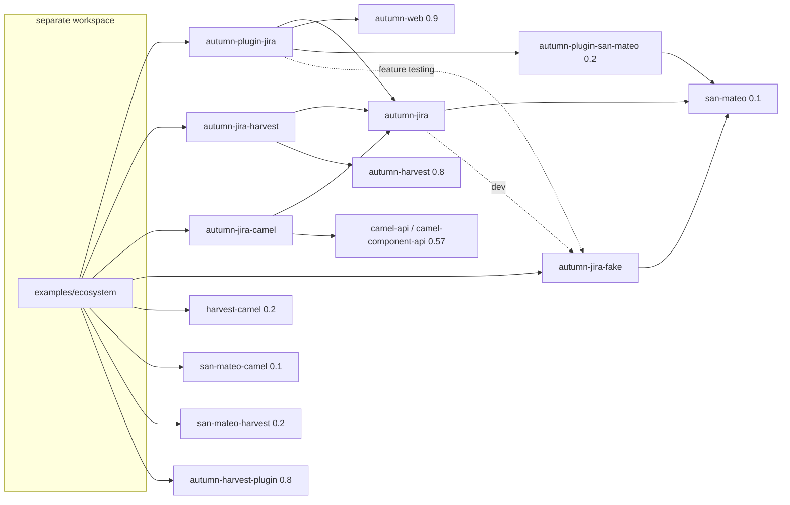
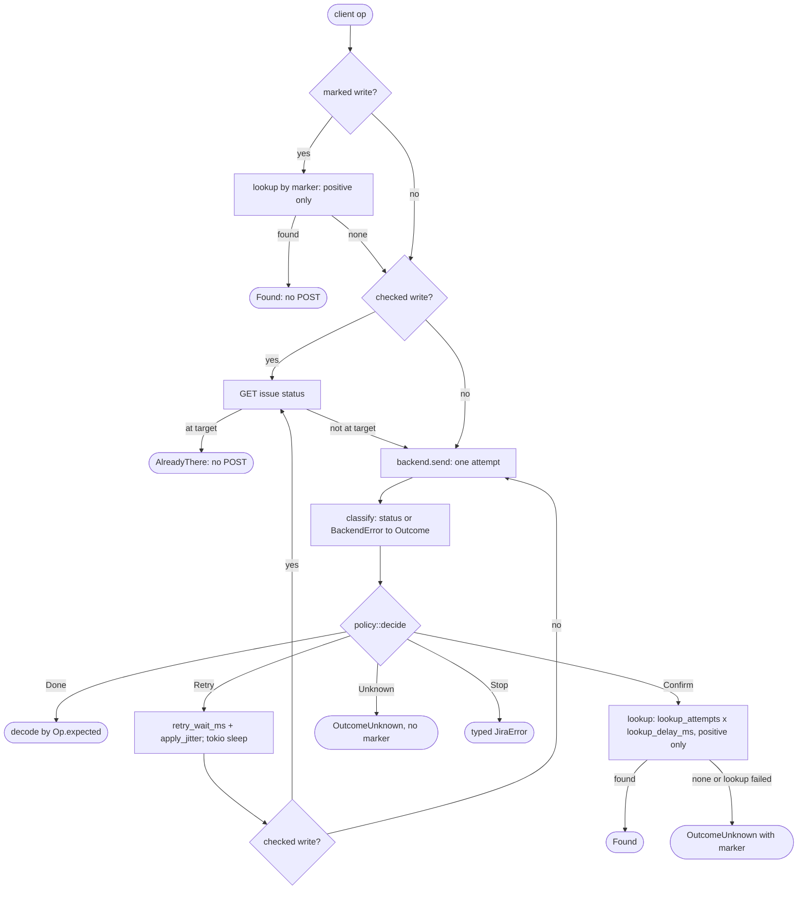
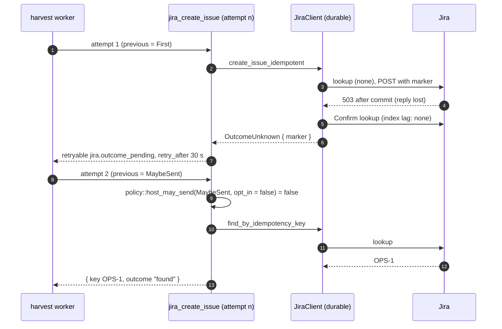
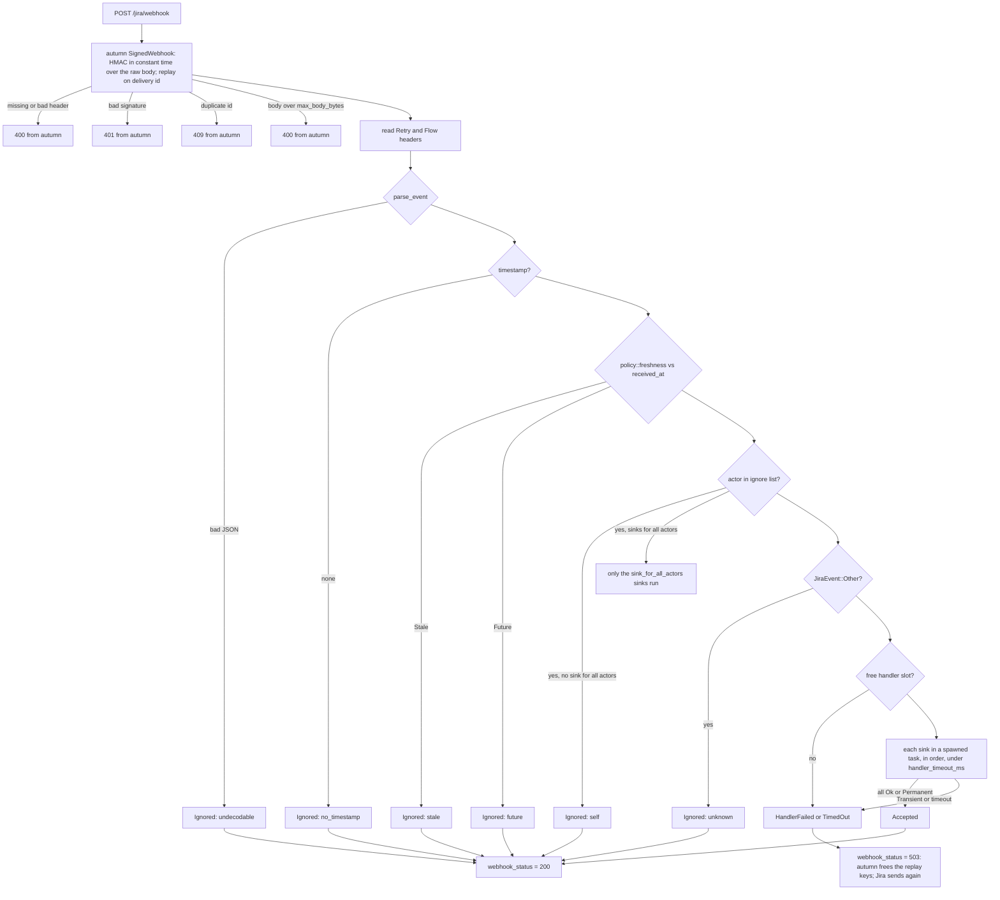
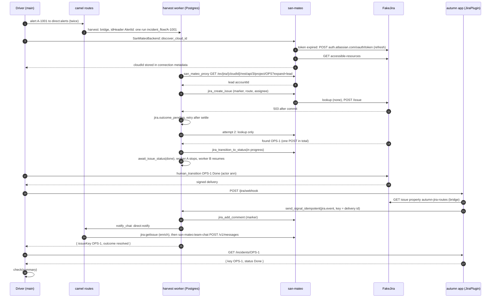
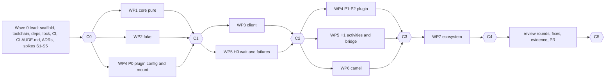

# Plan: autumn-plugin-jira and the ecosystem example

- Status: Accepted (design v3, as built). This file is the only source for
  the implementers. Follow it literally. A change to a public signature
  changes this file in the same commit. Design v3 records the code of the
  five library crates as built. Where this file and the code differ, the
  code is correct and this file needs a fix. Section 2.1 lists each change
  from design v2.
- Date: 2026-11-02
- Style: ASD-STE100. Short sentences. Active voice. Present tense.
- Inputs: `docs/planning/brainstorm.md`, `docs/planning/reverse-brainstorm.md`,
  `docs/planning/six-hats.md` (the resolution of every critique), the API
  notes of the planning session, the Jira Cloud REST v3 OpenAPI spec, and the
  san-mateo house style (`/home/user/san-mateo`).
- Marks: `[V]` is a fact that the planning team read in the published crate
  source (`~/.cargo/registry/src/*/`) or in the spec. `[U]` is an assumption
  that no source states. Section 15 lists each `[U]` and its check.
- Ids: `F01..F60` are failure modes in `planning/reverse-brainstorm.md`.
  `W`, `B`, `R`, `Y`, `G`, `L` are the white, black, red, yellow, green and
  blue hat points in `planning/six-hats.md`.

## Contents

1. Goals and non-goals
2. Decisions (2.1: as-built changes)
3. Workspace and crates
4. Public API: `autumn-jira`
5. Public API: `autumn-jira-fake`
6. Verified core and Verus scope
7. Retry and idempotency design
8. Public API and design: `autumn-plugin-jira` (webhooks)
9. Public API and design: `autumn-jira-harvest`
10. Public API and design: `autumn-jira-camel`
11. The ecosystem example
12. Main-workspace examples
13. Test strategy
14. CI jobs
15. Risks and assumptions
16. Acceptance criteria
17. Work packages and file ownership
18. TDD order
19. Cut list
20. Later (not in v1)

---

## 1. Goals and non-goals

### 1.1 Goals

1. A typed, safe Jira Cloud REST v3 client for Rust. It creates, reads,
   edits, deletes, lists and searches issues. It also does transitions,
   comments, projects and issue types.
2. Safe writes. The client never sends a non-idempotent write a second time
   after a 5xx reply or a network error, unless a mechanism makes it safe.
   The mechanisms are a marker lookup (create issue, add comment) and a
   state check (transition to a status).
3. An autumn-web 0.9 plugin. One `.plugin(JiraPlugin::new())` call gives a
   `JiraService` extractor, a health indicator and a signed webhook route
   with typed event dispatch.
4. Two auth modes: a direct API token (Basic auth), and a san-mateo
   connection (`jira-basic` or the `atlassian` OAuth provider) through
   `autumn-plugin-san-mateo`.
5. autumn-harvest 0.8 activities, a durable "wait for a status" helper and a
   webhook-to-signal bridge.
6. A rust-camel 0.57 `jira:` producer component.
7. An independent, stateful fake Jira (`autumn-jira-fake`) for every test
   and example. No test calls a real Jira.
8. A small verified core (`policy.rs`) with a Verus mirror.
9. A runnable example of the whole ecosystem: autumn-web, san-mateo,
   autumn-plugin-san-mateo, autumn-harvest, san-mateo-harvest, rust-camel,
   san-mateo-camel, harvest-camel and the four crates of this repo.

### 1.2 Non-goals (v1)

- Jira Data Center or Server, `/rest/api/2`, Agile (`/rest/agile/1.0`),
  Jira Service Management, Forge and Connect apps.
- OAuth dynamic webhooks (JWT signed, 30-day expiry). v1 supports admin and
  REST webhooks with an HMAC secret only (F10, F27).
- Attachments, worklogs, issue links, watchers, bulk create, markdown to ADF,
  widgets, a CLI command, OpenAPI code generation.
- "Exactly once". Webhooks are at least once. Idempotent create is best
  effort with a documented residual window (ADR 0003).
- Section 20 lists the ideas that come after v1.

---

## 2. Decisions

Each row has an ADR. `planning/six-hats.md` gives the hat points behind each
row.

| # | Decision | ADR |
|---|---|---|
| D1 | Five crates in a star graph: `autumn-jira` (core), `autumn-jira-fake`, `autumn-plugin-jira`, `autumn-jira-harvest`, `autumn-jira-camel`. No adapter crate depends on another adapter crate. | 0001 |
| D2 | The core depends on `san-mateo 0.1`. It reuses `HttpTransport`, `ReqwestTransport` (no redirects, body cap) [V], `Secret`, `Entropy` and the `SanMateo` facade. `SanMateoBackend` lives in the core. | 0001, 0002 |
| D3 | One seam: `trait JiraBackend` sends one attempt. `DirectBackend` (Basic auth over `HttpTransport`) and `SanMateoBackend` (`SanMateo::proxy` with `retries = 0`) implement it. The client does all retries with the verified policy. | 0002 |
| D4 | Fixed hosts only: `https://{subdomain}.atlassian.net` or `https://api.atlassian.com/ex/jira/{cloudId}`. No free base URL. No redirects. Path segments are percent-encoded. | 0002 |
| D5 | An unsafe write is sent at most once in a client call. After a 5xx or a "maybe sent" network error, a marked write does a positive lookup only (`Confirm`). No lookup result ever causes a second send in the same call. | 0003 |
| D6 | Marker for create: label `autumn-idem-<26 lower base32>` plus issue property `autumn-jira` with the full key, in the same POST. Marker for comments: a last paragraph `autumn-ref: <26 lower base32>`. | 0003 |
| D7 | A durable host (harvest activity, camel route under harvest) re-sends a marked write after a "maybe sent" attempt only with an explicit opt-in (`resend_after_negative_lookup`). Default: lookup only, then fail closed with `outcome_unknown`. Verified fn `host_may_send`. | 0003 |
| D8 | Webhooks use autumn `SignedWebhook` (provider `generic`, header `X-Hub-Signature`, delivery id `X-Atlassian-Webhook-Identifier`) [V]. The plugin mounts the route at the full path with `merge`, not `nest` [V: `SignedWebhook` looks up the endpoint by `parts.uri.path()`, and `nest` strips the prefix]. | 0004 |
| D9 | After verification the route answers 200 (accepted or ignored) or 503 (handler fault or timeout). Never a 4xx from the plugin. A duplicate keeps autumn's 409 [V]. | 0004 |
| D10 | Event seam in the core: `trait EventSink` and `HandlerError`. The plugin calls sinks. The harvest bridge is a sink. | 0001, 0004 |
| D11 | Signal routing by issue property `autumn-jira-routes` (workflow name, workflow id, HMAC tag) plus one constant label `autumn-tracked`. The bridge reads the property with a strongly consistent GET and checks the tag in constant time. | 0006 |
| D12 | `await_issue_status` races the signal against a poll timer under one deadline. The deadline uses `ctx.system_now()` (recorded) [V], never `ctx.now()` (fixed start time) [V]. Webhooks speed up the wait. They are not required. | 0006 |
| D13 | The fake is its own crate. It shares no code with the client. It is sans-IO (`handle`) and implements `HttpTransport`. It has no network server. | 0007 |
| D14 | The ecosystem example is a separate cargo workspace `examples/ecosystem` with its own `Cargo.lock` and CI job. `harvest-camel` needs `autumn-harvest-plugin` with `connectors`, which turns on autumn-web default features and the C builds `pq-src` and `libsqlite3-sys` [V]. | 0008 |
| D15 | Verified pure core `autumn_jira::policy`, mirrored in `verus/policy.rs`. `verus_bodies_match` and a drift-completeness test. Verus runs in CI only. | 0005 |

### 2.1 As-built changes (design v3)

Each row is one change from design v2. The section column names the part
of this file that now shows the change. The waves of section 17.1 found
the changes V1 to V53. Review round 1 found V54 to V96, and each of these
rows names its finding id. Review round 2 found V97
and the later rows. The wave and fixer reports give the full
text.

| # | Change | Reason | Section |
|---|---|---|---|
| V1 | `IdempotencyKey` is in `ids`. `client` and the crate root re-export it. | WP1 owns its test (AC1). `client` belongs to WP3. | 4.1, 4.2 |
| V2 | `MarkerRef` is in `error`, with `MarkerRef::label` and `MarkerRef::comment`. `client` re-exports it. | `JiraError::OutcomeUnknown` holds it. | 4.5, 4.6 |
| V3 | The clause methods return `Result<JqlCondition>`. `Jql::and` takes a `JqlCondition`. | An incomplete clause cannot go into `and`. | 4.7 |
| V4 | New `policy::scale_permille`. `apply_jitter` calls it. | The multiply needs proof code (`nonlinear_arith`) in the Verus body. V67 now body-matches it. | 6 |
| V5 | `decide` retries `UnsafeWrite` with `NotSent` while attempts are left. | The request did not leave the process. Design v2 gave no rule. | 6 |
| V6 | Small public helpers in `ids`, `model`, `request`, `webhook` and `error`. | Tests and adapters need them. | 4.2 to 4.8 |
| V7 | Model `Deserialize` reads the Jira wire format through `model::wire`. `Serialize` writes the Rust field names. | A harvest history holds `IssueSummary`, `StatusSummary` and `IssueRefs`. | 4.5 |
| V8 | The attempt loop is in `client/call.rs`. | One file for the classify glue, the status map and `Retry-After`. | 3.1, 7.1 |
| V9 | `ApiRequest` builders, `Method::as_str`, `DirectBackend::site`, `SanMateoBackend::target`, `SanMateoTarget` builders. | Tests and adapters build requests and targets. | 4.4 |
| V10 | New `JiraClient::account_id`. | One cached `GET /myself` for the own account id. | 4.5 |
| V11 | New `JiraClient::search_page_at` and `client::IssuePage`. | `jira_search_page` and camel `search` read one page at a given token. | 4.5 |
| V12 | New `JiraError::may_have_run` and `error::NOT_SENT_NETWORK_CODES`. | One "sent" rule for harvest and camel. The san-mateo map test pins the codes. | 4.6, 7.2 |
| V13 | Five more `san_mateo::Error` variants map to `NotSent { transient: false }`. | The design v2 table had no row for them. | 4.4 |
| V14 | Cloud id discovery rules for a wrong provider, a bad metadata value and a failure inside `send`. | Design v2 did not give them. | 4.4 |
| V15 | `get_issue_property` gives `Ok(None)` for each 404. | Jira gives 404 for a missing issue and for a missing property. | 4.5 |
| V16 | `SearchPager::next_page` gives the error on the page where the stop happens. | One simple loop. The issues of that page are lost (known limit). | 4.5 |
| V17 | The comment lookup runs once, with no delay. V62 gives its pages. | The comment list is strongly consistent (A3). | 7.1 |
| V18 | `parse_event` takes the actor from `comment.author` when a comment event has no `user`. | The Jira webhook page shows no top-level `user` on comment events. | 4.8 |
| V19 | `FakeJira` has default constants, a `FakeProject` builder and a fixed workflow with ids. | Tests and examples need stable names and ids. | 5 |
| V20 | Exact fault rules: `BadJson` keeps the 2xx status of the op, faults apply after the auth check, 429 entries share the fault queue. | Design v2 left these open. | 5 |
| V21 | The fallback also serves another site, another cloud id, an unknown OAuth client and an unknown Bearer token. | Two fakes then serve two tenants (EX7). | 5.1 |
| V22 | The spec fixture has 23 schemas. The count schema is `JQLCountResultsBean`. | The spec has no schema `IssueCount`. | 5.3 |
| V23 | The fake has its own HMAC over `sha2`. It has no `hmac` dependency. | It shares no code with the client (D13). | 3.2, 5 |
| V24 | `autumn-plugin-jira` has the public modules `config` and `webhook_config`. | Apps and tests read the config and call the pure boot check. | 8, 8.1, 8.4 |
| V25 | `JiraPlugin` has a manual `Default`. The prefix builder normalizes its input. | The default prefix is `/jira`. | 8 |
| V26 | A startup error is `AutumnError::internal_server_error_msg(e.to_string())`. | The panic of `TestApp` and the boot error of `run()` then show the `Display` text with the fix. | 8.2 |
| V27 | `SanMateoAfterJira` comes from the health indicator registry. | A re-check in `on_startup` does not work in `TestApp`. | 8.2 |
| V28 | san_mateo mode without `connection_id`: `client()` never sends and gives `Config { code: "no_connection_id" }`. | A multi-tenant app uses `for_connection` only. | 8, 8.2 |
| V29 | One more conflict: `transport(..)` with `client(..)`. | A prebuilt client has its own transport. | 8.1 |
| V30 | Health stops the call at 90% of `timeout_ms` and adds `error` to the details. | A slow Jira gives `DOWN` with `timeout`, not the `UNKNOWN` of autumn. | 8.3 |
| V31 | The route answers 503 before the start. No delivery id counts as `undecodable`. A panic counts as `handler_failed`. | Jira sends the delivery again. The route never answers 4xx after verification. | 8.4 |
| V32 | The S1 pass test is in `install.rs`. `spike_mount.rs` keeps only the `nest` evidence. | AC24 names `install.rs`. | 16.1, 17.1 |
| V33 | WP4 built service and health before the route pipeline. | The route needs the started runtime cell, and the tests read the counters from the health details. | 18 |
| V34 | `autumn_app` takes the real path when `JIRA_SITE` is set. | The plugin then names a missing `JIRA_API_TOKEN`. The autumn text for a missing webhook secret names no variable. | 12 |
| V35 | `await_issue_status` drains `jira.event` before it returns. | Strict replay of harvest 0.8 gives `EarlyCompletion` for a history that ends with signals that no code read. | 9.3, ADR 0006 |
| V36 | `poll_every` under `MIN_POLL_EVERY` (1 s) fails with `jira.invalid_input`. | A zero poll gives a hot loop of reads. | 9.3 |
| V37 | `start_to_close` is 3m (get, search), 5m (edit, delete) and 12m (create, transition, comment, watch). | Durable `worst_case` at 60 s for each request is 390 s for a marked write and 650 s for a checked write. The watch makes four calls: 520 s. | 7.2, 9.2, ADR 0003 (V64 changes the values) |
| V38 | After a maybe-sent attempt, a lookup that fails with a retryable error stays `jira.outcome_pending`. | Else a lookup that gets a 429 (`sent = false`) lets the next attempt send again. | 7.2, ADR 0003 |
| V39 | `jira_delete_issue` gives `gone_after_retry` for a 404 after a maybe-sent attempt. | The delete rule of 7.1, across harvest attempts. | 9.2 |
| V40 | New harvest public items: the timeout constants, the `*Kind` enums, `BridgeCounters`, the input builders, the activity fns and their `*_info()`. | Workflows and tests use them. | 9 |
| V41 | `failure_for` sets `details.sent` from `JiraError::may_have_run`. | One rule in the core (V12). | 9.1 |
| V42 | `routes_from_property` gives `Signalled` for a route that passes both checks. It means "to signal". | It keeps the design v2 signature. | 9.4 |
| V43 | The deadline tests of the wait use the seeded `Simulation`. | In `WorkflowTestEnv`, `system_now` reads the real clock. | 9.3, 13 |
| V44 | New `Operation` enum and public `EndpointOptions` fields. | A typed form of the URI path and the options. | 10 |
| V45 | The URI parser applies the Ops column and the required options. An unknown `connection` gives `CamelError::Config`. | Each wrong URI fails at route add. | 10 |
| V46 | An override header equal to the option passes without `allowHeaderOverrides`. | The `JiraIssueKey` out header of an earlier step on the same issue is common. | 10 |
| V47 | A `JiraJql` header next to the `project` option always fails. | Raw JQL drops the project filter. | 10 |
| V48 | Exact reply bodies, out headers, `maxPages` and `throwExceptionOnFailure` rules. | Design v2 left these open. | 10 |
| V49 | `to_camel_error` gives `Io` or `ValidationError` when the harvest HTTP rule and `retryable` disagree. | The retry class holds for each value. | 10 |
| V50 | The component does not call `.durable()`. The app registers durable clients. | The app owns the client settings. | 10 |
| V51 | `live.rs` has five own ignored cases and does not run the suite. | The suite needs a `FakeJira`. | 13 |
| V52 | Two suite cases are in `core/t/client.rs` over `MemoryTransport`. | The fake cannot move an issue or serve a short page that is not the last. | 16.1 |
| V53 | Test and coverage are one CI job. The weekly steps are in the jobs. | The tests run once, under coverage. | 14 |
| V54 | A transport `Invalid` maps to `NotSent` only for the texts of a check before the send. Any other text is `MaybeSent { code: "send_error" }`. `SanMateoBackend` applies the same rule to the wrapped san-mateo `Invalid`. | `ReqwestTransport` also gives `Invalid` for a send error after Jira has the request (R1-write-safety-3). | 4.4, 4.6 |
| V55 | `SanMateoBackend` checks a stored cloud id once after the first 401 or 404. The prefix is an `RwLock` with a `confirmed` flag. | A tenant can connect the same connection to another site (R3-secrets-ssrf-3). | 4.4 |
| V56 | Webhook payloads use the REST v2 shape. `IssueEvent.comment` and `JiraEvent::comment` are new. A string body gives `Adf::text`. | The Jira webhook page shows REST v2 payloads, and an `issue_commented` update carries the comment (R6-fake-fidelity-1, R6-fake-fidelity-2). | 4.8, 5 |
| V57 | New `WebhookComment.update_author`. The actor of `comment_updated` is `updateAuthor`, and `comment_deleted` with no `user` has no actor. | The author of a comment is not the person who edits or deletes it (R2-webhook-security-2). | 4.8 |
| V58 | `has_comment_marker` needs a full marker on the last non-empty line. | A typed prefix or a quoted marker dropped a human comment (R2-webhook-security-7). | 4.8 |
| V59 | A 2xx that is not the expected status on a marked write goes to the marker lookups. | The write can have run (B11; R1-write-safety-8, R5-spec-proof-6). | 7.1 |
| V60 | A retry after `outcome_pending` is a lookup only. The error docs say this. | The docs did not name the safe retry (R1-write-safety-7). | 7.1 |
| V61 | `LabelsNotOnScreen` comes only for the not-on-screen message on `labels`. | A bad label value is a `Validation` error (R6-fake-fidelity-3). | 4.6, 7.1 |
| V62 | The comment lookup pages newest first up to `max_pages`, gives `PageLimit` at the cap, and matches only a comment by the own account. | 100 comments did not cover a busy issue, and a person can type the marker (R1-write-safety-9, R2-webhook-security-7). | 7.1 |
| V63 | `Transition` has `is_global` and `looped`. After a maybe-sent attempt, the client sends a transition again only at the same status and only when it is not global and not looped. A 400 or 409 then reads the status once more. | A global or looped transition can run two times (R1-write-safety-4, R1-write-safety-5). | 4.5, 7.1, ADR 0003 |
| V64 | `start_to_close` is 9m (get, search, edit, delete) and 42m (create, transition, comment, watch). New `activities::MAX_TRANSPORT_TIMEOUT` (60 s) and `SAN_MATEO_CALLS_PER_SEND` (4). `[jira.http] timeout_secs` is 1 to 60. | A san-mateo send can make four transport calls (R4-harvest-determinism-6, R9-test-quality-6). | 7.2, 8.1, 9.2 |
| V65 | The offset pagers and the comment lookup use `policy::token_page_step`. `max_pages = 0` reads one page. | One pager rule for each list (R5-spec-proof-7). | 4.5 |
| V66 | An issue property key `.` or `..` gives `InvalidInput`. | A dot segment moves the request to another path (R3-secrets-ssrf-1). | 4.5 |
| V67 | `scale_permille` is body-matched. Three lists name each policy function. `the_spec_has_no_proof_escape` is new. | A function could skip the proof, and a proof escape still says "verified" (R5-spec-proof-2, R5-spec-proof-3, R5-spec-proof-4). | 6, ADR 0005 |
| V68 | `failure_for` details hold `retryable`. | A workflow cannot see a retry class (R4-harvest-determinism-1). | 9.1 |
| V69 | `marked_write_failure` writes `sent = false` for a pre-lookup read error. Each `jira.*` failure with `sent = false` gives `NotSent`. | A failed pre-lookup sent nothing (R5-spec-proof-1). | 7.2, 9.1 |
| V70 | `jira_delete_issue` gives `gone_after_retry` for a 404 on any attempt after the first. | The `sent` flag tells only the last send of an attempt (R1-write-safety-6). | 7.2, 9.2 |
| V71 | New `JiraPlugin::sink_for_all_actors`. An ignored actor goes only to those sinks. | A bot status change did not signal a waiting workflow (R2-webhook-security-5). | 8, 8.4, 9.4 |
| V72 | The `for_connection` cache is an LRU of 1024 clients. New `JiraService::forget`. | The cache had no bound and kept a stale site (R10-plugin-ecosystem-4, R7-api-docs-9). | 8 |
| V73 | New `[jira.webhook] max_handler_tasks` (64) and `abandon_after_ms` (300000). New health detail `handler_tasks`. | A sink that hangs made tasks without a limit (R10-plugin-ecosystem-3). | 8, 8.1, 8.3, 8.4 |
| V74 | The boot check needs `max_age_secs + max_future_skew_secs < replay_window_secs`, and warns below `JIRA_RETRY_HORIZON_SECS` (5400). `max_future_skew_secs` is at most 300. | A copy can be fresh after autumn forgets its id, and a short age drops a Jira retry (R2-webhook-security-3, R2-webhook-security-8, R10-plugin-ecosystem-6, R5-spec-proof-9). | 8.1, 8.4 |
| V75 | `[jira.san_mateo] cloud_id` and `site_url` apply to `connection_id` only, and need it. | The token of one tenant went to the site of another tenant (R10-plugin-ecosystem-1, R3-secrets-ssrf-2). | 8.1 |
| V76 | `email_env` and `token_env` must be env var names. | A secret in the wrong key showed in an error (R3-secrets-ssrf-4). | 8.1 |
| V77 | `client(..)` with a `[jira.http]` that is not the default gives `Conflict`. | The settings were dropped with no sign (R7-api-docs-6). | 8.1 |
| V78 | Health is `UNKNOWN` with a reason when there is no `connection_id`. | In multi-tenant mode the indicator was always `DOWN` (R10-plugin-ecosystem-2, R7-api-docs-1). | 8.3 |
| V79 | A drop guard counts `timed_out` at the autumn request timeout. The start warns when the handlers can take longer than the request timeout. | A delivery that autumn stopped added to no counter (R10-plugin-ecosystem-7). | 8.4 |
| V80 | The docs give the memory cost of `max_body_bytes` for an unsigned request. | autumn reads the body before it checks the signature (R2-webhook-security-9). | 8.4, ADR 0004 |
| V81 | `build.rs` finds the README for the doctests. `contract_matches_cargo_toml` runs only in the workspace. | The packaged crate did not build (R8-build-ci-7). | 3.4 |
| V82 | The real path of `autumn_app` uses `JiraConfig::load`. | Profile files and `AUTUMN_JIRA__*` did not apply (R10-plugin-ecosystem-5). | 12 |
| V83 | New `MAX_POLL_ROUNDS` (3000), `MAX_SIGNAL_ROUNDS` (1000) and `LAST_READ_MARGIN` (46 min). The wait deadline fits `ctx.deadline()`. | A long wait could fill the history, and the run deadline could stop the last read (R4-harvest-determinism-4, R4-harvest-determinism-5). | 9.3 |
| V84 | New `drain_jira_signals`. A workflow that works after the wait calls it last. | A late signal broke a strict replay (R4-harvest-determinism-2). | 9.3, ADR 0006 |
| V85 | The waits of one run run one at a time. | Two waits took the signals of each other (R4-harvest-determinism-7). | 9.3 |
| V86 | Each read moves the newest time by `issue.updated`. | A signal older than a read moved the wait back (R4-harvest-determinism-3). | 9.3, ADR 0006 |
| V87 | A retryable failure of a poll read or the last read is a missed poll. | One failed poll ended a long wait (R4-harvest-determinism-1). | 9.3 |
| V88 | The bridge reads the status and the key from the site of its client. One bridge serves one site. | A delivery of another site with the same issue id moved a wait (R2-webhook-security-1). | 9.4, ADR 0004, ADR 0006 |
| V89 | The route tag binds the run, not the issue. The limit and its bounds are written down. | A tag with the issue id needs a PUT after the create (R2-webhook-security-6). | 9.4, ADR 0006 |
| V90 | New camel option `settleMs` (default 10000, 0..=120000) and `EndpointOptions::settle_ms`. | The camel path does not get the harvest settle delay (R1-write-safety-10). | 10, ADR 0003 |
| V91 | The own `JiraIssueKey` out header of an earlier step is not an override header. | A chain of `jira:` steps on two issues failed (R7-api-docs-2). | 10 |
| V92 | A camel redelivery of a marked write does a lookup only. A redelivery of an unmarked write fails and sends nothing. | A camel `retry(..)` sent a create two times (R1-write-safety-1, R1-write-safety-2). | 10, ADR 0003 |
| V93 | The ecosystem run deadline wraps only the drive, so the stops always run. | A run timeout stopped nothing (R10-plugin-ecosystem-8). | 11.4 |
| V94 | New `scripts/one-version.sh`. `scripts/extract-jira-schemas.py` needs the spec path. | One check for each lock, and no session path in the repo (R8-build-ci-2, R8-build-ci-5). | 14 |
| V95 | ADR 0004 names the crash case of the replay store. | A crash after the keys are stored loses the event (R2-webhook-security-4). | ADR 0004 |
| V96 | `jira_add_comment` reads at most `COMMENT_LOOKUP_PAGES` (3) comment pages, and its `start_to_close` is 70m (`COMMENT_START_TO_CLOSE`). New `autumn_jira::client::MAX_TRANSPORT_TIMEOUT_SECS` (60), the cap of `timeout_secs`. | The paged lookup of V62 and the cold `GET /myself` did not fit the 42m budget (follow-up of R1-write-safety-9 and R9-test-quality-6). | 7.2, 8.1, 9.2 |
| V97 | After a maybe-sent transition attempt, every stop off the target is a non-retryable `OutcomeUnknown`. New `JiraClient::resume_transition_to_status(issue, target, cause)`: one status read, no send. | A host retry after a stop with a retryable error started a new call and sent the transition again (R2A-write-safety-1, R2A-write-safety-2). | 4.5, 7.1 |
| V98 | `Transition::is_global` and `Transition::looped` are `Option<bool>`. The resend rule counts a missing flag as `true`. | A reply with no flag made a global transition look safe to send again (R2A-write-safety-6). | 4.5, 7.1 |
| V99 | New `JiraClient::add_comment_idempotent_first(issue, body, key)`: no lookup before the POST. The comment lookup starts a page back by the drop of the total. | A first attempt could not comment on an issue with more comments than the page cap (R2F-fixcheck-a-1). A delete between two pages hid the marker (R2A-write-safety-5). | 4.5, 7.1 |

---

## 3. Workspace and crates

### 3.1 Tree

```
autumn-plugin-jira/
  Cargo.toml                  # [workspace] members = ["crates/*"], exclude = ["examples/ecosystem"]
  Cargo.lock
  rust-toolchain.toml         # channel 1.99.0; components rustfmt, clippy, llvm-tools
  clippy.toml                 # allow-unwrap-in-tests, allow-expect-in-tests (san-mateo copy)
  CLAUDE.md  README.md  LICENSE
  verus/policy.rs             # spec and proofs for crates/autumn-jira/src/policy.rs
  scripts/
    smoke-autumn-example.sh   # boots the autumn_app binary (dev and prod), signed POST, SIGTERM
    coverage-gate.py          # per-crate src line coverage >= 85 from llvm-cov JSON
    extract-jira-schemas.py   # spec -> crates/autumn-jira-fake/tests/fixtures/schemas.json
    run-ecosystem.sh          # starts Postgres with compose when needed, runs the example
  docs/
    plan.md  examples-plan.md  ac-evidence.md
    adr/0001..0008-*.md
    planning/{brainstorm,reverse-brainstorm,six-hats}.md
  .github/workflows/ci.yml
  crates/
    autumn-jira/              # core client
      src/ (client.rs + client/{call,idempotent,pager,settings}.rs)
      tests/ examples/embedded.rs
    autumn-jira-fake/         # FakeJira
      src/ tests/ tests/fixtures/schemas.json
    autumn-plugin-jira/       # autumn-web 0.9 plugin
      src/{config, webhook_config, plugin, runtime, service, health, webhook, secrets, error, testing}.rs
      tests/ examples/autumn_app/{main.rs, autumn.toml, autumn-prod.toml}
    autumn-jira-harvest/      # harvest activities, wait helper, bridge
      src/ tests/ examples/harvest_workflow.rs
    autumn-jira-camel/        # jira: component
      src/{component, options, headers, input, producer, error}.rs
      tests/ examples/camel_route.rs
  examples/
    ecosystem/                # SEPARATE workspace
      Cargo.toml  Cargo.lock  README.md  compose.yaml  autumn.toml
      src/{main.rs, app.rs, routes.rs, workflow.rs, transport.rs, summary.rs}
      tests/ (none: tests are #[cfg(test)] modules in src, house pattern)
```

### 3.2 Crates

| Crate | Purpose | Normal dependencies | Features |
|---|---|---|---|
| `autumn-jira` | Client, ids, models, ADF, JQL, errors, verified `policy`, `JiraBackend`, `DirectBackend`, `SanMateoBackend`, webhook types and signature check, `EventSink`, `WRITES`. | `san-mateo = "0.1"`, `async-trait 0.1`, `serde 1` (`derive`), `serde_json 1`, `chrono 0.4` (no default; `clock`, `serde`), `thiserror 2`, `tokio 1` (`time`, `sync`), `hmac 0.12`, `sha2 0.10`, `data-encoding 2`, `percent-encoding 2`, `tracing 0.1`. | none |
| `autumn-jira-fake` | `FakeJira`: a stateful in-memory Jira Cloud. | `san-mateo = "0.1"` (transport types only), `async-trait`, `serde_json`, `sha2` (own HMAC code, no `hmac`), `base64 0.22`, `thiserror`, `tokio` (`time`, `sync`), `chrono`. NOT `autumn-jira` (guard test). | none |
| `autumn-plugin-jira` | autumn-web plugin: `[jira]` config, `JiraService`, health, webhook route, dispatch. | `autumn-jira`, `autumn-web = { version = "0.9", default-features = false }`, `autumn-plugin-san-mateo = "0.2"`, `san-mateo`, `async-trait`, `serde`, `serde_json`, `toml 0.9`, `thiserror`, `tracing`, `tokio`. | `testing`: optional dep `autumn-jira-fake`; test helpers. |
| `autumn-jira-harvest` | Activities, `await_issue_status`, `HarvestSignalBridge`. | `autumn-jira`, `autumn-harvest = "0.8.0"` (default features), `san-mateo`, `async-trait`, `serde`, `serde_json`, `thiserror`, `hmac`, `sha2`, `chrono`, `tracing`, `diesel-async 0.9` (`postgres`, `deadpool`), `deadpool 0.13`. | none |
| `autumn-jira-camel` | Producer-only `jira:` component. | `autumn-jira`, `camel-api = "0.57"`, `camel-component-api = "0.57"`, `async-trait`, `serde_json`, `tower 0.5` (`util`), `tracing`. | none |
| `ecosystem` (example, `publish = false`) | The full loop (section 11). | The four library crates by `path` (`autumn-plugin-jira` with `testing`), `autumn-jira-fake` by `path`, `san-mateo`, `autumn-plugin-san-mateo`, `san-mateo-harvest = "0.2"`, `san-mateo-camel = "0.1"`, `harvest-camel = "0.2.0"`, `autumn-harvest = "0.8.0"`, `autumn-harvest-plugin = "0.8.0"` (`connectors`), `autumn-web = "0.9"`, `camel-{api,builder,component-direct,core} = "0.57"`, `tokio`, `tokio-util`, `deadpool`, `diesel-async`, `serde_json`, `reqwest` (test only, inbound POST). | none |

Dev-dependencies (house pattern): `autumn-jira-fake` by path, `tokio`
(`macros`, `rt-multi-thread`, `test-util`), `proptest 1`, `tower` (`util`),
`autumn-harvest` (`testing`), `camel-core`, `camel-builder`,
`camel-component-direct`, `tracing-subscriber` (capture test), `reqwest`
(boot test only).

### 3.3 Crate graph



### 3.4 Workspace rules

- `[workspace.package]`: `edition = "2024"`, `rust-version = "1.89"`,
  `license = "Apache-2.0"`, `version = "0.1.0"`, `repository =
  "https://github.com/autumn-foundation/autumn-plugin-jira"`.
- All dependency versions live in `[workspace.dependencies]`. Crates use
  `{ workspace = true }`.
- `[workspace.lints.rust]`: `unsafe_code = "forbid"`, `missing_docs = "deny"`.
- `[workspace.lints.clippy]`: `pedantic = { level = "warn", priority = -1 }`,
  `nursery = { level = "warn", priority = -1 }`, `unwrap_used = "deny"`,
  `expect_used = "deny"`, `dbg_macro = "deny"`, `todo = "deny"`,
  `unimplemented = "deny"`, `print_stdout = "deny"`, `print_stderr = "deny"`.
  CI runs clippy with `-D warnings`. `clippy.toml` allows `unwrap`/`expect`
  in tests.
- Each `allow` has a `reason = "..."`. Examples that print a summary have
  `#![allow(clippy::print_stdout, reason = "the example prints its summary")]`.
- `autumn-jira-camel/src/lib.rs` has
  `#![allow(clippy::result_large_err, reason = "CamelError is 168 bytes")]` [V].
- `examples/ecosystem/Cargo.toml` copies the lints. A guard test compares them.
- The root `Cargo.lock` holds no `harvest-camel`, `autumn-harvest-plugin`,
  `pq-src` or `libsqlite3-sys` (guard test, F49).
- One version each of `autumn-web`, `san-mateo`, `autumn-harvest`,
  `camel-api`, `camel-core`, `camel-component-api` in both locks (CI, F29).
- Each crate `lib.rs` has a crate doc with one compiled example. The root
  `README.md` snippets compile as doctests through
  `#[cfg(all(doctest, feature = "testing", jira_readme))] #[doc = include_str!(env!("AUTUMN_PLUGIN_JIRA_README"))] pub struct ReadmeDoctests;`
  in `crates/autumn-plugin-jira/src/lib.rs` (F47, V81). The snippets use
  `FakeJira` and the `testing` helpers, so they need the `testing` feature.
  `crates/autumn-plugin-jira/build.rs` finds the README next to
  `Cargo.toml` (a package) or at `../../` (the workspace). It sets
  `AUTUMN_PLUGIN_JIRA_README` and the cfg `jira_readme`. It sets the cfg
  `jira_workspace` when `../../Cargo.toml` exists and `Cargo.toml.orig`
  does not. The unit test `contract_matches_cargo_toml` reads the root
  `Cargo.toml`, so it runs only under `jira_workspace`.
  `contract_is_compatible` runs in each layout.

---

## 4. Public API: `autumn-jira`

All public items have doc comments. All public structs and enums that can
grow are `#[non_exhaustive]`. Builders return `Self` and are `#[must_use]`.
`Result<T, E = JiraError>` is `autumn_jira::Result`.

### 4.1 Modules

| Module | Contents |
|---|---|
| `ids` | Newtypes (4.2) and `IdempotencyKey`. |
| `site` | `JiraSite`, `BasicAuth`. |
| `model` | Response models: `Issue`, `IssueFields`, `Status`, `StatusCategory`, `StatusSummary`, `IssueSummary`, `IssueType`, `ProjectRef`, `Project`, `User`, `Comment`, `CommentPage`, `Transition`, `CreatedIssue`, `IssueRefs`, `ServerInfo`, `AccessibleResource`, `Page<T>`. |
| `request` | `NewIssue`, `IssueTypeRef`, `IssueEdit`, `EditOptions`, `FieldSet`, `SearchRequest`, `StatusTarget`, `TransitionFields`, `MAX_SEARCH_RESULTS` (100), `MAX_SEARCH_PROPERTIES` (5). |
| `adf` | `Adf`, `AdfBuilder`, `Span`. |
| `jql` | `Jql`, `JqlField`, `JqlClause`, `JqlCondition`, `Order`. |
| `time` | `JiraTimestamp`. |
| `error` | `JiraError`, `Op`, `UnknownCause`, `MarkerRef`, `ErrorClass`, `CamelKind`, `Result`, `SCOPE_HINT`, `NOT_SENT_NETWORK_CODES`. |
| `policy` | Verified pure core (section 6). |
| `backend` | `JiraBackend`, `ApiRequest`, `ApiResponse`, `Method`, `BackendError`, `BackendInfo`, `BackendMode`, `DirectBackend`, `SanMateoBackend`, `SanMateoTarget`, `resolve_cloud_id`. |
| `client` | `JiraClient`, `ClientSettings`, `SearchPager`, `IssuePage`, `CreateOutcome`, `CommentOutcome`, `TransitionOutcome`, `DeleteOutcome`. Re-exports `IdempotencyKey` (from `ids`) and `MarkerRef` (from `error`). The private `client/call.rs` holds the attempt loop, the classify glue, the status-to-error map and the `Retry-After` parse. |
| `webhook` | `Delivery`, `DeliveryMeta`, `Flow`, `JiraEvent`, `IssueEvent`, `CommentEvent`, `WebhookIssue`, `WebhookFields`, `WebhookComment`, `ChangeItem`, `StatusChange`, `StatusRef`, `ParsedEvent`, `parse_event`, `verify_signature`, `sign`, header constants. |
| `sink` | `EventSink`, `HandlerError`. |
| `writes` | `JiraWrite`, `WriteKind`, `WRITES`. |

Crate root re-exports: `JiraClient`, `JiraError`, `Result`, `JiraSite`,
`BasicAuth`, `IssueKey`, `IssueId`, `IssueRef`, `ProjectKey`, `AccountId`,
`Adf`, `Jql`, `NewIssue`, `StatusTarget`, `IdempotencyKey`, `Delivery`,
`JiraEvent`, `EventSink`, `HandlerError`, `ClientSettings`, and
`pub use san_mateo;`.

### 4.2 Newtypes (`ids`)

Each newtype has `parse(&str) -> Result<Self>` (strict), `as_str(&self) ->
&str`, `Display`, `Serialize`, `Clone`, `Eq`, `Hash`, `Ord`, and a STRICT
`Deserialize` that calls `parse` (R7). So `Path<IssueKey>` in an autumn
handler rejects bad input with 400. Response models read Jira ids through
private wire types (`model::wire`) with `pub(crate) fn from_response(String)
-> Self` (lenient, F42). A response key such as `lower-7` is kept as given.

| Type | Strict input rule |
|---|---|
| `ProjectKey` | `^[A-Z][A-Z0-9_]{1,9}$` |
| `IssueKey` | `^[A-Z][A-Z0-9_]{1,9}-[1-9][0-9]{0,9}$`; `project(&self) -> ProjectKey`, `number(&self) -> u64` |
| `IssueId`, `ProjectId`, `StatusId`, `CommentId`, `TransitionId`, `IssueTypeId` | `^[1-9][0-9]{0,18}$` (a string, not a number) |
| `IssueRef` | enum `Id(IssueId)` or `Key(IssueKey)`. `IssueRef::parse` picks by shape. `From<IssueKey>`, `From<&IssueKey>`, `From<IssueId>`, `From<&IssueId>`. `path_segment(&self) -> &str`. |
| `AccountId` | 1..=128 chars of `[A-Za-z0-9:_-]` |
| `CloudId` | UUID text, lower case, 36 chars |
| `SiteName` | `^[a-z0-9][a-z0-9-]{0,62}$` (same as the `jira-basic` provider pattern [V]) |
| `StatusCategoryKey` | 1..=64 chars of `[a-z0-9-]`. Constants `NEW = "new"`, `INDETERMINATE = "indeterminate"`, `DONE = "done"`. Lenient for responses (the spec shows `in-flight`) [V]. |
| `FieldId` | `^[a-z][A-Za-z0-9_]{0,63}$` or `^customfield_[0-9]{1,10}$`. The rule is literal: `customfield_12345678901` passes through the first form. |
| `WebhookDeliveryId` | 1..=200 printable ASCII, no space |
| `PageToken` | opaque, non-empty; `Debug` shows only the length |

`IdempotencyKey` (in `ids`; `client` and the crate root re-export it, V1):
1..=200 printable ASCII, no space.
- `IdempotencyKey::parse(&str) -> Result<Self>`
- `IdempotencyKey::derive(parts: &[&str]) -> Self`: `"d1-"` plus the lower
  hex SHA-256 of the parts, each part prefixed by its byte length and `:`.
  A stable key from app data (R8, Y11).
- `marker_label(&self, prefix: &str) -> String`: `prefix` plus the first 26
  chars of lower-case RFC 4648 base32 of SHA-256(key) (130 bits).
- `comment_marker(&self) -> String`: `"autumn-ref: "` plus the same 26 chars.
- `as_str(&self) -> &str`. `Debug` shows the key (it is not a secret).

Helpers that design v2 did not list (V6): `Delivery::new(meta,
ParsedEvent)`, `DeliveryMeta::new`, `StatusSummary::new`, `IssueRefs::new`,
`From<CreatedIssue> for IssueRefs`, `Issue::{property, field, status}`,
`Status::summary`, `NewIssue::{project_key, summary_text, label_list}`,
`SearchRequest::{jql, page_size}`, `FieldSet::{ids, to_csv}`,
`EditOptions::notify_users(bool)`, `TransitionFields::{field, resolution}`,
`IssueEdit::is_empty`, `Op::ALL`, `error::SCOPE_HINT`, and `JiraEvent:
Display`. Some are `const fn` where design v2 shows `fn`:
`JiraTimestamp::epoch_ms`, `JiraError::{status, retry_after}`,
`StatusTarget::{done, in_progress, todo}` and `Flow::parse`. `Adf`,
`Delivery` and the webhook types also derive `Eq`. `User` has a `Debug`
that hides the email.

### 4.3 Site and auth (`site`)

```rust
#[derive(Debug, Clone, PartialEq, Eq)]
pub enum JiraSite {
    /// `https://{subdomain}.atlassian.net`. Classic API token.
    Subdomain(SiteName),
    /// `https://api.atlassian.com/ex/jira/{cloud_id}`. Scoped API token.
    CloudId(CloudId),
}
impl JiraSite {
    pub fn base_url(&self) -> String;   // the only base URL builder (guard test)
    pub fn label(&self) -> String;      // "acme.atlassian.net" or "cloud:<id>"; no secret
}
#[derive(Clone)]
pub struct BasicAuth { email: String, token: Secret }
impl BasicAuth {
    /// Fails on an empty email or token. Never logs either.
    pub fn new(email: impl Into<String>, token: Secret) -> Result<Self>;
}
impl Debug for BasicAuth { /* "BasicAuth { email: \"<redacted>\", token: \"<redacted>\" }" */ }
```

### 4.4 Backend seam (`backend`)

```rust
#[derive(Debug, Clone, Copy, PartialEq, Eq)]
pub enum Method { Get, Post, Put, Delete }

impl Method { pub const fn as_str(self) -> &'static str; }   // "GET", ...

#[derive(Debug, Clone, PartialEq, Eq)]
pub struct ApiRequest {
    pub op: Op,
    pub method: Method,
    /// "/rest/api/3/...". Each id segment is percent-encoded by the client.
    pub path: String,
    pub query: Vec<(String, String)>,
    /// JSON bytes. `None` for no body.
    pub body: Option<Vec<u8>>,
}
impl ApiRequest {                                                    // V9
    pub fn new(op: Op, method: Method, path: impl Into<String>) -> Self;
    #[must_use] pub fn query(self, name: &str, value: impl Into<String>) -> Self;
    #[must_use] pub fn json(self, value: &serde_json::Value) -> Self;
    pub fn path_and_query(&self) -> String;                          // encoded query
}
#[derive(Debug, Clone, PartialEq, Eq)]
pub struct ApiResponse { pub status: u16, pub headers: Vec<(String, String)>, pub body: Vec<u8> }
impl ApiResponse { pub fn header(&self, name: &str) -> Option<&str>; } // case-insensitive

/// One attempt failed with no HTTP reply.
#[derive(Debug, Clone, PartialEq, Eq, thiserror::Error)]
#[non_exhaustive]
pub enum BackendError {
    /// The request did not leave this process. `transient` says if a retry can help.
    #[error("not sent ({code})")] NotSent { transient: bool, code: &'static str },
    /// The request may have reached Jira. The outcome of a write is unknown.
    #[error("maybe sent ({code})")] MaybeSent { code: &'static str },
    /// The credentials cannot be used (refresh exhausted). Not sent.
    #[error("auth ({code})")] Auth { code: &'static str },
}

#[derive(Debug, Clone, Copy, PartialEq, Eq)]
pub enum BackendMode { ApiToken, SanMateo }
#[derive(Debug, Clone, PartialEq, Eq)]
pub struct BackendInfo { pub mode: BackendMode, pub site: String }  // site = JiraSite::label or "san-mateo:<integration>/<connection>"

#[async_trait]
pub trait JiraBackend: Send + Sync + 'static {
    /// Sends one attempt. It never retries and never follows a redirect.
    async fn send(&self, request: ApiRequest) -> Result<ApiResponse, BackendError>;
    /// Mode and site for health details. No secrets.
    fn info(&self) -> BackendInfo;
}

pub struct DirectBackend { /* site, auth, Arc<dyn HttpTransport> */ }
impl DirectBackend {
    pub fn new(site: JiraSite, auth: BasicAuth, transport: Arc<dyn HttpTransport>) -> Self;
    pub const fn site(&self) -> &JiraSite;
}

#[derive(Debug, Clone, PartialEq, Eq)]
pub struct SanMateoTarget {
    pub environment: String,
    pub connection: san_mateo::ConnectionKey,
    /// `atlassian` only. Else the backend reads metadata key `cloudId`, then discovers.
    pub cloud_id: Option<CloudId>,
    /// Picks one site from `accessible-resources`, for example `https://acme.atlassian.net`.
    pub site_url: Option<String>,
}
impl SanMateoTarget {                                                // V9
    pub fn new(environment: impl Into<String>, connection: ConnectionKey) -> Self;
    #[must_use] pub fn cloud_id(self, cloud_id: CloudId) -> Self;
    #[must_use] pub fn site_url(self, url: impl Into<String>) -> Self;
}
pub struct SanMateoBackend { /* SanMateo, target, RwLock<Option<(prefix, Source)>>, confirmed flag (V55) */ }
impl SanMateoBackend {
    pub fn new(san: SanMateo, target: SanMateoTarget) -> Self;
    pub const fn target(&self) -> &SanMateoTarget;
    /// Reads accessible-resources, picks the site, stores `cloudId` in the
    /// connection metadata (merge = true), and returns it.
    pub async fn discover_cloud_id(&self) -> Result<CloudId>;
}
/// Pure. Keeps entries with a scope that starts with `read:jira-` or
/// `write:jira-`. Fails on zero matches, or on more than one match with no
/// `site_url`.
pub fn resolve_cloud_id(resources: &[AccessibleResource], site_url: Option<&str>) -> Result<CloudId>;
```

`DirectBackend` rules: URL = `site.base_url() + path + "?" + encoded query`.
Headers: `authorization: Basic base64(email:token)`, `accept:
application/json`, `content-type: application/json` when a body exists,
`user-agent: autumn-jira/<version>`. Map `TransportError` [V]:

| `san_mateo::transport::TransportError` | `BackendError` | Why |
|---|---|---|
| `Connect(_)` | `MaybeSent { code: "connect" }` | `ReqwestTransport` maps a reset during the reply read to `Connect` [V] (G5). |
| `Timeout` | `MaybeSent { code: "timeout" }` | |
| `BodyTooLarge` | `MaybeSent { code: "body_too_large" }` | Jira replied, so a write ran. |
| `Invalid(text)`, `text` is a check before the send (V54) | `NotSent { transient: false, code: "invalid_request" }` | The texts are `bad HTTP method`, `bad URL`, `bad header name`, `bad header value`, and a text that starts with `builder error`. |
| `Invalid(_)`, any other text (V54) | `MaybeSent { code: "send_error" }` | `ReqwestTransport` also gives `Invalid` for a reqwest send error, for example a reset after Jira has the request. A write can have run. |

`SanMateoBackend` rules:
- Provider: `san.get_integration(env, &key.provider_config_key).await?.provider`
  [V]. `jira-basic` gives prefix `""`. `atlassian` gives `/ex/jira/{cloudId}`.
  Other providers: `NotSent { transient: false, code: "not_a_jira_provider" }`.
- Cloud id order: `target.cloud_id`, then `metadata["cloudId"]` of
  `san.list_connections(env, &ConnectionFilter { provider_config_key,
  connection_id, .. })` [V], then `discover_cloud_id`. The prefix is cached
  in an `RwLock`.
- Stored cloud id check (V55): san-mateo keeps the metadata when a tenant
  connects the same connection to another site, so a stored id can be
  stale. After the first 401 or 404 reply under a stored id (from metadata
  or from a discovery), the backend reads `accessible-resources` one time.
  When the token covers the id, the id is confirmed and the backend does
  not check it again. Else the backend picks the site again, stores the new
  id, and uses it from the next attempt on. It never sends the attempt
  again. A failed check changes nothing, and a later 401 or 404 checks
  again. A discovered id counts as confirmed. A `target.cloud_id` is never
  checked.
- Residual case (V55): when the token covers the old and the new site and
  no `site_url` is set, the backend keeps the stored id. Only a credential
  fingerprint can find this case, and san-mateo gives none.
- `SanMateoBackend` maps a san-mateo `Error::Invalid` that starts with `the
  upstream request is not valid: ` by the same rule as `DirectBackend`: a
  check before the send gives `NotSent`, any other text gives `MaybeSent {
  code: "send_error" }` (V54).
- Request: `ProxyRequest { method, endpoint: prefix + path + query, headers:
  [accept, content-type when body], body, retries: 0, retry_on: vec![],
  base_url_override: None, params: vec![] }`. With `retries = 0` san-mateo
  sends once, plus one resend after a 401 refresh [V].
- `Ok(ProxyResponse)` maps to `ApiResponse` for every status. A non-2xx is
  not an error at this layer [V].
- Map `san_mateo::Error` (`#[non_exhaustive]`, so the match has a `_` arm) [V]:

| `san_mateo::Error` | `BackendError` |
|---|---|
| `Upstream(_)` (connect error or timeout) | `MaybeSent { code: "upstream" }` |
| `UpstreamTooLarge` | `MaybeSent { code: "upstream_too_large" }` |
| `Store(_)`, `RefreshCooldown` | `NotSent { transient: true, code }` |
| `Provider { status, .. }` | `NotSent { transient: status.map_or(true, \|s\| s >= 500 \|\| matches!(s, 408 \| 425 \| 429)), code: "provider" }` |
| `UnknownIntegration`, `UnknownConnection`, `UnknownProvider`, `Template`, `ForbiddenHost`, `Invalid`, `MissingField`, `UnsupportedAuthMode`, `IntegrationNotAllowed`, `Crypto`, `Internal`, and (V13) `InvalidConnectSession`, `InvalidOAuthState`, `Conflict`, `UnknownFunction`, `Function` | `NotSent { transient: false, code: err.code() }` |
| `RefreshExhausted`, `Unauthorized(_)` | `Auth { code: err.code() }` |
| `_` (future variant) | `MaybeSent { code: "unknown" }` (the safe side for writes, B11) |

Note [V]: when a 401 refresh fails inside the proxy, san-mateo returns the
401 reply, not an error. The client maps it to `Unauthorized`.

Discovery rules (V14):
- `discover_cloud_id` on a provider that is not `atlassian` gives
  `JiraError::CloudId`.
- A metadata `cloudId` that does not parse counts as no value, so the
  backend runs the discovery.
- A discovery that fails inside `send` gives `NotSent { transient:
  e.is_retryable(), code: e.code() }`: the Jira call did not leave the
  process.

One map from a `BackendError` to a `JiraError` (`backend::backend_error`,
crate-private): `NotSent { transient: false }` gives `Config { code }`;
`NotSent { transient: true }` and `MaybeSent` give `Network { op, code }`
after the last attempt; `Auth` gives `Auth { code }`.

### 4.5 Client (`client`)

```rust
#[derive(Clone)]
pub struct JiraClient { backend: Arc<dyn JiraBackend>, settings: ClientSettings, entropy: Arc<dyn Entropy>, myself: Arc<OnceCell<AccountId>> }

/// V96: the longest transport timeout of one request. The plugin caps
/// `[jira.http] timeout_secs` at it; the harvest budgets hold for it.
pub const MAX_TRANSPORT_TIMEOUT_SECS: u64 = 60;

#[derive(Debug, Clone, PartialEq, Eq)]
#[non_exhaustive]
pub struct ClientSettings {
    pub max_attempts: u32,            // default 5; capped by policy::MAX_ATTEMPTS
    pub base_backoff_ms: u64,         // default 2_000
    pub max_backoff_ms: u64,          // default 30_000; a Retry-After above it returns RateLimited
    pub max_pages: u32,               // default 1_000
    pub lookup_attempts: u32,         // default 3; capped by policy::MAX_LOOKUPS
    pub lookup_delay_ms: u64,         // default 2_000 (search index lag)
    pub jitter: bool,                 // default true; tests set false
    pub marker_label_prefix: String,  // default "autumn-idem-"
}
impl Default for ClientSettings { .. }
impl ClientSettings {
    /// For harvest activities and camel routes under harvest: one retry owner (B2, Y18).
    /// max_attempts 2, base 500, max_backoff 10_000, lookup_attempts 1, lookup_delay 0.
    pub fn for_durable_host() -> Self;
    /// Keeps `jitter` and `marker_label_prefix`; caps the other fields at the durable values.
    #[must_use] pub fn durable(self) -> Self;
    /// Worst-case wall time of one client call of `class`, for a transport timeout `per_request`.
    /// Durable settings at 60 s: Read, IdempotentWrite, UnsafeWrite 130 s;
    /// MarkedWrite 390 s (pre-lookup, write, one lookup); CheckedWrite 650 s
    /// (each of 2 attempts reads the status and the transitions, then sends).
    pub fn worst_case(&self, class: OpClass, per_request: Duration) -> Duration;
}

impl JiraClient {
    pub fn new(backend: Arc<dyn JiraBackend>) -> Self;               // OsEntropy
    pub fn api_token(site: JiraSite, auth: BasicAuth, transport: Arc<dyn HttpTransport>) -> Self;
    pub fn san_mateo(san: SanMateo, target: SanMateoTarget) -> Self;
    #[must_use] pub fn with_settings(self, settings: ClientSettings) -> Self;
    #[must_use] pub fn with_entropy(self, entropy: Arc<dyn Entropy>) -> Self;  // tests: SeqEntropy
    #[must_use] pub fn durable(self) -> Self;                       // settings.durable()
    pub fn settings(&self) -> &ClientSettings;
    pub fn info(&self) -> BackendInfo;

    // Account and site
    pub async fn myself(&self) -> Result<User>;                     // always calls Jira; fills the cache
    pub async fn account_id(&self) -> Result<AccountId>;            // V10: one GET /myself, then the cache
    pub async fn server_info(&self) -> Result<ServerInfo>;

    // Projects and issue types (lists)
    pub async fn get_project(&self, key: &ProjectKey) -> Result<Project>;
    pub async fn projects(&self, start_at: u64, max_results: u32) -> Result<Page<Project>>;   // GET /project/search
    pub async fn all_projects(&self) -> Result<Vec<Project>>;                                // offset pager, max_pages
    pub async fn issue_types(&self, project: &ProjectKey) -> Result<Vec<IssueType>>;         // createmeta pager

    // Issues
    pub async fn create_issue(&self, issue: &NewIssue) -> Result<CreatedIssue>;
    pub async fn create_issue_idempotent(&self, issue: &NewIssue, key: &IdempotencyKey) -> Result<CreateOutcome>;
    pub async fn find_by_idempotency_key(&self, project: &ProjectKey, key: &IdempotencyKey) -> Result<Option<IssueRefs>>;
    pub async fn get_issue(&self, issue: impl Into<IssueRef> + Send) -> Result<Issue>;      // FieldSet::default()
    pub async fn get_issue_with(&self, issue: impl Into<IssueRef> + Send, fields: &FieldSet) -> Result<Issue>;
    pub async fn edit_issue(&self, issue: impl Into<IssueRef> + Send, edit: &IssueEdit, options: EditOptions) -> Result<()>;
    pub async fn delete_issue(&self, issue: impl Into<IssueRef> + Send, delete_subtasks: bool) -> Result<DeleteOutcome>;
    pub async fn set_issue_property(&self, issue: impl Into<IssueRef> + Send, key: &str, value: &Value) -> Result<()>;
    pub async fn get_issue_property(&self, issue: impl Into<IssueRef> + Send, key: &str) -> Result<Option<Value>>;

    // Transitions
    pub async fn transitions(&self, issue: impl Into<IssueRef> + Send) -> Result<Vec<Transition>>;
    pub async fn transition(&self, issue: impl Into<IssueRef> + Send, id: &TransitionId, fields: &TransitionFields) -> Result<()>;
    pub async fn transition_to_status(&self, issue: impl Into<IssueRef> + Send, target: &StatusTarget) -> Result<TransitionOutcome>;
    pub async fn transition_to_status_with(&self, issue: impl Into<IssueRef> + Send, target: &StatusTarget, fields: &TransitionFields) -> Result<TransitionOutcome>;
    pub async fn resume_transition_to_status(&self, issue: impl Into<IssueRef> + Send, target: &StatusTarget, cause: UnknownCause) -> Result<TransitionOutcome>;

    // Comments
    pub async fn add_comment(&self, issue: impl Into<IssueRef> + Send, body: &Adf) -> Result<Comment>;
    pub async fn add_comment_idempotent(&self, issue: impl Into<IssueRef> + Send, body: &Adf, key: &IdempotencyKey) -> Result<CommentOutcome>;
    pub async fn add_comment_idempotent_first(&self, issue: impl Into<IssueRef> + Send, body: &Adf, key: &IdempotencyKey) -> Result<CommentOutcome>;
    pub async fn find_comment_by_idempotency_key(&self, issue: impl Into<IssueRef> + Send, key: &IdempotencyKey) -> Result<Option<Comment>>;
    pub async fn comments(&self, issue: impl Into<IssueRef> + Send, start_at: u64, max_results: u32) -> Result<CommentPage>;
    pub async fn all_comments(&self, issue: impl Into<IssueRef> + Send) -> Result<Vec<Comment>>;

    // Search
    pub fn search(&self, request: SearchRequest) -> SearchPager;
    pub async fn search_all(&self, request: SearchRequest, max_issues: usize) -> Result<Vec<Issue>>;
    pub async fn approximate_count(&self, jql: &Jql) -> Result<u64>;
    /// V11: one page at `token`. The host checks for a repeated token.
    pub async fn search_page_at(&self, request: &SearchRequest, token: Option<&PageToken>) -> Result<IssuePage>;
}

#[derive(Debug, Clone, PartialEq, Eq)]
#[non_exhaustive]
pub struct IssuePage { pub issues: Vec<Issue>, pub next_token: Option<PageToken> }  // next_token None on the last page

#[derive(Debug, Clone, PartialEq, Eq)]
pub enum CreateOutcome { Created(CreatedIssue), Found(IssueRefs) }
#[derive(Debug, Clone, PartialEq, Eq)]
pub enum CommentOutcome { Created(Comment), Found(Comment) }
#[derive(Debug, Clone, PartialEq, Eq)]
pub enum TransitionOutcome { AlreadyThere(StatusSummary), Moved { via: TransitionId, to: StatusSummary } }
#[derive(Debug, Clone, Copy, PartialEq, Eq)]
pub enum DeleteOutcome { Deleted, GoneAfterRetry }  // GoneAfterRetry: 404 on a retry after a maybe-sent attempt
// In `error` (V2); `client` re-exports it.
#[derive(Debug, Clone, PartialEq, Eq, Hash, Serialize, Deserialize)]
pub struct MarkerRef { pub label: Option<String>, pub comment_marker: Option<String> }
impl MarkerRef { pub const fn label(label: String) -> Self; pub const fn comment(marker: String) -> Self; }

pub struct SearchPager { /* client, request, token, seen tokens (BTreeSet<String>), pages */ }
impl SearchPager {
    /// `Ok(None)` at the end. `PaginationStalled` on a repeated token. `PageLimit` at `max_pages`.
    /// The error comes on the page where the stop happens, and the issues of
    /// that page are lost (V16). The next call gives `Ok(None)`.
    pub async fn next_page(&mut self) -> Result<Option<Vec<Issue>>>;
    pub const fn pages(&self) -> u32;
}
```

Request types (`request`), all `#[non_exhaustive]` with builders:

```rust
pub enum IssueTypeRef { Id(IssueTypeId), Name(String) }   // body {"id"} or {"name"}
NewIssue::new(project: ProjectKey, issue_type: IssueTypeRef, summary: impl Into<String>)
    .description(Adf).labels(impl IntoIterator<Item = impl Into<String>>)
    .assignee(AccountId).priority_name(impl Into<String>)
    .field(FieldId, serde_json::Value)    // passed through as given: the app owns custom fields
    .property(key: impl Into<String>, value: Value)
IssueEdit::new().set_summary(..).set_description(Adf).add_label(..).remove_label(..)
    .set_assignee(Option<AccountId>).set_field(FieldId, Value)
#[derive(Default)] pub struct EditOptions { pub notify_users: Option<bool> }  // sent only when Some (F44); EditOptions::notify_users(bool)
FieldSet::default()   // summary,status,issuetype,project,assignee,labels,created,updated,description (F17)
FieldSet::new(impl IntoIterator<Item = FieldId>) .with(FieldId)
SearchRequest::new(Jql).fields(FieldSet).max_results(1..=100).properties([..; <=5])   // POST /search/jql
    // max_results clamps to 1..=MAX_SEARCH_RESULTS. More than MAX_SEARCH_PROPERTIES keys gives InvalidInput at send.
pub enum StatusTarget { Name(String), Id(StatusId), Category(StatusCategoryKey) }   // Serialize, Deserialize
impl StatusTarget { pub fn done() -> Self; pub fn in_progress() -> Self; pub fn todo() -> Self;
    pub fn matches(&self, status: &StatusSummary) -> bool; }  // name: ASCII case-insensitive
#[derive(Default)] pub struct TransitionFields { pub fields: Map<String, Value>, pub update: Map<String, Value> }
TransitionFields::default().field(name, Value).resolution("Done")   // {"resolution": {"name": "Done"}}
```

Models (`model`) read Jira replies leniently: unknown keys are ignored; ids
are strings; `StatusCategory.id` is an integer [V]; `IssueBean.properties` is
an object (key to value) [V]; `nextPageToken` is absent on the last page [V].
`Deserialize` reads the wire format through `model::wire`. `Serialize`
writes the Rust field names (V7). `StatusSummary`, `IssueSummary` and
`IssueRefs` derive both with the same names, so a harvest history holds
them. A search page with no `isLast` and no token is the last page, and an
empty `nextPageToken` counts as no token.

Read rules (V15): `get_issue_property` gives `Ok(None)` for each 404, so a
missing issue also gives `None`. `delete_issue` always sends
`deleteSubtasks=true|false`.

Property key rule (V66): `set_issue_property` and `get_issue_property`
reject an empty key, a key over 255 chars, and the keys `.` and `..` with
`InvalidInput`, and send no request. A URL parser treats `.` and `..` as
dot segments, so such a key moves the request to another path. `%2E`
encoding does not help, because WHATWG URL parsing also treats `%2e` as a
dot segment.

Pager rule (V65): `all_projects`, `issue_types`, `all_comments` and the
comment lookup use `policy::token_page_step`, as the search pager does.
They always read the first page, and they give `PageLimit` only when pages
are left after `max_pages`. So `max_pages = 0` reads one page.

`Transition` (`#[non_exhaustive]`) has `id`, `name`, `to`, `has_screen`,
`is_global` (`isGlobal`: the transition goes from every status) and
`looped` (`looped`: the transition goes back to the same status). The
resend rule of 7.1 reads the last two (V63). Both are `Option<bool>`, and
`None` means that the reply has no flag. The resend rule counts a missing
flag as `true`, so it fails closed (V98).

```rust
pub struct StatusSummary { pub id: StatusId, pub name: String, pub category: StatusCategoryKey }
pub struct IssueSummary { pub id: IssueId, pub key: IssueKey, pub summary: Option<String>,
    pub status: Option<StatusSummary>, pub labels: Vec<String>, pub updated: Option<JiraTimestamp> }
impl From<&Issue> for IssueSummary
pub struct IssueRefs { pub id: IssueId, pub key: IssueKey }
pub struct CreatedIssue { pub id: IssueId, pub key: IssueKey }
pub struct Page<T> { pub values: Vec<T>, pub start_at: u64, pub total: Option<u64>, pub is_last: bool }
pub struct CommentPage { pub comments: Vec<Comment>, pub start_at: u64, pub total: u64 }
```

Every search sends `fields` explicitly. No code uses `/rest/api/3/search`
without `/jql` or `/approximate-count` (text guard, F16).

### 4.6 Errors (`error`)

```rust
#[derive(Debug, Clone, Copy, PartialEq, Eq, Hash)]
#[non_exhaustive]
pub enum Op { Myself, ServerInfo, GetProject, ListProjects, ListIssueTypes, CreateIssue,
    GetIssue, EditIssue, DeleteIssue, SetProperty, GetProperty, GetTransitions,
    DoTransition, AddComment, ListComments, Search, Count, Discovery }
impl Op {
    pub const fn class(self) -> policy::OpClass;   // the base class; idempotent variants pass MarkedWrite / CheckedWrite
    pub const fn name(self) -> &'static str;       // "create_issue"
    pub const fn expected(self) -> &'static [u16]; // create 201; edit 204, 200; delete 204; transition 204;
                                                   // add comment 201; set property 200, 201; others 200
}
impl Display for Op  // name()

#[derive(Debug, Clone, Copy, PartialEq, Eq)]
pub enum UnknownCause { ServerError(u16), Network, Timeout, BadReply }

#[derive(Debug, Clone, PartialEq, Eq, thiserror::Error)]
#[non_exhaustive]
pub enum JiraError {
    #[error("invalid {what}: {reason}")] InvalidInput { what: &'static str, reason: String },
    #[error("jira {op}: not found or no permission")] NotFoundOrForbidden { op: Op },
    #[error("jira {op}: unauthorized (HTTP {status}); {hint}")] Unauthorized { op: Op, status: u16, hint: &'static str },
    #[error("jira {op}: CAPTCHA required; log in once in a browser")] CaptchaRequired { op: Op },
    #[error("jira {op}: rejected (HTTP {status}): {} message(s), fields {fields:?}", .messages.len())]
        Validation { op: Op, status: u16, messages: Vec<String>, fields: Vec<String> },
    #[error("jira {op}: conflict")] Conflict { op: Op },
    #[error("jira {op}: gone")] Gone { op: Op },
    #[error("jira {op}: payload too large")] PayloadTooLarge { op: Op },
    #[error("jira {op}: rate limited")] RateLimited { op: Op, retry_after: Option<Duration>, reason: Option<String> },
    #[error("jira {op}: upstream HTTP {status}")] Upstream { op: Op, status: u16 },
    #[error("jira {op}: outcome unknown ({cause:?}); not sent again")] OutcomeUnknown { op: Op, cause: UnknownCause, marker: Option<MarkerRef> },
    #[error("jira {op}: network error ({code})")] Network { op: Op, code: &'static str },
    #[error("jira {op}: redirect (HTTP {status}) not followed")] Redirect { op: Op, status: u16 },
    #[error("jira {op}: unexpected HTTP {status}")] UnexpectedStatus { op: Op, status: u16 },
    #[error("jira {op}: bad reply: {reason}")] Decode { op: Op, reason: String },
    #[error("jira {op}: page token repeated after {pages} page(s)")] PaginationStalled { op: Op, pages: u32 },
    #[error("jira {op}: page limit {max} reached")] PageLimit { op: Op, max: u32 },
    #[error("no transition to {target}; available: {available:?}")] TransitionNotAvailable { target: String, available: Vec<String> },
    #[error("labels are not on the create screen of {project}; add the Labels field or use create_issue")] LabelsNotOnScreen { project: ProjectKey },
    #[error("cloud id: {0}")] CloudId(String),
    #[error("jira config ({code})")] Config { code: &'static str },
    #[error("jira auth ({code})")] Auth { code: &'static str },
}

#[derive(Debug, Clone, Copy, PartialEq, Eq)]
pub enum CamelKind { Validation, Config, Unauthenticated, Http(u16), Io }
#[derive(Debug, Clone, Copy, PartialEq, Eq)]
pub struct ErrorClass { pub code: &'static str, pub retryable: bool, pub http_status: u16, pub camel: CamelKind }

impl JiraError {
    /// One table for all hosts (Y7). Every host map is one line over this.
    pub const fn class(&self) -> ErrorClass;
    pub const fn code(&self) -> &'static str;      // class().code
    pub const fn is_retryable(&self) -> bool;      // class().retryable
    pub fn status(&self) -> Option<u16>;
    pub fn messages(&self) -> &[String];           // Jira errorMessages; not in Display
    pub fn retry_after(&self) -> Option<Duration>;
    /// V12: `false` only when the request cannot have run in Jira. The one
    /// "sent" rule of harvest (`details.sent`) and camel.
    pub fn may_have_run(&self) -> bool;
}
/// V12: the `Network` codes that did not leave the process (from
/// `BackendError::NotSent { transient: true }`). The san-mateo map test pins them.
pub const NOT_SENT_NETWORK_CODES: [&str; 3] = ["store_error", "connection_refresh_backoff", "provider"];
pub const SCOPE_HINT: &str = "needs read:jira-work write:jira-work read:jira-user (OAuth) or a valid API token";
```

The class table (one `match`, tested over every variant):

| Variant | code | retryable | http_status | camel |
|---|---|---|---|---|
| `InvalidInput` | `invalid_input` | no | 400 | Validation |
| `NotFoundOrForbidden` | `not_found_or_forbidden` | no | 404 | Http(404) |
| `Unauthorized` | `unauthorized` | no | 502 | Unauthenticated |
| `CaptchaRequired` | `captcha_required` | no | 502 | Unauthenticated |
| `Validation` | `validation` | no | 422 | Validation |
| `Conflict` | `conflict` | no | 409 | Http(409) |
| `Gone` | `gone` | no | 502 | Config |
| `PayloadTooLarge` | `payload_too_large` | no | 413 | Validation |
| `RateLimited` | `rate_limited` | yes | 503 | Http(429) |
| `Upstream` | `upstream` | yes | 502 | Http(status) |
| `OutcomeUnknown` (marker) | `outcome_pending` | yes | 502 | Io |
| `OutcomeUnknown` (no marker) | `outcome_unknown` | no | 502 | Validation |
| `Network` | `network` | yes | 502 | Io |
| `Redirect` | `redirect` | no | 502 | Config |
| `UnexpectedStatus` | `unexpected_status` | no | 502 | Config |
| `Decode` | `decode` | no | 502 | Validation |
| `PaginationStalled` | `pagination_stalled` | no | 502 | Validation |
| `PageLimit` | `page_limit` | no | 502 | Validation |
| `TransitionNotAvailable` | `transition_not_available` | no | 409 | Validation |
| `LabelsNotOnScreen` | `labels_not_on_screen` | no | 422 | Validation |
| `CloudId` | `cloud_id` | no | 502 | Config |
| `Config` | `config` | no | 500 | Config |
| `Auth` | `auth` | no | 502 | Unauthenticated |

Rules:
- `Display` never holds a body, a header value, a query string or a secret
  (F11, F53). `Decode.reason` holds a serde error kind and a JSON path only.
- `Unauthorized.hint` names the needed scopes for 401 and 403:
  `"needs read:jira-work write:jira-work read:jira-user (OAuth) or a valid API token"` (F30).
- `X-Seraph-LoginReason: AUTHENTICATION_DENIED` gives `CaptchaRequired` (F32).
- `retry_after` reads integer seconds from `Retry-After` only. Never `Beta-*` (F34).
- 400 on an idempotent create gives `LabelsNotOnScreen` only when `labels`
  is the only bad field and its message has `not on the appropriate
  screen` (V61). Any other 400 stays `Validation`.
- `may_have_run` is `false` for `InvalidInput`, `Config`, `Auth`,
  `CloudId`, `NotFoundOrForbidden`, `Unauthorized`, `CaptchaRequired`,
  `Validation`, `Conflict`, `Gone`, `PayloadTooLarge`, `RateLimited`,
  `TransitionNotAvailable`, `LabelsNotOnScreen`, and `Network` with a code
  in `NOT_SENT_NETWORK_CODES`. It is `true` for each other error: that is
  the safe side.
- A `Network` error has the code `send_error` for a transport `Invalid`
  that is not a check before the send (V54). That code is not in
  `NOT_SENT_NETWORK_CODES`, so `may_have_run` is `true`.

### 4.7 ADF, JQL, time

```rust
#[derive(Debug, Clone, PartialEq, Serialize, Deserialize)]
pub struct Adf(serde_json::Value);                // always a valid "doc" root, version 1
impl Adf {
    pub fn text(text: &str) -> Self;              // one paragraph per line; no empty text node (F38)
    pub fn builder() -> AdfBuilder;
    pub fn to_plain_text(&self) -> String;        // paragraphs joined by '\n'; unknown nodes give their text
    pub fn contains_text(&self, needle: &str) -> bool;
    pub fn with_paragraph(self, text: &str) -> Self;
    pub const fn as_value(&self) -> &serde_json::Value;
    pub fn from_value(value: serde_json::Value) -> Result<Self>;  // checks the doc root
}
AdfBuilder: paragraph(&str) | paragraph_spans(&[Span]) | heading(level: u8 /*1..=6*/, &str)
          | bullet_list(&[&str]) | ordered_list(&[&str]) | code_block(lang: Option<&str>, &str)
          | rule() | build() -> Result<Adf>
Span: text(&str) | strong(&str) | em(&str) | code(&str) | link(text: &str, url: &str /* https only */)

#[derive(Debug, Clone, PartialEq, Eq)]
pub struct Jql { /* text, ORDER BY offset, raw flag */ }
pub enum Order { Asc, Desc }
pub struct JqlClause { /* field */ }                        // waits for its operator
pub struct JqlCondition(String);                            // V3: a complete condition
impl JqlClause {
    pub fn eq(self, value: impl AsRef<str>) -> Result<JqlCondition>;
    pub fn ne(self, value: impl AsRef<str>) -> Result<JqlCondition>;
    pub fn in_<S: AsRef<str>>(self, values: &[S]) -> Result<JqlCondition>;   // empty list: InvalidInput
    pub fn is_empty(self) -> Result<JqlCondition>;
}
impl JqlCondition { pub fn as_str(&self) -> &str; }
impl Jql {
    pub fn project(key: &ProjectKey) -> Self;              // a bounded start
    pub const fn field(name: JqlField) -> JqlClause;
    #[must_use] pub fn and(self, condition: JqlCondition) -> Self;
    #[must_use] pub fn order_by(self, field: JqlField, order: Order) -> Self;
    pub fn raw(jql: impl Into<String>) -> Self;             // explicit name: the app owns the text
    pub fn as_str(&self) -> &str;
}
// jql.and(Jql::field(JqlField::Labels).eq("x")?) reads the same as design v2.
// `and` after `raw` puts the raw text in parentheses, so an OR in it cannot
// change the meaning. `and` after `order_by` puts the condition before ORDER BY.
// `order_by` skips a bad custom field or property (it returns Self, not a Result).
pub enum JqlField { Project, Key, Labels, Status, StatusCategory, IssueType, Assignee, Created, Updated,
    Custom(u64) /* cf[N] */, Property { key: String, path: String } }
// Values go through policy::jql_quote. A control char in a value gives InvalidInput.

#[derive(Debug, Clone, Copy, PartialEq, Eq, PartialOrd, Ord)]
pub struct JiraTimestamp(DateTime<Utc>);  // parses "%Y-%m-%dT%H:%M:%S%.f%z", RFC 3339, epoch ms (F19)
impl JiraTimestamp { pub fn parse(&str) -> Result<Self>; pub const fn from_epoch_ms(i64) -> Option<Self>;
    pub fn epoch_ms(&self) -> i64; pub const fn as_datetime(&self) -> &DateTime<Utc>; }
```

### 4.8 Webhook types (`webhook`) and the event seam (`sink`)

```rust
pub const SIGNATURE_HEADER: &str = "X-Hub-Signature";
pub const DELIVERY_HEADER: &str = "X-Atlassian-Webhook-Identifier";
pub const RETRY_HEADER: &str = "X-Atlassian-Webhook-Retry";
pub const FLOW_HEADER: &str = "X-Atlassian-Webhook-Flow";

#[derive(Debug, Clone, PartialEq)]
pub struct Delivery { pub meta: DeliveryMeta, pub event: JiraEvent,
    pub timestamp: Option<JiraTimestamp>, pub actor: Option<AccountId> }
#[derive(Debug, Clone, PartialEq, Eq)]
pub struct DeliveryMeta { pub id: WebhookDeliveryId, pub retry: u32, pub flow: Flow }
pub enum Flow { Primary, Secondary, Unknown }
impl Flow { pub fn parse(value: &str) -> Self; }

#[derive(Debug, Clone, PartialEq)]
#[non_exhaustive]
pub enum JiraEvent {
    IssueCreated(IssueEvent), IssueUpdated(IssueEvent), IssueDeleted(IssueEvent),
    CommentCreated(CommentEvent), CommentUpdated(CommentEvent), CommentDeleted(CommentEvent),
    Other { name: String },   // unknown webhookEvent: no dispatch (F39)
}
pub struct IssueEvent { pub issue: WebhookIssue, pub changelog: Vec<ChangeItem>, pub type_name: Option<String>,
    pub comment: Option<WebhookComment> }   // V56: the comment of an `issue_commented` update
pub struct CommentEvent { pub issue: WebhookIssue, pub comment: WebhookComment }
/// Lenient: comment payloads carry a reduced issue (B12). Only `id` is required.
pub struct WebhookIssue { pub id: IssueId, pub key: Option<IssueKey>, pub fields: WebhookFields }
pub struct WebhookFields { pub summary: Option<String>, pub status: Option<StatusSummary>,
    pub labels: Option<Vec<String>>, pub project: Option<ProjectKey>, pub issue_type: Option<String> }
pub struct WebhookComment { pub id: CommentId, pub body: Option<Adf>, pub author: Option<AccountId>,
    pub update_author: Option<AccountId> }  // V57; a string body (REST v2) gives Adf::text (V56)
pub struct ChangeItem { pub field: String, pub from: Option<String>, pub to: Option<String>,
    pub from_string: Option<String>, pub to_string: Option<String> }
pub struct StatusRef { pub id: Option<StatusId>, pub name: Option<String> }
pub struct StatusChange { pub from: StatusRef, pub to: StatusRef }
impl JiraEvent {
    pub fn name(&self) -> &str;                      // "jira:issue_updated", ...
    pub fn issue(&self) -> Option<&WebhookIssue>;
    pub fn status_change(&self) -> Option<StatusChange>;   // from the changelog item with field "status"
    pub fn comment(&self) -> Option<&WebhookComment>;     // V56: a comment event, or an issue_commented update
    pub fn has_comment_marker(&self) -> bool;        // V58: the last non-empty line is a full marker (loop guard, B9)
}
pub struct ParsedEvent { pub event: JiraEvent, pub timestamp: Option<JiraTimestamp>, pub actor: Option<AccountId> }
/// Parses after verification. Accepts `changelog.id` as a string or a number (F40).
/// A comment body and a description can be a string (REST v2) or ADF (V56).
/// The actor is `user.accountId` (V57 gives the comment rules). The issue
/// `key` is lenient (F42). The issue id and the comment id must be numeric.
pub fn parse_event(body: &[u8]) -> Result<ParsedEvent>;
/// HMAC-SHA256 in constant time (`Mac::verify_slice`). Checks the header
/// shape first with `policy::signature_shape_ok`. For apps that do not use autumn.
pub fn verify_signature(secret: &[u8], body: &[u8], header: &str) -> bool;
pub fn sign(secret: &[u8], body: &[u8]) -> String;   // "sha256=<lower hex>"

// sink
#[derive(Debug, Clone, PartialEq, Eq, thiserror::Error)]
pub enum HandlerError {
    /// Jira sends the delivery again (503).
    #[error("transient: {0}")] Transient(String),
    /// A retry cannot fix it. The plugin answers 200 and logs an error.
    #[error("permanent: {0}")] Permanent(String),
}
impl HandlerError { pub fn transient(e: impl Display) -> Self; pub fn permanent(e: impl Display) -> Self; }
impl From<JiraError> for HandlerError   // is_retryable() picks the variant (R3)

#[async_trait]
pub trait EventSink: Send + Sync + 'static {
    /// A name for logs and health details.
    fn name(&self) -> &str { std::any::type_name::<Self>() }
    /// At least once. The same delivery id can come again. Make it idempotent.
    async fn deliver(&self, delivery: Arc<Delivery>) -> Result<(), HandlerError>;
}
```

### 4.9 What the client writes to Jira (`writes`)

```rust
pub enum WriteKind { Label, IssueProperty, CommentText }
pub struct JiraWrite { pub what: &'static str, pub kind: WriteKind, pub when: &'static str }
pub const WRITES: &[JiraWrite] = &[
    JiraWrite { what: "autumn-idem-<26 chars>", kind: WriteKind::Label, when: "create_issue_idempotent" },
    JiraWrite { what: "autumn-jira", kind: WriteKind::IssueProperty, when: "create_issue_idempotent" },
    JiraWrite { what: "autumn-ref: <26 chars>", kind: WriteKind::CommentText, when: "add_comment_idempotent" },
    JiraWrite { what: "autumn-tracked", kind: WriteKind::Label, when: "harvest route or watch" },
    JiraWrite { what: "autumn-jira-routes", kind: WriteKind::IssueProperty, when: "harvest route or watch" },
];
```

The README section "What the plugin writes to your Jira" has one row per
entry. A guard test compares them (G20, R5).

Webhook payload rules (V56 to V58):
- Jira sends webhook payloads in the REST v2 shape: a comment body and a
  description are strings (wiki markup), `self` links are `/rest/api/2/`,
  and `changelog.id` is a number. The parser takes a string body or an ADF
  body. A string body gives one paragraph for each line of the raw text.
  The parser does not read wiki markup. REST v3 replies still give ADF.
- A comment on an issue sends two events: a `jira:issue_updated` with
  `issue_event_type_name` = `issue_commented`, which carries the comment
  in `IssueEvent.comment`, and then a `comment_created`.
  `JiraEvent::comment` gives the comment of both kinds.
- `has_comment_marker` needs a full marker on the last non-empty line:
  `autumn-ref: ` and 26 lower base32 chars. The prefix in other text, or a
  quoted marker with a reply below it, does not count. The marker has no
  key, so a person can type a full marker. A sink that must not drop such
  a comment also checks the comment author.
- The actor: a top-level `user` always wins. Without it,
  `comment_created` uses `comment.author`, `comment_updated` uses
  `comment.updateAuthor` (else `comment.author`), and `comment_deleted`
  gives `None`: the payload does not tell who deleted the comment.

---

## 5. Public API: `autumn-jira-fake`

A complete in-memory Jira Cloud, not a script. It reads the Jira wire format
from the spec on its own. It shares no code with `autumn-jira` (D13).

```rust
pub const DEFAULT_SITE: &str = "acme";
pub const DEFAULT_CLOUD_ID: &str = "11111111-2222-4333-8444-555555555555";
pub const DEFAULT_EMAIL: &str = "bot@acme.example";     // the default Basic auth user (the bot)
pub const DEFAULT_API_TOKEN: &str = "fake-api-token";
pub const ANN: &str = "acct-ann";                       // a person; person actions also take "ann"
pub const BOT: &str = "acct-bot";                       // the API account; every API call acts as BOT

#[derive(Clone)]
pub struct FakeJira { /* Arc<Mutex<State>> */ }   // clones share state; Default; Debug with counts only

impl FakeJira {
    /// Site "acme", cloud id `11111111-2222-4333-8444-555555555555`, project OPS
    /// (issue types Task 10001, Incident 10002, Bug 10003), users ann (human)
    /// and bot (API account), the default workflow (section 5.2).
    pub fn new() -> Self;
    #[must_use] pub fn with_site(self, subdomain: &str, cloud_id: &str) -> Self;
    #[must_use] pub fn with_basic_auth(self, email: &str, token: &str) -> Self;
    #[must_use] pub fn with_oauth(self, client_id: &str, client_secret: &str, access_token: &str, refresh_token: &str) -> Self;
    #[must_use] pub fn with_project(self, project: FakeProject) -> Self;
    #[must_use] pub fn with_webhook_secret(self, secret: &str) -> Self;
    #[must_use] pub fn with_fallback(self, other: Arc<dyn HttpTransport>) -> Self;  // non-Atlassian hosts (Y16)

    /// Sans-IO core: one request in, one reply out.
    pub fn handle(&self, request: &HttpRequest) -> Result<HttpResponse, TransportError>;

    // Faults and timing
    pub fn fault(&self, op: FakeOp, fault: Fault);          // FIFO per op
    pub fn rate_limit(&self, op: FakeOp, times: usize, retry_after_secs: u64);
    pub fn index_lag(&self, lag: Duration);                  // virtual time (tokio::time::Instant)
    pub fn labels_not_on_screen(&self, project: &str);
    pub fn expire_access_token(&self);                       // next Bearer call gives 401

    // A person acts in the Jira UI. Each call queues a signed delivery.
    pub fn human_transition(&self, key: &str, status_name: &str, actor: &str) -> Result<(), FakeError>;
    pub fn human_comment(&self, key: &str, text: &str, actor: &str) -> Result<(), FakeError>;
    pub fn human_edit_labels(&self, key: &str, add: &[&str], remove: &[&str], actor: &str) -> Result<(), FakeError>;

    // Inspect
    pub fn take_deliveries(&self) -> Vec<FakeDelivery>;
    pub fn requests(&self) -> Vec<FakeRequest>;              // method, host, path, query; auth redacted
    pub fn count(&self, op: FakeOp) -> usize;
    pub fn issue(&self, key: &str) -> Option<serde_json::Value>;
    pub fn issues(&self) -> Vec<serde_json::Value>;
    pub fn token_refreshes(&self) -> usize;
    pub fn snapshot(&self) -> serde_json::Value;             // issues, comments, labels, properties
}
#[async_trait] impl HttpTransport for FakeJira { /* handle() after tokio yield */ }

#[non_exhaustive]
pub enum Fault {
    Status(u16),                 // reply this status; no write
    StatusAfterCommit(u16),      // the write happens; the reply is lost
    Network,                     // TransportError::Connect; no write
    NetworkAfterCommit,          // the write happens; TransportError::Connect
    Timeout,                     // TransportError::Timeout; no write
    TimeoutThenCommit(Duration), // TransportError::Timeout; the write happens after the delay
    Redirect,                    // 302 with Location https://evil.example/
    RepeatToken,                 // search repeats the last nextPageToken
    BadJson,                     // the write happens; the normal 2xx status of the op (201 create, else 200) with a body that is not JSON
}
#[non_exhaustive]
pub enum FakeOp { Myself, ServerInfo, GetProject, ProjectSearch, CreateMeta, CreateIssue, GetIssue,
    EditIssue, DeleteIssue, GetProperty, SetProperty, GetTransitions, DoTransition, GetComments,
    AddComment, Search, Count, AccessibleResources, Token }
pub struct FakeProject { /* key, id, name, issue types, lead */ }
impl FakeProject {
    pub fn new(key: &str, id: &str, name: &str) -> Self;
    #[must_use] pub fn issue_type(self, id: &str, name: &str) -> Self;
    #[must_use] pub fn lead(self, account_id: &str) -> Self;   // default lead: ANN
    pub fn key(&self) -> &str;
}
// with_project adds a project, or replaces the project with the same key.
#[derive(Clone)]
pub struct FakeDelivery { pub headers: Vec<(String, String)>, pub body: Vec<u8>, /* private secret */ }
// The private secret field stops a struct literal outside the crate. Debug leaves the secret out.
impl FakeDelivery { pub fn id(&self) -> &str; pub fn header(&self, name: &str) -> Option<&str>;
    #[must_use] pub fn tampered(&self) -> Self; #[must_use] pub fn with_actor(&self, account_id: &str) -> Self; }
pub struct FakeRequest { pub method: String, pub host: String, pub path: String, pub query: String }
#[derive(Debug, thiserror::Error)] pub enum FakeError { #[error("no issue {0}")] NoIssue(String), #[error("no transition to {0}")] NoTransition(String) }
/// Own HMAC code (not the client's): "sha256=<lower hex>".
pub fn sign(secret: &[u8], body: &[u8]) -> String;
```

### 5.1 Hosts and endpoints

- `https://{site}.atlassian.net/rest/api/3/...` (Basic auth).
- `https://api.atlassian.com/ex/jira/{cloudId}/rest/api/3/...` (Bearer or Basic).
- `https://api.atlassian.com/oauth/token/accessible-resources` (Bearer): one
  Jira entry with scopes `read:jira-work`, `write:jira-work`, plus one
  Confluence-only entry (F31).
- `https://auth.atlassian.com/oauth/token` (POST, `grant_type=refresh_token`):
  checks the client id, secret and refresh token, rotates both tokens, gives
  `expires_in: 3600` (W27, Y3).
- Other hosts: the fallback transport, else `TransportError::Connect`.
  Only the async `send` uses the fallback; `handle()` gives
  `TransportError::Connect` for another host. `send` also uses the
  fallback for another `*.atlassian.net` site, another cloud id on the
  gateway, a token request of an unknown OAuth client, and an unknown
  Bearer token on accessible-resources (V21). So
  `fake_a.with_fallback(Arc::new(fake_b))` serves two tenants (EX7). A
  request that goes to the fallback is not in `requests()`.
- Wrong or missing auth: 401. An old access token after
  `expire_access_token`: 401.
- Faults (V20): a fault is used only after the auth check passes. `count(op)`
  also counts 401 replies and faulted calls. `rate_limit` puts its 429
  entries in the same FIFO queue as `fault`. Each 429 has `Retry-After`,
  `RateLimit-Reason: jira-burst-based` and `X-RateLimit-Reset`.
  `RepeatToken` sets `nextPageToken` to the last token that the fake gave
  out and `isLast = false`.
- Tokens: OAuth tokens are `<site>-at-<n>` and `<site>-rt-<n>`. The old
  refresh token stops at once (no reuse leeway). An access token from before
  a refresh stays valid until `expire_access_token`. A page token belongs to
  one JQL text.
- The project lead is in the reply only with `expand=lead` (W23).
- Endpoints: `myself`, `serverInfo`, `project/{key}`, `project/search`
  (PageBean), `issue/createmeta/{key}/issuetypes`, issue create, get, edit,
  delete (`deleteSubtasks` as a string [V]), `issue/{id}/properties/{key}` GET
  and PUT, `transitions` GET and POST (with `fields`), `comment` GET (with
  `orderBy=created` and `orderBy=-created`) and POST, `search/jql` POST and
  GET, `search/approximate-count`. Legacy `/rest/api/3/search`: 410.
- Create with `labels` when `labels_not_on_screen`: 400 with
  `errors.labels`.

### 5.2 Model

- Projects with issue types and one fixed workflow for all projects (V19).
  Statuses: To Do `10000` (`new`), In Progress `10001` (`indeterminate`),
  Done `10002` (`done`). Transitions: `21` "Start work" (To Do to In
  Progress), `31` "Resolve" (In Progress to Done), `11` "Reopen" (Done to To
  Do; it clears the resolution). The transition names differ from the
  status names on purpose. "Resolve" needs `fields.resolution` (B13);
  without it: 400 with `errors.resolution`. Resolutions: Done `10000`,
  Won't Do `10001`, Duplicate `10002`, Cannot Reproduce `10003`.
- Per-project key counter. Keys are never reused.
- Labels, properties, comments, `created` and `updated` in `+0000` format.
- JQL subset: `clause (AND clause)* [ORDER BY field [ASC|DESC]]`. Clause:
  `field = "v"`, `field != "v"`, `field in ("a", "b")`. Fields: `project`,
  `key`/`issuekey`, `labels`, `status`, `statusCategory`, `issuetype`,
  `assignee`. Value escapes `\"` and `\\`. An unbounded query (no clause) or
  an unknown field gives 400 with an `ErrorCollection`. Token pages with
  `nextPageToken` and `isLast`. The subset also takes single quotes, `IS
  [NOT] EMPTY`, `= EMPTY`, `NOT IN` and `currentUser()`. It sorts on
  `created`, `updated`, `summary`, `priority`, `key`, `status`,
  `issuetype`, `labels` and `assignee`. `OR` gives 400. A project value that
  names no project gives 400, as in Jira. With no `ORDER BY`, the newest
  issue comes first (id DESC). Labels are a sorted set, as in Jira.
- Index lag: a new or changed issue is visible to search only after `lag`
  of `tokio::time::Instant` time. `GET /issue`, properties and the comment
  list are always current (G13). Search matches on the index and shows the
  current issue.
- Deliveries: with a webhook secret, each change (create, edit, transition,
  comment, delete) queues a `FakeDelivery`: body per the webhook page
  (`timestamp` epoch ms, `webhookEvent`, `user.accountId`, `issue`,
  `changelog`), headers `X-Hub-Signature`, `X-Atlassian-Webhook-Identifier`
  (unique), `X-Atlassian-Webhook-Flow: Primary`. API writes by the bot also
  queue deliveries (the loop case, F09). Delivery ids are `<site>-<n>`.
- Delivery details: a `comment_created` body has no top-level `user`; the
  actor is in `comment.author` [U, the Jira webhook page]. `with_actor` sets
  `user` when the body has one, and `comment.author` and `updateAuthor`
  otherwise; its new id is `<id>-as-<account>`, and it signs again. A
  comment in `update.comment` of an edit or a transition has no delivery of
  its own. An edit that changes nothing sends no delivery. A property PUT
  sends no delivery and does not reindex. Each change queues exactly one
  delivery.

### 5.3 Spec shape check

`scripts/extract-jira-schemas.py` reads `swagger-v3.json` and writes
`crates/autumn-jira-fake/tests/fixtures/schemas.json`: for the response
schemas (`IssueBean`, `CreatedIssue`, `SearchAndReconcileResults`,
`PageOfComments`, `Comment`, `Transitions`, `PageBeanProject`, `Project`,
`PageOfCreateMetaIssueTypes`, `User`, `ServerInformation`, `ErrorCollection`,
`EntityProperty`, `JQLCountResultsBean`, ...) it keeps property names and
JSON types only. The fixture has 23 schemas. The count schema is
`JQLCountResultsBean`: the spec has no schema `IssueCount` (V22). No
descriptions. The test `fake_replies_match_the_spec_shapes` walks each fake
reply and fails on a key that the schema does not list, or on a
wrong JSON type (B14, G14). It walks more than 100 objects: each 2xx reply,
the search pages, the `ErrorCollection` of 400, 401, 404, 410, 429 and 503,
and the issue and comment inside deliveries. A weekly CI step re-extracts
the file from the current spec and fails on a diff.

---

## 6. Verified core and Verus scope

`crates/autumn-jira/src/policy.rs` is small, pure and `const fn` where
possible. No I/O, no serde, no async, no allocation except `jql_quote`.
`verus/policy.rs` mirrors it. Copy the idioms of the proved san-mateo
`verus/policy.rs` (`/home/user/san-mateo/verus/policy.rs`).

Constants (body-matched):

```rust
pub const MAX_ATTEMPTS: u32 = 5;
pub const MAX_BACKOFF_MS: u64 = 30_000;
pub const MAX_LOOKUPS: u32 = 3;
pub const DEFAULT_MAX_PAGES: u32 = 1_000;
pub const JITTER_MIN_PERMILLE: u32 = 700;
pub const JITTER_MAX_PERMILLE: u32 = 1_300;
pub const MAX_FUTURE_SKEW_MS: u64 = 300_000;
```

Enums (plain `Copy` enums in both files):

```rust
pub enum OpClass { Read, IdempotentWrite, CheckedWrite, MarkedWrite, UnsafeWrite }
pub enum Outcome { Success, RateLimited, ServerError, Redirect, ClientError, NotSent, MaybeSent }
pub enum Decision { Done, Retry, Confirm, Unknown, Stop }
pub enum Previous { First, NotSent, MaybeSent, Unknown }
pub enum PageStep { Fetch, Done, Stalled, Limit }
pub enum Freshness { Fresh, Stale, Future }
pub enum Verdict { Accepted, Ignored, HandlerFailed, TimedOut }
```

| Function | Signature | Spec (proved) | Body match |
|---|---|---|---|
| `classify_status` | `(status: u16) -> Outcome` | 200..=299 `Success`; 429 `RateLimited`; 300..=399 `Redirect`; 408, 425, 500..=599 and >= 600 `ServerError`; other `ClientError`. | yes |
| `decide` | `(class: OpClass, outcome: Outcome, attempt: u32, max_attempts: u32) -> Decision` | (a) `Success` ==> `Done`. (b) `ClientError` or `Redirect` ==> `Stop`. (c) **`no_resend_after_maybe_sent`**: `class` in {`UnsafeWrite`, `MarkedWrite`} and `outcome` in {`ServerError`, `MaybeSent`} ==> result in {`Unknown`, `Confirm`}; `UnsafeWrite` gives `Unknown`, `MarkedWrite` gives `Confirm`. (d) `UnsafeWrite` and `RateLimited` ==> `Stop`. (e) `Retry` ==> `attempt < min(max_attempts, MAX_ATTEMPTS)`. (f) the other classes retry `RateLimited`, `ServerError`, `NotSent`, `MaybeSent` while attempts are left, else `Stop`. (g) `MarkedWrite` retries `RateLimited` and `NotSent` while attempts are left. (h) V5: `UnsafeWrite` retries `NotSent` while attempts are left: the request did not leave the process. | yes |
| `backoff_ms` | `(initial_ms: u64, attempt: u32, cap_ms: u64) -> u64` | Copied from san-mateo with its proof [V]: `result <= cap_ms`; monotone in `attempt`; no overflow. | no (loop with proof code); a differential proptest checks it equals `san_mateo::policy::backoff_ms` |
| `retry_wait_ms` | `(attempt: u32, base_ms: u64, cap_ms: u64, retry_after_ms: Option<u64>) -> Option<u64>` | `None` iff `retry_after_ms > cap_ms`. `Some(w)` ==> `w <= cap_ms` and `w >= retry_after_ms.unwrap_or(0)`. | yes |
| `scale_permille` (V4) | `(value: u64, permille: u32) -> u64` | `value * permille / 1000` with no overflow. A `value` above `u64::MAX / 1300` or a `permille` above 1300 gives `value` with no change. The Verus body has proof code (`lemma_scale_fits`, `by (nonlinear_arith)`). | yes (V67: the compare drops each `proof { ... }` block); proptests `spec_as_test_scale_permille_in_range` and `spec_as_test_scale_permille_out_of_range` |
| `apply_jitter` | `(wait_ms: u64, permille: u32, floor_ms: u64, cap_ms: u64) -> u64` | permille clamped to 700..=1300, then `scale_permille`; `floor_ms <= r <= max(cap_ms, floor_ms)`. | yes |
| `host_may_send` | `(previous: Previous, resend_opt_in: bool) -> bool` | `result == (previous == First \|\| previous == NotSent \|\| resend_opt_in)`. So a "maybe sent" or unknown previous attempt never leads to a send without the opt-in. | yes |
| `token_page_step` | `(pages_done: u32, max_pages: u32, is_last: bool, has_token: bool, repeated: bool) -> PageStep` | `Fetch` ==> `pages_done < max_pages && !is_last && has_token && !repeated`. Lemma `token_pager_terminates`: a loop that adds 1 to `pages_done` on each `Fetch` ends within `max_pages` steps. | yes |
| `offset_next` | `(start_at: u64, returned: u64, total: u64) -> Option<u64>` | `Some(n)` ==> `n > start_at && n < total`. `None` when `returned == 0` or `start_at + returned >= total` (saturating). | yes |
| `freshness` | `(event_ms: u64, now_ms: u64, max_age_ms: u64, max_skew_ms: u64) -> Freshness` | `Stale` iff `now_ms > event_ms && now_ms - event_ms > max_age_ms`. `Future` iff `event_ms > now_ms && event_ms - now_ms > max_skew_ms`. Else `Fresh`. | yes |
| `webhook_status` | `(verdict: Verdict) -> u16` | Result is 200 or 503. `HandlerFailed`, `TimedOut` ==> 503. `Accepted`, `Ignored` ==> 200. | yes |
| `is_lower_hex` | `(b: u8) -> bool` | `true` iff `b` in `b'0'..=b'9'` or `b'a'..=b'f'`. | yes |
| `signature_shape_ok` | `(header: &[u8]) -> bool` | Not in Verus. Proptest: `true` iff length 71, prefix `sha256=`, 64 `is_lower_hex` bytes. | proptest only |
| `jql_quote` | `(value: &str) -> String` | Not in Verus. Output = `"` + escape(value) + `"`; escape puts `\` before each `"` and `\`. Proptest `unquote(jql_quote(x)) == x`, and every `"` inside has an odd run of `\` before it (F14). | proptest only |

Tests in `policy::tests` (V67):
- `verus_bodies_match`: compares the body of each function marked "yes" and
  all constants (san-mateo body extractor, copied). The extractor drops
  each `proof { ... }` block of the Verus body.
- Three lists, and each function before `#[cfg(test)]`, of any
  visibility, is in exactly one of them: `BODY_MATCHED` (11 functions),
  `PROOF_PROPTESTED = [("backoff_ms", "spec_as_test_backoff")]` and
  `PROPTEST_ONLY = ["signature_shape_ok", "jql_quote"]` (G6). Each list
  entry is a real function. A proved function needs a `pub fn` line in
  the spec, and a comment does not count. A `PROPTEST_ONLY` function is
  not in the spec. Each `PROOF_PROPTESTED` test exists.
  `every_const_fn_is_proved_or_listed` and `each_fn_is_in_exactly_one_list`
  check this. A new function cannot skip the proof by omission.
- `the_spec_has_no_proof_escape`: `verus/policy.rs` holds no `assume(`,
  `admit(`, `external_body`, `verifier::external`, `#[verifier(`,
  `assume_specification` or `exec_allows_no_decreases_clause` outside
  comments. Verus still says "verified" with one of them. Negative
  self-tests insert each one.
- `the_drift_check_sees_changes`: an edited copy fails the body match.
- One proptest per `ensures` clause (`spec_as_test_*`). They are the local
  stand-in for Verus (L8).
- `backoff_matches_san_mateo`: differential proptest.
- The Verus file path: the test reads
  `concat!(env!("CARGO_MANIFEST_DIR"), "/../../verus/policy.rs")` with
  `std::fs::read_to_string`. When the file is absent (a packaged crate), the
  test passes only when `CI` is unset (B23).

Non-verified glue (table tested): HTTP status and `BackendError` to
`Outcome` (`NotSent{transient: true}` to `NotSent`; `NotSent{transient:
false}` and `Auth` stop with `Config` or `Auth`; `MaybeSent` to
`MaybeSent`); `Decision` to client action; harvest previous failure to
`Previous`.

Verus CI: copy the san-mateo `verus` job (pinned `VERUS_REV`, built from
source, cached `target-verus`, `VERUS_Z3_PATH`) [V W9]. Run
`verus verus/policy.rs`. No `assume` in proofs (review angle R5). As built:
"31 verified, 0 errors" (CI run 41387106070, head `59dc5d4`).

---

## 7. Retry and idempotency design

### 7.1 One client call



Rules:
- Reads and idempotent writes (PUT edit, PUT property, DELETE) retry 429,
  408, 425, 5xx, `NotSent{transient}` and `MaybeSent` up to `max_attempts`.
- The wait: `retry_wait_ms(attempt, base, cap, Retry-After)`. A
  `Retry-After` above `max_backoff_ms` stops with `RateLimited` (F34). Then
  `apply_jitter` with `permille` from `Entropy` (700..=1300), when `jitter`
  is on (W29).
- Plain `create_issue`, `add_comment`, `transition`: `UnsafeWrite`. After a
  5xx or `MaybeSent`: exactly one send, then `OutcomeUnknown { marker: None }`
  (F01). After 429: `RateLimited`, no retry (Atlassian: retry only
  idempotent requests [V notes]).
- `create_issue_idempotent`: `MarkedWrite`. The POST body gets
  `labels += key.marker_label(prefix)` and `properties += {"key":
  "autumn-jira", "value": {"idempotencyKey": key}}`. The lookup is `POST
  /search/jql` with `project = "<P>" AND labels = "<marker>"`, `fields =
  ["summary", "status"]`, `properties = ["autumn-jira"]`, `maxResults = 10`.
  A hit counts only when `properties["autumn-jira"].idempotencyKey` equals
  the full key. A label-only hit (a person copied the label) is skipped. Two
  or more hits: the lowest id, and a `warn` log with the count only.
- 429 on a marked write: retry while attempts are left (the marker makes the
  request idempotent by mechanism; assumption A1 in section 15).
- A lookup that fails (any error) never counts as "not found". `Confirm`
  then gives `OutcomeUnknown { marker: Some(..) }` (B3).
- A 2xx reply that does not decode on a marked write counts as `MaybeSent`,
  so `Confirm` finds the refs. On a plain write it gives `Decode` (B11).
  A 2xx that is not the expected status (for example a 200 in place of the
  201) on a marked write also goes to the lookups, with the cause `BadReply`
  (V59).
- A retry after `outcome_pending` is a lookup only
  (`find_by_idempotency_key` or `find_comment_by_idempotency_key`), never
  the write again (V60). The docs of `OutcomeUnknown`, `is_retryable`,
  `create_issue_idempotent` and `add_comment_idempotent` say this.
- The label fix (V61): a 400 on an idempotent create gives
  `LabelsNotOnScreen` only when `labels` is the only bad field and its
  message has `not on the appropriate screen`. Any other 400, for example
  a label with a space, stays `Validation` with the Jira messages.
- `add_comment_idempotent`: `MarkedWrite`. The ADF body gets a last
  paragraph `key.comment_marker()`. Lookup (V17, V62): `GET
  .../comment?orderBy=-created&maxResults=100`, newest first, for up to
  `max_pages` pages. Each step uses `policy::token_page_step`. A match is a
  comment by the account of the credentials (`account_id()`, one cached
  `GET /myself`) with a line that is the full marker. A person can type or
  quote the marker, but a person is not the author of the client comments.
  When pages are left at the cap, the lookup gives `PageLimit`, never
  `None`, so it fails closed. When the total drops between two pages, the
  next page starts that many places back, so a delete does not move the
  marker past the cursor (V99).
- `add_comment_idempotent_first`: the first attempt of a host, when no
  earlier call used the key. It skips the lookup before the POST, so a busy
  issue does not give `PageLimit` when nothing can have been sent. After a
  5xx or a lost reply, it looks up the marker as above (V99). The comment list is strongly consistent [U
  A3], so after a lost reply the client does one lookup with no delay.
  `lookup_attempts` does not apply to comments.
- `transition_to_status`: `CheckedWrite`. Before each attempt: `GET
  issue?fields=status`. At the target: `AlreadyThere`. Else `GET
  transitions`, pick the first transition whose `to` matches the target, and
  POST it with `TransitionFields`. No match or an empty list:
  `TransitionNotAvailable { available: names }` (F43).
- The transition resend rule (V63): after a 5xx or a "maybe sent" attempt,
  the status alone cannot show that the first attempt did not run. So the
  client sends again only when the issue is still at the status of the
  first attempt, and the transition is not global (`is_global`) and not
  looped (`looped`). Such a transition is not valid after a commit, so Jira
  rejects a second send. Else the call stops with `OutcomeUnknown { op:
  DoTransition, marker: None }`: an automation can have moved the issue
  on, or a global transition can run two times.
- A 400 or a 409 after a "maybe sent" attempt makes the client read the
  status once more (V63). At the target, the call gives `Moved { via, to
  }`.
- After a 5xx or a "maybe sent" attempt, each stop that is not at the
  target gives `OutcomeUnknown { op: DoTransition, marker: None }`. That
  error is not retryable. This includes the stop of the last attempt, a
  429, a failed status read and the 400 or 409 above. So no host retry
  starts a new call that sends again (R2A-write-safety-1, V97).
- `resume_transition_to_status(issue, target, cause)` is the call of a
  host retry after its own attempt can have run. It reads the status and
  sends nothing. At the target, it gives `AlreadyThere`. Else, and when the
  read fails, it gives `OutcomeUnknown { cause, marker: None }` (V97).
- `delete_issue`: `IdempotentWrite`. A 404 on a retry after a `MaybeSent`
  or 5xx attempt gives `Ok(DeleteOutcome::GoneAfterRetry)`. A 404 on the
  first attempt gives `NotFoundOrForbidden`.
- Never forward an `Idempotency-Key` header to Jira (F02). Jira ignores it.

### 7.2 Durable hosts

A durable host is a harvest activity, or a camel route that a harvest
activity calls. It uses `client.durable()` (B2, Y18). One layer retries:
harvest.



- Previous attempt (glue, table test): attempt 1 gives `First`. Else parse
  `ctx.previous_failure()` with `parse_typed_payload` [V]. Each `jira.*`
  failure with `details.sent = false` gives `NotSent` (V69).
  `jira.outcome_pending` gives `MaybeSent`. A missing or other payload (a
  worker crash, a `start_to_close` timeout) gives `Unknown`. `details.sent`
  is `JiraError::may_have_run` (V12, V41).
- `host_may_send` false: lookup only. Found: `outcome = "found"`. None:
  non-retryable `jira.outcome_unknown`. The workflow sees a typed failure.
- Lookup failure (V38): when the lookup-only path fails with a retryable
  error, the failure stays `jira.outcome_pending` (`details.sent = true`,
  `retry_after` = the settle delay). So the next attempt also looks up only.
  Without this rule, a lookup that gets a 429 (`sent = false`) lets the
  attempt after it send the write again. A non-retryable lookup error keeps
  `failure_for`.
- Delete across attempts (V39, V70): `jira_delete_issue` gives
  `gone_after_retry` for a 404 on any attempt after the first. The `sent`
  flag of a failure tells only the last client send of that attempt, and
  an earlier send of the same attempt can have deleted the issue.
- A failed pre-lookup (V69): a marked write gets a read error only from
  its pre-lookup, because a lookup that fails after the send becomes
  `OutcomeUnknown` in the client. So `marked_write_failure` writes
  `details.sent = false` for an error of a read op. `previous_attempt`
  maps each `jira.*` failure with `details.sent = false` to `NotSent`.
- Opt-in: `resend_after_negative_lookup = true` on the activity input, or
  `resendAfterNegativeLookup=true` on the camel URI. Then a negative lookup
  leads to one more `create_issue_idempotent`. ADR 0003 states the residual
  risk: index lag longer than the settle delay can give a duplicate.
- Settle delay: `SETTLE_SECS = 30` as `with_retry_after` on
  `jira.outcome_pending`. The input field `settle_secs` overrides it (tests
  and examples use 3).
- Budget (B2, V37, V64): `start_to_close` of each activity is larger than
  the sum of `ClientSettings::for_durable_host().worst_case(class, t)` over
  its client calls, for each transport timeout `t` up to
  `activities::MAX_TRANSPORT_TIMEOUT` (60 s, the `ReqwestTransport` default
  [V]). A san-mateo send counts as `activities::SAN_MATEO_CALLS_PER_SEND`
  (4) transport calls: a token refresh before the send, the send, a
  refresh after a 401, and the send again. The direct worst cases at 60 s
  are 130 s for a read, an idempotent write and an unsafe write, 390 s for
  a marked write and 650 s for a checked write. The san-mateo worst cases
  are 490 s, 1 470 s and 2 450 s.

  | Activity | Client calls | Worst case (san-mateo) | `start_to_close` |
  |---|---|---|---|
  | `jira_get_issue`, `jira_search_page` | 1 read | 490 s | `"9m"` (`READ_START_TO_CLOSE`, 540 s) |
  | `jira_edit_issue`, `jira_delete_issue` | 1 idempotent write | 490 s | `"9m"` (`WRITE_START_TO_CLOSE`, 540 s) |
  | `jira_create_issue` | 1 marked write | 1 470 s | `"42m"` (`LONG_WRITE_START_TO_CLOSE`, 2 520 s) |
  | `jira_add_comment` | `GET /myself` (a cold cache), then 1 marked write with up to `COMMENT_LOOKUP_PAGES` (3) comment pages before and after the send (V96) | 3 920 s | `"70m"` (`COMMENT_START_TO_CLOSE`, 4 200 s) |
  | `jira_transition_to_status` | 1 checked write | 2 450 s | `"42m"` |
  | `jira_watch_issue` | GET issue, GET property, PUT property, PUT edit | 4 x 490 s = 1 960 s | `"42m"` |

  Test `start_to_close_covers_the_client_budget` adds up the client calls
  of each activity with the real constants, for direct and san-mateo
  sends. A transport timeout over 60 s can let harvest stop an attempt in
  the middle of a call, so the plugin caps `[jira.http] timeout_secs` at
  60 (V64). The one-time cloud id discovery and the cloud id check (V55)
  are not in the model: the backend caches the first and does the second
  only once.
- Comment lookup cap (V96): `jira_add_comment` gives its client
  `max_pages = min(max_pages, COMMENT_LOOKUP_PAGES)`, so its budget is
  finite. An issue can get more comments between two attempts than 3
  pages hold. Then the lookup stops with `PageLimit` and does not report
  "not found", so no attempt sends the comment again. The activity fails,
  and it never writes a duplicate.

### 7.3 Residual risks (ADR 0003)

- A duplicate issue is possible only with the explicit opt-in, and only when
  the search index lag is longer than the settle delay. Default: no
  duplicate, but a lost create can fail closed with `outcome_unknown`.
- A worker crash after the POST and before the result gives `Unknown`, so
  the next attempt does a lookup only.
- A site without the Labels field on the create screen cannot use
  idempotent create. The error says how to fix it. No silent fallback.

---

## 8. Public API and design: `autumn-plugin-jira`

```rust
pub const PLUGIN_NAME: &str = "autumn-plugin-jira";
pub const AUTUMN_WEB_REQUIREMENT: &str = "0.9";
pub const SECTION: &str = "jira";
pub const ENV_PREFIX: &str = "AUTUMN_JIRA__";
pub const DEFAULT_PREFIX: &str = "/jira";
pub const INDICATOR_NAME: &str = "jira";
pub const ENDPOINT_NAME: &str = "jira";
pub const RECOMMENDED_MAX_BODY_BYTES: usize = 27_262_976;   // 26 MiB; Jira drops payloads over 25 MB [V notes]
pub const MIN_MAX_BODY_BYTES: usize = 8_388_608;            // a boot warning below 8 MiB
pub fn plugin_contract() -> PluginContract;                 // SMP pattern [V]

pub use autumn_jira as jira;
pub use autumn_jira::{Adf, Delivery, EventSink, HandlerError, IssueKey, JiraClient, JiraError, JiraEvent, Jql, StatusTarget};
pub use config::JiraConfig;            // V24: `pub mod config` (8.1)
pub use health::JiraHealth;
pub mod webhook_config;                // V24: the pure boot check (8.4)
#[cfg(feature = "testing")] pub mod testing;

/// A manual `Default` (V25): the default prefix is `/jira`. `Debug` shows env var names only.
pub struct JiraPlugin { /* config, prefix, transport, client, handlers, secrets, opt-ins */ }
impl JiraPlugin {
    pub fn new() -> Self;
    #[must_use] pub fn with_config(config: JiraConfig) -> Self;
    #[must_use] pub fn prefix(self, prefix: &str) -> Self;                   // mount-time (builder, not config); adds a leading "/", drops a trailing "/"; "" and "/" give "/webhook"
    #[must_use] pub fn transport(self, transport: Arc<dyn HttpTransport>) -> Self;  // api_token mode
    #[must_use] pub fn client(self, client: JiraClient) -> Self;              // prebuilt client
    #[must_use] pub fn sink(self, sink: impl EventSink) -> Self;              // mounts the webhook route
    #[must_use] pub fn sink_for_all_actors(self, sink: impl EventSink) -> Self; // V71: also gets the ignored actors
    #[must_use] pub fn on_event<F, Fut>(self, f: F) -> Self
        where F: Fn(Arc<Delivery>, AppState) -> Fut + Send + Sync + 'static,
              Fut: Future<Output = Result<(), HandlerError>> + Send + 'static;
    #[must_use] pub const fn webhook_route(self) -> Self;                     // route with no handler (log only)
    #[must_use] pub const fn allow_webhooks_without_replay_protection(self) -> Self; // explicit unsafe opt-in
    pub fn route_prefix(&self) -> &str;
    pub fn webhook_path(&self) -> String;                                     // "{prefix}/webhook"
    pub fn start(self, state: &AppState) -> Result<JiraRuntime, PluginError>;
    pub fn start_with_role(self, state: &AppState, role: ProcessRole) -> Result<JiraRuntime, PluginError>;
}
impl Plugin for JiraPlugin { fn name(&self) -> Cow<'static, str>; fn build(self, app: AppBuilder) -> AppBuilder; fn contract(&self) -> Option<PluginContract>; }

/// A WebhookEndpointConfig that passes the boot check (R1).
pub fn webhook_endpoint(path: &str, secret_env: &str) -> WebhookEndpointConfig;
/// The TOML block that the boot check prints as the fix.
pub fn webhook_endpoint_toml(path: &str, secret_env: &str) -> String;

pub struct JiraRuntime { /* service, health, counters */ }
impl JiraRuntime { pub fn service(&self) -> &JiraService; pub fn health(&self) -> Arc<JiraHealth>; pub fn counters(&self) -> WebhookCounters; }

#[derive(Clone)]
pub struct JiraService { /* JiraClient; in san_mateo mode the SanMateo and the [jira.san_mateo] target; a client cache by connection id */ }
impl JiraService {
    pub fn from_state(state: &AppState) -> Option<Self>;
    pub fn require(state: &AppState) -> AutumnResult<Self>;        // 503 "Jira has not started"
    pub const fn client(&self) -> &JiraClient;
    /// San Mateo mode: a client for another connection of the same integration (multi-tenant, R15).
    /// Cached per connection id. The id: 1..=200 printable ASCII, no space (else
    /// `InvalidInput`). Outside san_mateo mode: `Config { code: "for_connection_needs_san_mateo" }`.
    /// The client of `[jira.san_mateo] connection_id` is in the same cache.
    /// V72: the cache is an LRU with at most 1024 clients. A new id drops
    /// the least recently used client. Pass only ids that the app checked.
    pub fn for_connection(&self, connection_id: &str) -> Result<JiraClient, JiraError>;
    /// V72: drops the cached client of one connection id. The next
    /// `for_connection` reads the site of the connection again. Use it when
    /// a tenant connects to another site. API token mode: it does nothing.
    pub fn forget(&self, connection_id: &str);
}
// V28: san_mateo mode without `connection_id`: `client()` (and `Deref`) is a
// client over a private backend that never sends. Each call gives
// `JiraError::Config { code: "no_connection_id" }`. Use `for_connection(id)`.
impl Deref for JiraService { type Target = JiraClient; }
impl FromRequestParts<AppState> for JiraService { type Rejection = AutumnError; }
pub fn autumn_error(err: &JiraError) -> AutumnError;    // status from err.class().http_status; hides Decode and Config text
pub trait JiraResultExt<T> { fn http(self) -> AutumnResult<T>; }   // `jira.get_issue(k).await.http()?` (R3)
impl<T> JiraResultExt<T> for Result<T, JiraError>

#[derive(Debug, Clone, Copy, Default, PartialEq, Eq, Serialize)]
pub struct WebhookCounters { pub accepted: u64, pub ignored_stale: u64, pub ignored_future: u64,
    pub ignored_no_timestamp: u64, pub ignored_self: u64, pub ignored_unknown: u64,
    pub undecodable: u64, pub permanent: u64, pub handler_failed: u64, pub timed_out: u64 }
// `JiraRuntime::new` is crate-private. `JiraService` has a doc test.

#[derive(Debug, thiserror::Error)]
#[non_exhaustive]
pub enum PluginError {
    #[error("jira config: {0}")] Config(String),
    #[error("set the environment variable {env}")] MissingSecret { env: String },
    #[error("san_mateo mode needs SanMateoPlugin; register it before JiraPlugin")] SanMateoMissing,
    #[error("SanMateoPlugin is registered after JiraPlugin; register it before")] SanMateoAfterJira,
    #[error("the webhook endpoint does not fit Jira; use:\n{fix}")] WebhookEndpoint { fix: String },
    #[error("{0} and {1} cannot be used together")] Conflict(&'static str, &'static str),
    #[error(transparent)] Jira(#[from] JiraError),
}
```

The `fix` of `WebhookEndpoint` starts with a TOML comment line that names
the wrong field, for example `# signature_header is not set, so autumn
reads X-Webhook-Signature; it must be "X-Hub-Signature"`. The
`webhook_endpoint_toml(..)` block with the configured endpoint name
follows it.

`config` module (V24). All structs are `#[serde(default,
deny_unknown_fields)] #[non_exhaustive]`:

```rust
pub struct JiraConfig { pub api_token: Option<ApiTokenConfig>, pub san_mateo: Option<SanMateoTarget>,
    pub http: JiraHttpConfig, pub webhook: JiraWebhookConfig, pub health: JiraHealthConfig }
pub enum JiraMode { ApiToken, SanMateo }   // as_str(): "api_token" | "san_mateo"
pub struct ApiTokenConfig { pub site: Option<String>, pub cloud_id: Option<String>, pub email_env: String, pub token_env: String }
pub struct SanMateoTarget { pub environment: String, pub integration: String, pub connection_id: Option<String>,
    pub cloud_id: Option<String>, pub site_url: Option<String> }   // the [jira.san_mateo] table
pub struct JiraHttpConfig { pub max_attempts: u32, pub base_backoff_ms: u64, pub max_backoff_ms: u64, pub max_pages: u32,
    pub lookup_attempts: u32, pub lookup_delay_ms: u64, pub timeout_secs: u64 }
pub struct JiraWebhookConfig { pub endpoint_name: String, pub max_age_secs: u64, pub max_future_skew_secs: u64,
    pub handler_timeout_ms: u64, pub max_handler_tasks: u32, pub abandon_after_ms: u64,   // V73
    pub ignore_actor_account_ids: Vec<String> }   // Debug shows the count of ids only
pub struct JiraHealthConfig { pub cache_secs: u64, pub timeout_ms: u64 }
impl JiraConfig {
    pub fn from_toml_str(autumn_toml: &str) -> Result<Self, PluginError>;
    pub fn load_from_dir(manifest_dir: &Path, profile_names: &[String], env: impl IntoIterator<Item = (String, String)>) -> Result<Self, PluginError>;
    pub fn load(profile: Option<&str>) -> Result<Self, PluginError>;   // AUTUMN_ENV, then AUTUMN_PROFILE, as autumn-web
    pub fn validate(&self) -> Result<(), PluginError>;
    pub fn mode(&self) -> Result<Option<JiraMode>, PluginError>;       // both tables: Config
}
```

`webhook_config` module (V24):

```rust
pub const DEFAULT_SECRET_ENV: &str = "JIRA_WEBHOOK_SECRET";
pub const JIRA_RETRY_HORIZON_SECS: u64 = 5400;   // V74: 15 min Secondary-flow delay + 5 retries x 15 min
pub const SIGNATURE_HEADER: &str = "X-Hub-Signature";
pub const SIGNATURE_PREFIX: &str = "sha256=";
pub const DELIVERY_ID_HEADER: &str = "X-Atlassian-Webhook-Identifier";
pub fn webhook_endpoint(path: &str, secret_env: &str) -> WebhookEndpointConfig;
pub fn webhook_endpoint_toml(path: &str, secret_env: &str) -> String;
/// Pure. Returns the warnings to log. `PluginError::WebhookEndpoint` with the fix on a mismatch.
pub fn check_webhook_endpoint(endpoints: &[WebhookEndpointConfig], webhook_path: &str,
    settings: &JiraWebhookConfig, allow_without_replay_protection: bool) -> Result<Vec<String>, PluginError>;
```

### 8.1 Config `[jira]`

`#[serde(default, deny_unknown_fields)] #[non_exhaustive]`. Layers:
`autumn.toml`, then `autumn-<profile>.toml`, then `.env` and `AUTUMN_JIRA__*`
(the SMP loader pattern [V]). Secrets by env var NAME only (F12). `Debug`
hides values. The mode comes from the table that exists (R14). Both tables:
`Config("set [jira.api_token] or [jira.san_mateo], not both")`. None: the
plugin starts with no mode table only when `client(..)` was called, else
`Config("set [jira.api_token] or [jira.san_mateo]")`.

```toml
[jira.api_token]                  # API token mode (Basic auth)
site = "acme"                     # SiteName; or cloud_id = "<uuid>" for a scoped token
email_env = "JIRA_EMAIL"
token_env = "JIRA_API_TOKEN"

[jira.san_mateo]                  # needs SanMateoPlugin, registered BEFORE JiraPlugin
environment = "default"
integration = "jira"              # provider jira-basic or atlassian
connection_id = "acme"            # optional; for_connection(id) serves other tenants
cloud_id = ""                     # optional, atlassian only; needs connection_id (V75)
site_url = ""                     # optional, picks the site on discovery; needs connection_id (V75)

[jira.http]
max_attempts = 5
base_backoff_ms = 2000
max_backoff_ms = 30000
max_pages = 1000
lookup_attempts = 3
lookup_delay_ms = 2000
timeout_secs = 30                 # ReqwestTransport timeout in api_token mode; 1 to 60 (V64)

[jira.webhook]
endpoint_name = "jira"            # name of the [[security.webhooks.endpoints]] entry
max_age_secs = 7200               # max_age_secs + max_future_skew_secs < replay_window_secs (default 86400 [V]); warn below JIRA_RETRY_HORIZON_SECS (5400) (V74)
max_future_skew_secs = 300        # default and upper bound: policy::MAX_FUTURE_SKEW_MS / 1000 (V74)
handler_timeout_ms = 8000
max_handler_tasks = 64            # V73: handler tasks at the same time; 1 or more
abandon_after_ms = 300000         # V73: the plugin stops a task after this; handler_timeout_ms or more
ignore_actor_account_ids = []     # use a dedicated service account (B9)

[jira.health]
cache_secs = 60
timeout_ms = 5000
```

A key `token`, `api_token` or `password` fails with a text that names
`token_env`. Builder conflicts fail `on_startup` (R12):
`client(..)` with a `[jira.*]` mode table, `transport(..)` in san_mateo
mode, and (V29) `transport(..)` with `client(..)`: `Conflict("transport(..)",
"client(..)")`. In api_token mode a missing or empty env var gives
`MissingSecret { env }`; the text names the variable, never a value.

Config rules of round 1 (V64, V73 to V77):
- `[jira.san_mateo] cloud_id` and `site_url` apply only to the client of
  `connection_id`. The client of another connection gets its site from
  the `cloudId` in its own metadata, else from a discovery with its own
  token. So the token of one tenant never goes to the site of another
  tenant. `cloud_id` or `site_url` without `connection_id` is a config
  error (V75).
- `max_future_skew_secs` over `policy::MAX_FUTURE_SKEW_MS / 1000` (300) is
  a config error. The error names the key and the constant (V74).
- `email_env` and `token_env` must be env var names:
  `[A-Za-z_][A-Za-z0-9_]{0,127}`. This covers the file values and the
  `AUTUMN_JIRA__*` overrides. The error names the key, never the value,
  because the value can be a secret (V76). The boot check prints
  `DEFAULT_SECRET_ENV` in the fix TOML when the configured `secret_env` is
  not an env var name.
- `client(..)` with a `[jira.http]` that is not the default fails with
  `Conflict("client(..)", "[jira.http]")`: a prebuilt client keeps its own
  settings (V77).
- `max_handler_tasks = 0` is a config error. `abandon_after_ms` below
  `handler_timeout_ms` is a config error (V73).
- `timeout_secs` is 1 to `autumn_jira::client::MAX_TRANSPORT_TIMEOUT_SECS`
  (60), the bound of the harvest budgets. A harvest test keeps it equal to
  `autumn_jira_harvest::activities::MAX_TRANSPORT_TIMEOUT`. The error
  names the key (V64). In san_mateo mode,
  the San Mateo transport owns the timeout, so the plugin does not use
  this value.
- `JiraPlugin::with_config` uses the config as given. It reads no file and
  no `AUTUMN_JIRA__*` env var. `new()` and `JiraConfig::load` read them.

### 8.2 Lifecycle

Copy the SMP pattern [V]: the state initializer builds the client and
inserts `JiraService`; a failure is stored and returned from `on_startup`.
No network call at startup (F20). In `build`, the plugin records
`app.has_plugin("autumn-plugin-san-mateo")` [V]. In san_mateo mode the
initializer reads `SanMateoService::from_state`. When it is absent (V27):
- SMP was registered before: `Config("SanMateoPlugin did not start; see
  its error")`.
- Else, when `state.health_indicator_registry()` contains
  `autumn_plugin_san_mateo::INDICATOR_NAME`: `SanMateoAfterJira`. autumn
  registers all health indicators before it runs any state initializer, in
  `run()` and in `TestApp`.
- Else: `SanMateoMissing` (R11).

A re-check in `on_startup` does not work: `TestApp` runs the startup hook
of each plugin right after its own initializer.

`on_startup` returns `AutumnError::internal_server_error_msg(e.to_string())`
(V26). So the panic of `TestApp` and the boot error of `run()` both show the
`Display` text: the fix TOML, the env var name, "register it before
JiraPlugin".

### 8.3 Health

Indicator `jira`, `IndicatorGroup::HealthOnly` [V] (F21). `timeout_ms()`
returns `[jira.health] timeout_ms`. `check` calls `myself` with
`max_attempts = 1` at most once per `cache_secs` (a TTL memo; the actuator
already runs one check at a time [V Y8]). A Jira 503 gives `DOWN` inside the
timeout. The plugin stops the call at 90% of `timeout_ms` (V30), so a slow
Jira gives `DOWN` with `error = "timeout"`, not the `UNKNOWN` of autumn.
Details: `mode`, `site`, `status` code of the last check, `checked_at`,
the webhook counters (`webhook`), `self_filter` (`on` when
`ignore_actor_account_ids` is not empty), `max_body_bytes` of the endpoint,
`handler_tasks` (the handler tasks that run now, V73), and `error` (the
`JiraError` code) when `DOWN`. `mode` of a prebuilt
`client(..)` comes from `client.info().mode`. No email, no account id, no
token. Before start: `DOWN` with `reason = "not started"`; after a failed
start: `reason = "start failed"`. In san_mateo mode with no
`connection_id` (V78), there is no default connection. The indicator makes
no call and gives `UNKNOWN` with a `reason` that names `for_connection`.
autumn counts `UNKNOWN` as healthy, so `/actuator/health` stays 200.
`/actuator/health` shows the details only
with `[health] detailed = true`: the test configs, `testing::app_config()`
and the example `autumn.toml` set it; `autumn-prod.toml` sets it to false.

### 8.4 Webhook route



- Mount: `app.merge(Router::new().route(&webhook_path, post(handler)))` [V W1].
  Not `nest`, not `scoped`. The router lives in `src/webhook.rs`. Declared with `declare_plugin_routes`:
  `RouteInfo { method: "POST", path: webhook_path, classification:
  RouteClassification::Public, module: Some("autumn_plugin_jira::webhook"),
  ..RouteInfo::default() }` [V]. Mounted only when a sink exists or
  `webhook_route()` was called.
- `now_ms` for `freshness` is `SignedWebhook::received_at()` [V W16]. It is
  the ambient system time: real time outside a Sim, not the clock of
  `TestApp::with_clock`.
- Before the start the route answers 503 (`Verdict::TimedOut`), so Jira
  sends the delivery again (V31). A delivery with no parsable delivery id
  counts as `undecodable` (200). A sink task that panics counts as
  `handler_failed` (503).
- Sinks run in order. Each runs in `tokio::spawn`. The route waits for each
  task under `handler_timeout_ms`. On a timeout the route answers 503 and
  the task continues (B16). A sink after a `Transient` does not run.
  Docs: each sink is at least once, also when another sink fails.
- Handler slots (V73): the runtime owns a semaphore with
  `max_handler_tasks` permits. Each spawned task holds a permit until it
  ends. The plugin stops a task at `abandon_after_ms`. With no free
  permit, the route answers 503 at once, starts no task, and adds one to
  `timed_out`. So a sink that hangs cannot make tasks without a limit.
- Request timeout (V79): when autumn drops the route future at
  `server.timeouts.request_timeout_ms` before the dispatch ends, a drop
  guard adds one to `timed_out` and logs a warning. So each delivery adds
  to exactly one counter. The start logs a warning when the handler count
  x `handler_timeout_ms` is `server.timeouts.request_timeout_ms` or more.
- Ignored actors (V71): a delivery from an account in
  `ignore_actor_account_ids` goes only to the sinks of
  `sink_for_all_actors`, and it counts by its dispatch verdict. With no
  such sink, it is `ignored_self`, as before. A waiting workflow needs its
  bridge in `sink_for_all_actors` when the app moves the issue with an
  ignored account.
- Body cap memory (V80): `max_body_bytes` is the memory that one unsigned
  request can make the app hold before autumn answers 401. Use proxy
  limits on body size, rate and concurrency, or a smaller cap.
- Boot check (`on_startup`, only when `role.serves_http()` and the route is
  mounted, F22). It finds the `[[security.webhooks.endpoints]]` entry with
  `name == endpoint_name` and checks: `path == webhook_path`; `provider ==
  generic`; `signature_header` equal (case-insensitive) to `X-Hub-Signature`
  (a `None` means the generic default `X-Webhook-Signature` [V], so it
  fails); `signature_prefix` is `None` or `"sha256="`; `timestamp_header` is
  `None` [V W15]; `delivery_id_header` equal to
  `X-Atlassian-Webhook-Identifier`; `replay_protection == true` unless the
  opt-in; `max_age_secs + max_future_skew_secs < replay_window_secs` (V74).
  On a mismatch the start fails with `WebhookEndpoint { fix:
  webhook_endpoint_toml(..) }`. `max_age_secs` below
  `JIRA_RETRY_HORIZON_SECS` (5400) logs a `warn`: Jira sends a delivery
  again after a 503 with the first timestamp for up to about 90 minutes,
  and a smaller value makes that copy stale (V74).
  `max_body_bytes < MIN_MAX_BODY_BYTES` logs a `warn` with the fix (the app
  owns the choice). The pure function
  `webhook_config::check_webhook_endpoint` does the check. The startup hook
  reads the endpoints from `state.config_arc().security.webhooks.endpoints`.
- autumn itself enforces the 32-byte production secret and fails a memory
  replay store in prod unless `[security.webhooks.replay] allow_memory_in_production` [V W15]. The
  docs show both. The `autumn_app` prod profile sets a 32+ byte secret and
  `[security.webhooks.replay] allow_memory_in_production = true` with a
  comment.
- Dedup layers (ADR 0004): (1) the autumn replay store on the delivery id
  inside `replay_window_secs`; (2) `send_signal_idempotent` per workflow run,
  kept for the life of the run [V W19]; (3) sinks are idempotent by
  contract. A duplicate of an accepted delivery gets 409. Jira retries 409
  [V notes]. The plugin keeps the 409: a 200 for a duplicate that is still
  in flight loses the event when the first copy then fails.
- Docs and the README TOML say `excludeBody: false` for REST webhooks (W17).

### 8.5 `testing` feature

```rust
pub mod testing {
    /// A plugin wired to the fake: transport, secrets and the test webhook secret.
    pub fn plugin_for(fake: &FakeJira) -> JiraPlugin;
    /// An AutumnConfig with the Jira endpoint (secret TEST_WEBHOOK_SECRET), CSRF on,
    /// and `[health] detailed = true`.
    pub fn app_config() -> AutumnConfig;
    pub const TEST_WEBHOOK_SECRET: &str = "test-webhook-secret-0123456789abcdef";  // 36 bytes
    #[async_trait]
    pub trait DeliverExt { async fn deliver(&self, delivery: &FakeDelivery) -> TestResponse; }
    impl DeliverExt for autumn_web::test::TestClient
}
impl JiraPlugin { #[doc(hidden)] #[cfg(feature = "testing")] pub fn secret_env(self, name: &str, value: &str) -> Self; }
```

---

## 9. Public API and design: `autumn-jira-harvest`

### 9.1 State, client references and failures

```rust
#[derive(Clone)]
pub struct JiraClients { /* default: JiraClient, named: BTreeMap<String, JiraClient> */ }
impl JiraClients {
    pub const fn new(default: JiraClient) -> Self;
    #[must_use] pub fn with(self, name: &str, client: JiraClient) -> Self;
}
/// Which client an activity uses. Serializable, so it sits in activity input (Y4).
#[derive(Debug, Clone, PartialEq, Eq, Serialize, Deserialize, Default)]
#[serde(tag = "type", rename_all = "snake_case")]
pub enum ClientRef {
    #[default] Default,
    Named { name: String },
    Connection { environment: String, integration: String, connection_id: String },
}
/// Named and Default read ctx.state::<JiraClients>(). Connection reads ctx.state::<SanMateo>().
/// The result is always `.durable()`. Each Connection part is 1..=200 printable
/// chars with no space, else `jira.invalid_input`. Missing state: `jira.config`.
pub fn client_for(ctx: &ActivityContext, client: &ClientRef) -> Result<JiraClient, ActivityFailure>;

/// The key for route tags (D11). From an env var at startup. Debug hides it.
#[derive(Clone)] pub struct RouteKey(/* Secret */);
impl RouteKey { pub fn new(secret: Secret) -> Result<Self, JiraError>; }   // >= MIN_ROUTE_KEY_BYTES (32)

pub const ERROR_PREFIX: &str = "jira.";
pub const CONFIG_ERROR: &str = "jira.config";
pub const INVALID_INPUT_ERROR: &str = "jira.invalid_input";
pub const OUTCOME_PENDING_ERROR: &str = "jira.outcome_pending";
pub const OUTCOME_UNKNOWN_ERROR: &str = "jira.outcome_unknown";
pub const WORKFLOW_ERROR: &str = "jira.workflow";   // a workflow failure with no activity error type
pub const SETTLE_SECS: u64 = 30;
/// "jira.<code>"; retryable iff err.is_retryable(); RateLimited -> with_retry_after;
/// OutcomeUnknown with marker -> with_retry_after(SETTLE_SECS); details {code, status, sent, retryable}.
/// `sent` is `err.may_have_run()` (V41). `retryable` is `err.is_retryable()` (V68): a
/// workflow cannot see a retry class. A RateLimited with no Retry-After gets no hint.
/// The marked writes use `marked_write_failure` (crate-private, V69): a read error has `sent = false`.
pub fn failure_for(err: &JiraError) -> ActivityFailure;
/// Glue for policy::host_may_send (section 7.2).
pub fn previous_attempt(ctx: &ActivityContext) -> Previous;
```

No activity sets an `Idempotency-Key` header (text guard, F02). No secret or
body goes into a failure, an output or the history (test over the full
history).

### 9.2 Activities

Each input struct holds ids and options only. Each has a work method with an
explicit client, `input.run(&client, ctx)`, so tests need no worker. The
`#[activity]` fn is one line: `input.run(&client_for(ctx, &input.client)?,
ctx).await`. All return `Result<T, ActivityFailure>` [V typed failure rule].

| Activity | Input -> Output | Safety | `start_to_close` | retry |
|---|---|---|---|---|
| `jira_create_issue` | `CreateIssueInput { client, project: ProjectKey, issue_type: IssueTypeRef, summary, description_text: Option<String>, labels: Vec<String>, assignee: Option<AccountId>, fields: BTreeMap<FieldId, Value>, route: Option<SignalRoute>, resend_after_negative_lookup: bool, settle_secs: Option<u64> }` -> `CreateIssueOutput { id: IssueId, key: IssueKey, outcome: CreateKind }` (`created` or `found`) | key from `ctx.idempotency_key()` (same for each attempt [V]); section 7.2 host rule | 42m | exponential(5, 2s) |
| `jira_get_issue` | `GetIssueInput { client, issue: IssueRef, fields: Option<Vec<FieldId>> }` -> `IssueSummary` | read | 9m | exponential(5, 1s) |
| `jira_search_page` | `SearchPageInput { client, jql: String, fields: Option<Vec<FieldId>>, max_results: u32, token: Option<String> }` -> `SearchPageOutput { issues: Vec<IssueSummary>, next_token: Option<String> }` | read; one page per call (F26) with `JiraClient::search_page_at`. Jira gives back the input token: `jira.pagination_stalled`. An empty token: `jira.invalid_input`. | 9m | exponential(5, 1s) |
| `jira_edit_issue` | `EditIssueInput { client, issue, set_summary: Option<String>, add_labels, remove_labels, fields, notify_users: Option<bool> }` -> `EditIssueOutput {}` | PUT idempotent | 9m | exponential(5, 1s) |
| `jira_transition_to_status` | `TransitionInput { client, issue, target: StatusTarget, fields: Map<String, Value> }` -> `TransitionOutput { outcome: TransitionKind, status: StatusSummary, via: Option<TransitionId> }` (`moved` or `already_there`) | state check | 42m | exponential(5, 2s) |
| `jira_add_comment` | `AddCommentInput { client, issue, text: String, resend_after_negative_lookup: bool, settle_secs: Option<u64> }` -> `CommentOutput { id: CommentId, outcome: CreateKind }` | marker from `ctx.idempotency_key()`; host rule; at most `COMMENT_LOOKUP_PAGES` comment pages (V96) | 70m | exponential(5, 2s) |
| `jira_delete_issue` | `DeleteIssueInput { client, issue, delete_subtasks: bool }` -> `DeleteOutput { outcome: DeleteKind }` (`deleted` or `gone_after_retry`) | DELETE idempotent; a 404 on any attempt after the first gives `gone_after_retry` (V39, V70) | 9m | exponential(5, 1s) |
| `jira_watch_issue` | `WatchIssueInput { client, issue, route: SignalRoute }` -> `WatchOutput { issue: IssueSummary }` | GET issue, GET property, PUT property (merge route), PUT edit label `autumn-tracked`: all idempotent (R6, G10). It keeps each entry of another run as it is. | 42m | exponential(5, 1s) |

`pub fn activities() -> Vec<ActivityInfo>` returns the eight in this order. A
unit test pins the names. Section 7.2 gives the budget of each
`start_to_close` (V37, V64).

New public items (V40), re-exported from `lib.rs`:
- the eight `jira_*` fns and their `jira_*_info()`;
- `activities::{GET_ISSUE, READ_START_TO_CLOSE (9m), WRITE_START_TO_CLOSE
  (9m), LONG_WRITE_START_TO_CLOSE (42m), get_issue_retry()}`;
- `activities::{MAX_TRANSPORT_TIMEOUT (60 s), SAN_MATEO_CALLS_PER_SEND (4)}`
  (V64) and `activities::{COMMENT_LOOKUP_PAGES (3), COMMENT_START_TO_CLOSE
  (70m)}` (V96), not re-exported at the root;
- `wait::{MAX_POLL_ROUNDS (3000), MAX_SIGNAL_ROUNDS (1000), LAST_READ_MARGIN
  (46 min), drain_jira_signals}` (V83), re-exported at the root;
- the enums `CreateKind { Created, Found }`, `TransitionKind { Moved,
  AlreadyThere }`, `DeleteKind { Deleted, GoneAfterRetry }` (serde
  `snake_case`);
- a `new(..)` builder on each input, and `GetIssueInput::client(ClientRef)`;
- `BridgeCounters` (9.4).

`CreateIssueInput.settle_secs` and `AddCommentInput.settle_secs` override
`SETTLE_SECS` (tests and examples use 3).

```rust
#[derive(Debug, Clone, PartialEq, Eq, Hash, PartialOrd, Ord, Serialize, Deserialize)]
#[serde(try_from = "RawRoute")]   // Deserialize checks the R5 rule
pub struct SignalRoute { pub workflow_name: String, pub workflow_id: String }
impl SignalRoute {
    /// Each part: 1..=200 chars of [A-Za-z0-9._:-] (no space, R5).
    pub fn new(workflow_name: &str, workflow_id: &str) -> Result<Self, JiraError>;
    /// HMAC-SHA256(key, "v1\n" + name + "\n" + id), first 32 lower hex chars.
    pub fn tag(&self, key: &RouteKey) -> String;
    pub fn verify(&self, key: &RouteKey, tag: &str) -> bool;   // constant time
    pub fn property_entry(&self, key: &RouteKey) -> Value;     // {"wf", "id", "tag"}
}
pub const MIN_ROUTE_KEY_BYTES: usize = 32;
pub const TAG_LEN: usize = 32;
pub const MAX_ROUTE_PART: usize = 200;
pub const ROUTES_PROPERTY: &str = "autumn-jira-routes";   // {"routes":[{"wf","id","tag"}]}
pub const TRACKED_LABEL: &str = "autumn-tracked";
```

`jira_create_issue` with a route: the create body gets label
`autumn-tracked` and property `autumn-jira-routes` (one route with its tag),
so no second call is needed. The activity reads `RouteKey` from
`ctx.state::<RouteKey>()`; none with a route gives `jira.config`.

### 9.3 The durable wait

```rust
pub const SIGNAL: &str = "jira.event";

#[derive(Debug, Clone, PartialEq, Eq, Serialize, Deserialize)]
pub struct IssueSignal { pub delivery_id: WebhookDeliveryId, pub event: String,
    pub issue_id: IssueId, pub issue_key: Option<IssueKey>, pub status: Option<StatusSummary>,
    pub timestamp_ms: Option<i64> }
#[derive(Debug, Clone, PartialEq, Eq, Serialize, Deserialize)]
pub struct WaitOptions { pub timeout: Duration, pub poll_every: Option<Duration>, pub client: ClientRef }
impl WaitOptions { pub const fn new(timeout: Duration) -> Self; /* poll_every DEFAULT_POLL_EVERY */ }
pub const MAX_WAIT: Duration = Duration::from_secs(29 * 24 * 3600);
pub const MIN_POLL_EVERY: Duration = Duration::from_secs(1);            // V36
pub const DEFAULT_POLL_EVERY: Duration = Duration::from_secs(15 * 60);
pub const MAX_POLL_ROUNDS: u64 = 3_000;                                 // V83
pub const MAX_SIGNAL_ROUNDS: u32 = 1_000;                               // V83
pub const LAST_READ_MARGIN: Duration = Duration::from_secs(46 * 60);    // V83
#[derive(Debug, Clone, Copy, PartialEq, Eq, Serialize, Deserialize)]
pub enum WaitSource { Initial, Signal, Poll }
#[derive(Debug, Clone, PartialEq, Eq, Serialize, Deserialize)]
pub enum StatusWait { Reached { status: StatusSummary, source: WaitSource }, TimedOut { last: Option<StatusSummary> } }

/// Waits until issue `issue_id` reaches `target`. Deterministic on replay.
pub async fn await_issue_status(ctx: &WorkflowContext, issue_id: &IssueId, target: &StatusTarget,
    options: &WaitOptions) -> Result<StatusWait, WorkflowFailure>;
/// V84: takes the `jira.event` signals in the history and returns their number. It never waits.
pub fn drain_jira_signals(ctx: &WorkflowContext) -> Result<usize, WorkflowFailure>;
```

Steps (D12, W2, B1, B5, Y2):
1. `options.timeout > MAX_WAIT` gives a non-retryable `WorkflowFailure`
   (`jira.invalid_input`) (B6). `poll_every` under `MIN_POLL_EVERY` gives
   the same failure (V36): a zero poll gives a hot loop of reads. More than
   `MAX_POLL_ROUNDS` poll rounds (`timeout / poll_every`, rounded up) give
   the same failure (V83). Each round adds events to the history, and
   harvest moves a run with 50 000 events to the DLQ. The default poll over
   `MAX_WAIT` is 2 784 rounds, so it passes.
   One wait at a time (V85): the waits of one run run one after the other.
   All waits share the signal name `jira.event`, so two waits at the same
   time can take the signals of each other. A second wait waits on
   `ctx.await_condition` until the first wait ends. It does not fail: a
   fail-fast guard is not deterministic, because harvest can park a
   workflow future. Its timeout starts when it starts, and its first read
   shows each change that it missed.
2. One read: `jira_get_issue` on `ctx.queue_name()` with
   `execute_activity_with_opts(&jira_get_issue_info(), read,
   Some(ctx.queue_name()), None, None)` [V GOTCHA]. The info defaults are
   exponential(5, 1s) and 9m (V64). At the target: `Reached { source: Initial }`.
   So an issue already done returns at once (R6). A failure of this first
   read keeps its error type and ends the wait.
3. `deadline = min(ctx.system_now() + timeout, ctx.deadline() -
   LAST_READ_MARGIN)`, and never before now [V: `system_now` records the
   wall clock in history; `ctx.deadline()` is the same on each replay]
   (V83). `LAST_READ_MARGIN` (46 min) is five attempts of
   `READ_START_TO_CLOSE` and the backoff. So a run with an
   `execution_timeout` gets `TimedOut` while it can still act on it. Loop
   with an index `i`:
   - `remaining = deadline - ctx.system_now()`. `remaining <= 0`: one last
     `jira_get_issue` (B5), then `Reached { Poll }` or `TimedOut`.
   - `ctx.race().signal(SIGNAL).timer(min(remaining, poll_every)).run()` [V].
     The race arms a fresh timer each round, so there is no stale timer.
   - A signal win: decode `IssueSignal`. Skip it when `issue_id` differs, or
     when `timestamp_ms` is older than the newest seen timestamp (F45). When
     `status` matches: `Reached { Signal }`. The newest timestamp comes from
     the signals of this issue and from the `updated` time of each read
     (V86). Both come from the Jira clock, so a signal older than a read is
     skipped. The compare is strict (`<`). A signal with no timestamp is
     never older. After `MAX_SIGNAL_ROUNDS` signal rounds that do not end
     the wait, the race has the timer only (V83). So a busy issue or a
     copied route cannot fill the history.
     A payload that is not an `IssueSignal` is skipped with `ctx.log_warn`
     (no payload in the log). A signal win runs no poll read in that round.
   - A timer win with `poll_every`: `jira_get_issue`. A match gives
     `Reached { Poll }`.
   - A missed poll (V87): a poll read or the last read that fails with a
     retryable class does not end the wait. The wait logs the error type
     with `ctx.log_warn`, keeps the last status and goes on, so a later
     deadline gives `TimedOut { last }`. The retryable classes are a
     `jira.*` failure with `details.retryable = true`, a timeout of the
     activity, and an activity failure with no `jira.` type. Any other
     `jira.*` failure, and a harvest error that is not about the activity
     (`Cancelled`, `NonDeterministic`), end the wait.
4. No `ctx.now()` anywhere in `autumn-jira-harvest/src` (guard test). A test
   runs the wait with the advancing clock OFF (W2).
5. Drain (V35): before it returns, the wait takes each `jira.event` signal
   that is already in the history (`ctx.drain_signals_raw(SIGNAL)`). Strict
   replay of harvest 0.8 (sweep, `replay_check`, `WorkflowReplayer`) gives
   `EarlyCompletion` for a history that ends with signals that no code
   read. Without the drain, a minimal `race(signal, timer)` workflow failed
   on 18 of 64 seeds; with it, 64 of 64 pass. The cost: a workflow that
   reads `jira.event` itself after the wait does not get the signals that
   came before the end of the wait. A later wait reads the issue first, and
   its read time makes an older signal stale (V86), so it does not need
   them. ADR 0006 records this.
6. Late signals (V84): a webhook can come after the wait, while the
   workflow does other work, for example an activity. Then the history
   ends with a signal that no code read, and a strict replay fails. So a
   workflow that does work after the wait calls `drain_jira_signals(ctx)?`
   as its last step before it returns. The crate example
   `jira_ticket_lifecycle` and the ecosystem `incident_flow` call it.

Test harness (V43, spike S2): in `WorkflowTestEnv`, `ctx.system_now()`
reads the real wall clock, so a deadline from it never comes there. The
deadline tests use the seeded `Simulation` (`env.simulation()`), which gives
`system_now` the virtual time. "Advancing clock OFF" means
`WorkflowReplayer::new()` with no `with_advancing_timer_clock`. Each history
replays there, and `replay_check` also runs.

### 9.4 Signal bridge

```rust
#[derive(Clone)]   // Debug hides the route key
pub struct HarvestSignalBridge { /* pool: DbPool, client: JiraClient, key: RouteKey, allowed: BTreeSet<String>, counters */ }
impl HarvestSignalBridge {
    pub fn new(pool: autumn_harvest::worker::DbPool, client: JiraClient, key: RouteKey) -> Self;   // [V DbPool]
    #[must_use] pub fn allow_workflow(self, workflow_name: &str) -> Self;   // allowlist; empty = none
    pub fn counters(&self) -> BridgeCounters;
    /// The core of `deliver`, with an outcome per route, for tests.
    pub async fn route(&self, delivery: &Delivery) -> Result<Vec<RouteOutcome>, HandlerError>;
}
#[async_trait] impl EventSink for HarvestSignalBridge { .. }
pub enum RouteOutcome { Signalled, Duplicate, NoRun, Finished, NotAllowed, BadTag }
#[derive(Debug, Clone, Copy, Default, PartialEq, Eq, Serialize)]
pub struct BridgeCounters { pub deliveries: u64, pub skipped: u64, pub signalled: u64, pub duplicate: u64,
    pub no_run: u64, pub finished: u64, pub not_allowed: u64, pub bad_tag: u64, pub transient: u64 }
/// Pure: does this delivery need routing? jira:issue_created, or jira:issue_updated with a status change (B4, W26).
pub fn wants(event: &JiraEvent) -> bool;
/// Pure: the routes in a property value, each with its check result.
/// `Signalled` means "passes both checks; to signal" (V42). `BadTag` and
/// `NotAllowed` are the rejects. The tag check comes first. A malformed entry
/// (no wf, id or tag string, or a name that breaks R5) is left out.
pub fn routes_from_property(value: &Value, key: &RouteKey, allowed: &BTreeSet<String>) -> Vec<(SignalRoute, RouteOutcome)>;
```

`deliver` steps:
1. `wants(event)` false: `Ok(())`.
2. `issue.fields.labels` present and without `autumn-tracked`: `Ok(())`.
3. `client.get_issue_property(issue_id, ROUTES_PROPERTY)` (a strongly
   consistent GET, G10). A `JiraError` gives `HandlerError::from(err)`. A
   404 (no routes) gives `Ok` with nothing to route. A delivery with no
   outcomes counts as `skipped`.
4. For each route: tag check in constant time (forged: `BadTag`, counted,
   `warn`, no DB call, B10). Not in the allowlist: `NotAllowed`.
4a. Status read (V88): when a route passes both checks, the bridge reads
   the issue (`fields=status`) on the site of its own client. The signal
   gets that status and key, not the payload values. A delivery does not
   name its Jira site, and two sites can have the same issue id. So a
   delivery of site B cannot give a wait on site A a false status. The
   cost is one GET for each routed delivery. A forged route makes no
   extra call.
5. `resolve_execution_id_by_workflow_id(conn, name, id)` [V]. `None`:
   `NoRun`. `ResolvedRun.state` terminal: `Finished`.
6. `signal::send_signal_idempotent(conn, exec_id, SIGNAL, payload,
   Some(delivery_id))` [V]. `Ok(true)`: `Signalled`. `Ok(false)`:
   `Duplicate`.
7. Errors (W19, B4): `HarvestError::Config`, `Cancelled`, `NotFound` give
   `Finished` (200). `ShardUnavailable`, `Database`, pool errors and each
   other `HarvestError` give `HandlerError::Transient` (503), with a fixed
   message that holds no database text. One test per class (Postgres). The
   bridge returns at the first transient route error. The routes before it
   can already have their signal; Jira sends the delivery again, and those
   routes then give `Duplicate`.
8. Limits (ADR 0006): one shard; a multi-shard engine needs a fan-out
   lookup. The workflow checks `issue_id` in each signal, so a route on
   another issue cannot move a workflow. One bridge serves one site: give
   each site its own webhook endpoint, secret and bridge (V88).
9. Route tag scope (V89): the tag binds the run (workflow name and id),
   not the issue. The create puts the route property in the create body,
   and Jira gives the issue id only after that call, so a tag with the
   issue id needs a second PUT. A copied route entry on another issue can
   therefore make signals for the run. The bounds: the wait checks
   `issue_id`, the bridge reads the status from its site, and
   `MAX_SIGNAL_ROUNDS` bounds the rounds. A v2 tag with a PUT after the
   create is an open decision for the lead.
10. Ignored actors (V71): register the bridge with
   `JiraPlugin::sink_for_all_actors` when the app moves issues with an
   account in `ignore_actor_account_ids`. Else a status change by that
   account does not signal the wait, and only the poll ends it.

---

## 10. Public API and design: `autumn-jira-camel`

```rust
pub const SCHEME: &str = "jira";
pub const OPERATIONS: &[&str] = &["createIssue", "getIssue", "editIssue", "transitionToStatus", "addComment", "search"];
pub const HEADER_ISSUE_KEY: &str = "JiraIssueKey";        // out; in only with allowHeaderOverrides
pub const HEADER_ISSUE_ID: &str = "JiraIssueId";          // out
pub const HEADER_OUTCOME: &str = "JiraOutcome";           // out: created|found|moved|already_there
pub const HEADER_JQL: &str = "JiraJql";                   // in only with allowHeaderOverrides
pub const HEADER_STATUS: &str = "JiraStatus";             // in only with allowHeaderOverrides
pub const HEADER_NEXT_TOKEN: &str = "JiraNextPageToken";  // out (search)
pub const DEFAULT_MAX_BODY_SIZE: usize = 2 * 1024 * 1024;

#[derive(Clone)]
pub struct JiraComponent { /* BTreeMap<String, JiraClient>: "default" plus named */ }
impl JiraComponent {
    pub fn new(default: JiraClient) -> Self;
    #[must_use] pub fn connection(self, name: &str, client: JiraClient) -> Self;
    pub fn endpoint_options(&self, uri: &str) -> Result<EndpointOptions, CamelError>;
}
impl Component for JiraComponent { /* scheme, metadata (producer only, uri_options), create_endpoint */ }

/// V44: the path of a `jira:` URI. Exact match: `createissue` fails.
#[derive(Debug, Clone, Copy, PartialEq, Eq, Hash)]
#[non_exhaustive]
pub enum Operation { CreateIssue, GetIssue, EditIssue, TransitionToStatus, AddComment, Search }
impl Operation { pub const ALL: [Self; 6]; pub const fn name(self) -> &'static str; pub fn parse(name: &str) -> Option<Self>; }
impl Display for Operation   // name()

#[derive(Debug, Clone, PartialEq, Eq)]
#[non_exhaustive]
pub struct EndpointOptions {            // V44: parsed, checked options
    pub operation: Operation,
    pub connection: String,
    pub project: Option<ProjectKey>,
    pub issue_type: Option<IssueTypeRef>,
    pub issue_key: Option<IssueRef>,
    pub status: Option<StatusTarget>,
    pub jql: Option<String>,
    pub fields: Option<FieldSet>,       // None: the default set
    pub max_results: u32,
    pub max_pages: u32,
    pub require_idempotency_key: bool,
    pub resend_after_negative_lookup: bool,
    pub settle_ms: u64,                 // V90: createIssue only
    pub notify_users: Option<bool>,
    pub allow_header_overrides: bool,
    pub throw_exception_on_failure: bool,
    pub max_body_size: usize,
}
pub fn uri_options() -> Vec<UriOption>;
pub fn to_camel_error(err: &JiraError, operation: &str) -> CamelError;   // from err.class().camel
```

The component does not call `.durable()` on its clients (V50). The app
registers `client.durable()` for routes under harvest. The `camel_route`
example does that.

URI `jira:<operation>?<options>`. Producer only: `create_consumer` gives
`EndpointCreationFailed("jira: is producer-only; use it in to(...), not in from(...)")`.
Every option is checked at route add. An unknown option gives `InvalidUri`
that lists all names. Idempotency comes from the harvest-camel header
`HarvestIdempotencyKey` [V], the only source (W12).

URI rules (V45):
- The Ops column applies. An option of another operation gives
  `InvalidUri("option '<x>' does not apply to <op>; it applies to <ops>")`.
- Required options give `InvalidUri` when absent: `createIssue` needs
  `project` and `issueType`; `getIssue`, `editIssue`, `transitionToStatus`
  and `addComment` need `issueKey`; `transitionToStatus` also needs
  `status`; `search` needs `project` or `jql`. Each of these, except the
  `createIssue` options, is required only without
  `allowHeaderOverrides=true`, because a header can then give the value.
- An unknown `connection` gives `CamelError::Config("no jira connection 'x'
  for jira:<op>; the connections are a, b")`: the URI is well formed, but
  it names a client that is not registered.
- Values: `issueType` with only digits is an `IssueTypeId`; other trimmed
  text is a name. `status` takes `id:<n>`, `category:<key>` or a trimmed
  name. A `jql` in `RAW(...)` is taken as it is. `fields` is a csv of
  `FieldId` with no empty item. `maxResults` is `1..=MAX_SEARCH_RESULTS`.
  `maxPages` is `1..=1000`. The bool options use `parse_bool_param`.

| Option | Default | Rule | Ops |
|---|---|---|---|
| `connection` | `default` | a registered client name | all |
| `project` | none | `ProjectKey` | createIssue; search (`project = "P"` when `jql` is absent) |
| `issueType` | none (required) | name or numeric id | createIssue |
| `issueKey` | none | `IssueRef` | getIssue, editIssue, transitionToStatus, addComment |
| `status` | none | a name, `id:<n>` or `category:<key>` | transitionToStatus |
| `jql` | none | raw JQL (the app owns it). `project` and `jql` together: `InvalidUri` (no wrapping, so no escape, B8). | search |
| `fields` | the default set | csv of `FieldId` | getIssue, search |
| `maxResults` | 50 | 1..=100 | search |
| `maxPages` | 1 | 1..=1000 | search |
| `requireIdempotencyKey` | `false` | bool | createIssue, addComment |
| `resendAfterNegativeLookup` | `false` | bool; explicit unsafe opt-in | createIssue, addComment |
| `settleMs` | 10000 | 0..=120000. On a lookup-only attempt whose first marker lookup finds nothing, the producer waits `settleMs` and looks up one more time (V90). The default is 10 s, because a `direct:` call stops after 30 s by default, and the wait and two lookups must fit in it. | createIssue |
| `notifyUsers` | unset | bool | editIssue |
| `allowHeaderOverrides` | `false` | bool. Only then do `JiraIssueKey`, `JiraJql`, `JiraStatus` replace options. Such a header without the flag fails the exchange with `ValidationError` that names `allowHeaderOverrides` (R18), unless the header equals the option (V46). | all |
| `throwExceptionOnFailure` | `true` | `parse_bool_param` [V] | all |
| `maxBodySize` | 2 MiB | > 0 | all |

Body in: JSON. `createIssue`: `{summary, description?, labels?, fields?}`.
`addComment`: `{text}` or a string. `editIssue`: `{setSummary?, addLabels?,
removeLabels?, fields?}`. `transitionToStatus`: optional `{fields}`.
`getIssue`, `search`: body ignored. Reply: `Body::Json` of the result in
`input`, `output = None` (san-mateo-camel convention [V]), plus the out
headers.

Body rules (V48):
- `createIssue`: `description` is a string (`Adf::text`) or an ADF object.
  The `fields` keys are `FieldId`s.
- `editIssue`: the body needs at least one change.
- `transitionToStatus`: the body is empty or `{fields}` only.
- `addComment`: `{text}`, a JSON string, or plain text that is not JSON.
- An unknown body key fails and lists the known keys, not the unknown key.
- `maxBodySize` applies to each body kind before any call and gives
  `StreamLimitExceeded`.

Reply bodies (V48):

| Operation | Reply body |
|---|---|
| `createIssue` | `{id, key, outcome: created \| found}` |
| `getIssue` | the serialized `autumn_jira::Issue` (Rust field names, for example `fields.issue_type`) |
| `editIssue` | `{issue}` |
| `transitionToStatus` | `{issue, outcome: moved \| already_there, status: StatusSummary}` |
| `addComment` | `{issue, id, outcome: created \| found}` |
| `search` | `{issues: [Issue], nextPageToken: string \| null}` |

Out headers (V48):
- `JiraIssueKey` and `JiraIssueId`: the key for a key ref, the id for an id
  ref. `createIssue` and `getIssue` set both.
- `JiraOutcome`: `createIssue`, `addComment` and `transitionToStatus` only.
- `JiraNextPageToken`: `search` only, when more pages exist.
- Each step removes the four out headers after its call and before it
  sets its own, so a stale `JiraIssueId` or token does not stay on the
  exchange. The call reads the in headers before that removal (V91).

Header rules (V46, V47):
- An override header without `allowHeaderOverrides` fails only when it
  differs from the option. A header equal to the option passes: it is often
  the `JiraIssueKey` out header of an earlier `jira:` step on the same
  issue. A header that does not parse also fails. The error text names the
  header and `allowHeaderOverrides`, and never holds the header value.
- Each operation reads only its own headers. For example, `createIssue`
  does not read `JiraIssueKey`, so a stale out header passes there.
- A `JiraJql` header next to the `project` option always fails, also with
  the flag: raw JQL drops the project filter. This is the reason of the
  URI conflict rule.
- The chain rule (V91): after a successful call, the producer stores the
  `JiraIssueKey` value that it set in the exchange property
  `autumn-jira-camel.ownIssueKey`. Only this component writes it. Without
  `allowHeaderOverrides`, a `JiraIssueKey` header equal to that value is
  not an override header, so the `issueKey` option applies. A route can
  then chain `jira:` steps on different issues. A header that another step
  changed still fails. With `allowHeaderOverrides`, the out header gives
  the issue, so a create-then-transition chain acts on the new issue.

`maxPages` (V48) is the page limit of one exchange, not an error. At the
limit, the reply has `nextPageToken` and the out header. A repeated token
gives `PaginationStalled` (`policy::token_page_step`). An incoming
`JiraNextPageToken` is not read.

`throwExceptionOnFailure=false` (V48) applies only to an error of the Jira
call. The exchange then gets `{"error": {code, retryable, message}}` and no
out headers. Body errors, header errors and the `outcome_unknown` of a
negative lookup always fail the exchange.

Idempotency (D7): with `HarvestIdempotencyKey`, create and comment use the
idempotent client calls with that key. `HarvestActivityAttempt > 1` [V]
gives `Previous::Unknown`, so `host_may_send` allows a send only with
`resendAfterNegativeLookup=true`. Else lookup only: found gives the reply
with outcome `found`; none gives `ValidationError("jira outcome_unknown:
an earlier attempt of <op> can have run, and the marker lookup found
nothing; set resendAfterNegativeLookup=true to send it again (ADR 0003)")`.
`OutcomeUnknown` with a key maps to `Io` (retryable, so harvest waits and
retries) with the class code `outcome_pending`; without a key to
`ValidationError`. Without the key header and `requireIdempotencyKey=false`,
the call is at most once.

Settle wait (V90): harvest-camel gives a camel attempt no `Retry-After`,
so the harvest settle delay does not apply on the camel path. So a
lookup-only `createIssue` whose first lookup finds nothing waits
`settleMs` and looks up again. A comment lookup reads the comment list,
which is always current, so `addComment` does not wait.

Camel redelivery (V92):
- A camel redelivery (`CamelRedelivered` that is not `false`, or
  `CamelRedeliveryCounter` of 1 or more; the names match with no regard to
  case, and an odd value fails closed) of a marked write gives
  `Previous::Unknown`, whatever `HarvestActivityAttempt` says. So the
  producer only looks up, also on harvest attempt 1.
- A camel redelivery of a `createIssue` or an `addComment` with no
  `HarvestIdempotencyKey` fails with a non-retryable `ValidationError`
  that names `HarvestIdempotencyKey`. The producer sends nothing.
- So a camel `retry(..)` never sends a `createIssue` or an `addComment`
  two times. Do not use camel redelivery on a route that a harvest
  activity calls: harvest is the one layer that retries.
- Known limit: a redelivery of an earlier step also sets these headers, so
  a later `jira:` write in that exchange also does a lookup only. It fails
  closed and never makes a duplicate.

Harvest headers (V48):
- `HarvestIdempotencyKey`: a non-empty string. It goes through
  `IdempotencyKey::parse`, or `IdempotencyKey::derive` when it does not
  parse, the same as the harvest activities. A blank key or a key that is
  not a string fails.
- `HarvestActivityAttempt`: a number or a digit string >= 1. No header
  counts as attempt 1.
- Header names match exactly first, then with no regard to case. A null
  value counts as no header. The names are crate-private constants in
  `src/headers.rs`.

Error map: `to_camel_error` uses `err.class().camel`: `Validation` to
`ValidationError("jira <code>: <display>")`, `Config` to `Config`,
`Unauthenticated` to `Unauthenticated`, `Http(s)` to `HttpOperationFailed {
method, url: "jira:<op>", status_code: s, status_text, response_body: None }`,
`Io` to `Io`. So `harvest_camel::is_retryable(&mapped) == err.is_retryable()`
for every `JiraError` [V rule `route.rs:248-270`]. V49: for an `Http(s)`
class whose harvest HTTP rule disagrees with `class.retryable` (for
example `Upstream { status: 404 }`), the map gives `Io` (retryable) or
`ValidationError` (not retryable), so the rule holds for each value.
`HttpOperationFailed.method` is the HTTP method of the failed Jira `Op`
(`POST` when the error has no op). `status_text` is `"<reason phrase>
(jira <code>)"`. Each other kind gives the text `"jira <code>: <Display>"`. The main workspace cannot
depend on `harvest-camel` (D14). `tests/retry_rule.rs` holds a pinned copy of
`is_retryable`. The ecosystem test `is_retryable_copy_matches_harvest_camel`
compares the copy with the real function on every mapped error. The Jira
`Retry-After` hint is lost through camel (W4); ADR 0003 says so. The
producer's `settleMs` wait makes up for it on `createIssue` (V90).

---

## 11. The ecosystem example

### 11.1 Roles

Each tool has one job, and the code says it in one line (R9):

- camel: the edges. Alert in (`harvest:` bridge), chat out (`san-mateo:`),
  and one content enricher (`jira:getIssue`).
- harvest: the durable flow (`incident_flow`).
- `autumn-jira-harvest` activities: every Jira write.
- san-mateo-harvest: one escape hatch, `san_mateo_proxy`, for a call that
  the client does not wrap (`GET /project/OPS?expand=lead`).
- san-mateo: credentials for Jira (`atlassian` OAuth, refresh, cloudId) and
  for the chat API (API key).
- autumn: the webhook door and one app route.

### 11.2 Composition

- The `notify` route copies `HarvestIdempotencyKey` to
  `SanMateoProxy-Idempotency-Key` in a `.process` step before
  `san-mateo:team-chat` [V san-mateo example] (W6). The chat API honours it.
- One `SanMateo`, cloned into `SanMateoPlugin::service(san)` [V W5],
  `HarvestBuilder::state(san)`, `JiraComponent`'s client and
  `SanMateoComponent::new(san)`. `server_url = "https://ops.example/san-mateo"`
  (ends with the SMP prefix [V]).
- Catalog: `Catalog::builtin()?.merge(Catalog::from_yaml_str(CHAT_YAML)?)`
  [V]. `CHAT_YAML` has our own `team-chat` provider (API_KEY, header
  `x-api-key`, base `https://chat.example`). Written by us.
- Transport: `FakeJira::new().with_oauth(..).with_webhook_secret(..)
  .with_fallback(Arc::new(chat))`, where `chat` is a `MemoryTransport` with
  `POST https://chat.example/v1/messages` 201 [V]. One transport for
  san-mateo. No port, no `allow_private_hosts`.
- Connections: integration `jira` (provider `atlassian`, client id and
  secret) with connection `acme` imported with an EXPIRED access token and a
  refresh token; integration `team-chat` with connection `team`.
- Harvest: `migrate::apply(url, &migrate::embedded())` under
  `pg_advisory_lock` [V W20], `HarvestRunner::start` with
  `HarvestMode::External` [V], a per-run queue and nonce ids.
- autumn app (in process, `TestApp` [V ADR 0006]): `SanMateoPlugin` then
  `JiraPlugin` (san_mateo mode, `sink_for_all_actors` = `HarvestSignalBridge`
  with `allow_workflow("incident_flow")`), route `GET /incidents/{key}`. CSRF
  on. The bot account `acct-bot` makes the API writes and is in
  `ignore_actor_account_ids`. The bridge is a sink for all actors (V71), so
  a status that the bot sets still signals the run. The bridge makes no
  write, so it cannot make a loop.
- `incident_flow` calls `drain_jira_signals(ctx)?` as its last step (V84).
- A rustls crypto provider is installed once in `main` before any client is
  built, when spike S3 shows two providers in this graph (B18).

### 11.3 Scenario: alert to ticket to resolution



Timeline lines (the `Summary` type holds them; `check` compares them
exactly):

```
[1] camel    alert A-1001 sent twice -> one run incident_flow/A-1001
[2] sanmateo token for acme expired -> refreshed (1 token call); cloudId stored in metadata
[3] escape   san_mateo_proxy GET project OPS expand=lead -> lead acct-lead
[4] jira     create: 503 after commit -> outcome_pending -> attempt 2 found OPS-1 (1 POST)
[5] jira     OPS-1 -> In Progress (moved)
[6] harvest  worker A stopped while waiting; worker B resumed the run
[7] autumn   POST /jira/webhook -> 200; bridge signalled 1 run
[8] harvest  OPS-1 Done (source signal) -> comment (created) -> chat message 201
[9] autumn   GET /incidents/OPS-1 -> OPS-1 Done
```

Fault script: `fake.fault(FakeOp::CreateIssue, Fault::StatusAfterCommit(503))`,
`fake.index_lag(2 s)`. The example settle delay is 3 s (the activity input
field `settle_secs` overrides `SETTLE_SECS` for the example; default 30).

Workflow `incident_flow(input: AlertInput) -> IncidentOutput` lives in
`examples/ecosystem/src/workflow.rs`. It sends every activity to
`ctx.queue_name()`.

### 11.4 Workspace and checks

- `examples/ecosystem/Cargo.toml`: empty `[workspace]`, `[[bin]] name =
  "ecosystem"`, `publish = false`, edition 2024, `rust-version = "1.89"`, own
  `Cargo.lock`, lints copied (guard). Pattern files:
  `harvest-camel-0.2.0/examples/order_flow.rs` (runner and connector wiring
  only) and `/home/user/san-mateo/examples/harvest-camel/src/main.rs`.
- `const RUN_TIMEOUT: Duration = Duration::from_secs(120)`, times the env
  factor `JIRA_EXAMPLE_TIME_FACTOR` (default 1; coverage sets 3, B19).
- Stop order: connector, runner, camel. The run error comes first [V].
- The run deadline (V93): `run()` calls `run_within(limit, StopLog)`. The
  deadline (`tokio::time::timeout_at`) wraps only the drive, so the stop
  block (connector, worker, camel) always runs. The workflow result task
  also ends at the drive deadline. An outer backstop (limit + 30 s x
  `JIRA_EXAMPLE_TIME_FACTOR`) still bounds a setup or a stop that hangs.
- `main` reads `DATABASE_URL` (non-empty), prints the timeline, exits
  non-zero on a failed check.
- `compose.yaml` (Postgres 16) and `scripts/run-ecosystem.sh` (R10).
- `examples/ecosystem/README.md`: a walkthrough with the sequence diagram and
  one code callout per timeline line.
- Tests: `#[cfg(test)]` modules; DB from `JIRA_TEST_DATABASE_URL`; skip
  locally when unset, but `assert!(std::env::var_os("CI").is_none())` (F35).
  Section 16 (EX5 to EX7) names them.

---

## 12. Main-workspace examples

| Example | Crate | Shows | Needs | Failure test |
|---|---|---|---|---|
| `embedded` | `autumn-jira` | API token client on `FakeJira`: projects, issue types, create, get, edit, search pages, transition with resolution, comment, idempotent create after 503 after commit, delete. | nothing | 400 on a bad field gives `Validation` |
| `autumn_app` | `autumn-plugin-jira` (`required-features = ["testing"]`) | `run()` app, route `GET /issues/{key}` with `JiraService` and `.http()?`, a log sink. The fake transport unless `JIRA_SITE` is set (V34). With `JIRA_SITE` the real path uses `ReqwestTransport` and `JiraConfig::load` (dev or prod from the build mode; `AUTUMN_ENV` wins), then sets the site from `JIRA_SITE` (V82). So profile files, `.env` and `AUTUMN_JIRA__*` apply. The plugin reads `JIRA_EMAIL` and `JIRA_API_TOKEN`. `scripts/smoke-autumn-example.sh` boots dev and prod, POSTs a signed webhook (openssl HMAC: 200, the copy 409, a bad signature 401), checks `/actuator/health`, sends SIGTERM. | nothing | the real path with no `JIRA_API_TOKEN` exits non-zero and names the variable |
| `harvest_workflow` | `autumn-jira-harvest` | Real Postgres worker. The recipe workflow `jira_ticket_lifecycle` (create with route, transition, `await_issue_status`, comment; all texts are input fields, R16). 503 after commit gives one issue and `found`. A delivery from `FakeJira` goes into `HarvestSignalBridge::deliver`. A second workflow, `jira_watch_lifecycle`, shows `jira_watch_issue` on an issue that a person made, done by poll only. Both workflows live in the example, not in `src`. The harvest retry `fixed(n, interval)` comes from input fields (`retry_attempts`, `retry_interval_ms`); the client uses `base_backoff_ms = 50`. | Postgres | 400 on create gives one POST and a workflow error |
| `camel_route` | `autumn-jira-camel` | `direct:in` to `jira:createIssue` (with `HarvestIdempotencyKey`), `.set_body(Body::Empty)`, then `jira:transitionToStatus?status=category:indeterminate&allowHeaderOverrides=true` (it takes the issue from the `JiraIssueKey` out header); out headers. Attempt 1, then attempt 2 with the same key: 1 create POST, 1 transition, outcome `moved` then `already_there`. It registers a durable client (`ClientSettings::for_durable_host()`). | nothing | an unknown option fails at route add |

Each example: `[[example]] test = true`, `const RUN_TIMEOUT`, `fn check(`
with the `check failed:` prefix, `expect_err(`, a CI step, a README row. The
`examples_wired` guard checks all of this by text (san-mateo pattern [V]).
`docs/examples-plan.md` gives the design of each example.

---

## 13. Test strategy

Levels:
1. Pure unit tests and proptests: `policy`, `ids`, `jql`, `adf`, `time`,
   `webhook` parse, route tags, class table.
2. `MemoryTransport` for raw protocol cases: 302, empty 204, HTML 404, bad
   JSON, 413, `Retry-After` and `Beta-Retry-After`, Seraph header.
3. `FakeJira` for behaviour. The client conformance suite
   (`crates/autumn-jira/tests/common/suite.rs`, used by `conformance.rs`
   through `mod common;`,
   `pub async fn run_client_suite<F, Fut>(make: F) where F: Fn(FakeJira) -> Fut,
   Fut: Future<Output = JiraClient>`, W11) runs the same cases on three
   setups: API token, san-mateo `jira-basic`, san-mateo `atlassian`. The
   OAuth setup expires the first token, so each case does one refresh and
   one cloud id discovery. Two cases need a reply that the fake cannot give
   (a moved issue, a short page that is not the last). They are in
   `core/t/client.rs` over `MemoryTransport` (V52).
4. Retry and backoff tests: `#[tokio::test(start_paused = true)]` (F37).
   No wall-clock sleep in tests. `index_lag` uses tokio time.
5. Chaos proptest (G15): random fault schedules on `create_issue_idempotent`
   under a paused clock. Invariants: at most one issue per key (default
   policy); no body or token in any captured log line.
6. Harvest: `ActivityContext::new_test*` [V], `WorkflowTestEnv` with
   `replay_check` on every case, `WorkflowSimulator` with real activity
   bodies over `FakeJira`, Postgres tests for the bridge.
7. Plugin: `TestApp` (multi-thread runtime [V]), and one child-process boot
   test with `run()` (SMP `boot.rs` pattern [V]).
8. Live: `crates/autumn-jira/tests/live.rs`, `#[ignore = "needs a real Jira
   site"]`, env `JIRA_LIVE_SITE`, `JIRA_LIVE_EMAIL`, `JIRA_LIVE_TOKEN`,
   `JIRA_LIVE_PROJECT`. It has five own cases (V51): the non-fault paths
   (`live_account_project_and_issue_types`,
   `live_create_get_edit_search_delete`) and the `[U]` items A2, A3 and A7
   (`marker_label_is_searchable`, `comment_lookup_sees_a_new_comment`,
   `create_body_property_is_readable`). It does not run the suite, because
   the suite needs a `FakeJira`. It deletes what it made. It is the only test
   file that makes a `ReqwestTransport`. Never in CI. Never logs values.

Rules:
- Postgres tests: one pool per test; migrations once under
  `pg_advisory_lock`; a unique queue and ids from a nonce; far-future times
  for rows that a purge must keep (B19).
- Examples and DB tests set `base_backoff_ms = 50` and harvest retry
  `RetryPolicy::fixed(n, 100 ms)` through inputs and settings.
- Unit test modules: `#[allow(clippy::unwrap_used, clippy::expect_used,
  reason = "tests")]`.
- Guard tests live in `crates/autumn-jira/tests/guards.rs` (lead owned). Each
  guard lands in the same merge as the feature that it guards (L12).

---

## 14. CI jobs (`.github/workflows/ci.yml`)

| Job | Steps |
|---|---|
| `lint` | `cargo fmt --all --check`; `cargo fmt --manifest-path examples/ecosystem/Cargo.toml --check`; `cargo clippy --workspace --all-targets --all-features --locked -- -D warnings`; `RUSTDOCFLAGS="-D warnings" cargo doc --workspace --no-deps --all-features --locked`; `shellcheck scripts/*.sh`. |
| `test` (V53: test and coverage in one job) | Postgres 16 service (`jira/jira/jira_test`); env `JIRA_TEST_DATABASE_URL`, `DATABASE_URL`, `JIRA_EXAMPLE_TIME_FACTOR=3`; `cargo llvm-cov --workspace --all-targets --all-features --json --summary-only --output-path cov.json --ignore-filename-regex '(/tests/\|/examples/)'`; `python3 scripts/coverage-gate.py cov.json 85` (each of the five crates, `src/` lines, B20); `cargo test --workspace --doc --all-features`; weekly and manual runs: `cargo update` first, and the spec shape step (re-extract `schemas.json`, `git diff --exit-code`); after the update step, `bash scripts/one-version.sh Cargo.toml`. |
| `examples` | Postgres 16; `cargo run --locked -p autumn-jira --example embedded`; `bash scripts/smoke-autumn-example.sh`; `cargo run --locked -p autumn-jira-harvest --example harvest_workflow` (once, then two at once); `cargo run --locked -p autumn-jira-camel --example camel_route`. |
| `msrv` | toolchain 1.89.0; `cargo +1.89.0 check --workspace --all-targets --all-features --locked`. |
| `verus` | The san-mateo job, copied: pinned `VERUS_REV`, build from source, cache `target-verus`, `VERUS_Z3_PATH`; `verus verus/policy.rs`. |
| `deps` | `bash scripts/one-version.sh Cargo.toml examples/ecosystem/Cargo.toml`: the `cargo tree --locked -e normal -d` one-version check for `autumn-web`, `san-mateo`, `autumn-harvest`, `camel-api`, `camel-core`, `camel-component-api`; root lock without `harvest-camel`, `autumn-harvest-plugin`, `pq-src`, `libsqlite3-sys`. |
| `example-ecosystem` | Postgres 16; toolchains 1.89.0 and 1.99.0; lock check (`cargo metadata --locked`, with the hint `cargo update --manifest-path examples/ecosystem/Cargo.toml -p autumn-jira -p autumn-plugin-jira -p autumn-jira-harvest -p autumn-jira-camel -p autumn-jira-fake`); fmt; clippy `-D warnings`; `cargo test --locked --manifest-path examples/ecosystem/Cargo.toml`; `cargo run --locked --manifest-path examples/ecosystem/Cargo.toml`; one-version check (`bash scripts/one-version.sh`, after the lock check and the weekly update); `cargo +1.89.0 check --locked --all-targets`. `timeout-minutes: 45`. |
| weekly (schedule and manual) | No own job (V53). On a `schedule` or `workflow_dispatch` run, `test` and `example-ecosystem` run `cargo update` first, and `test` re-extracts `schemas.json` from the current Jira spec and fails on a diff. |

No `continue-on-error`. No `||` after a checked command (guard). Branch
protection requires each job.

---

## 15. Risks and assumptions

| Id | Item | Plan |
|---|---|---|
| A1 | `[U]` A 429 means Jira did not run the write. | Marked and checked writes retry 429. Plain unsafe writes do not. Live case `rate_limited_create_made_no_issue` is not practical; the ADR states the assumption and its source (HTTP 429 is a refusal; Atlassian says retry only idempotent requests, and the marker makes the request idempotent by mechanism). |
| A2 | `[U]` JQL `labels = "x"` matches the exact label; labels allow `-` and lower case letters and digits. | Lower-case base32 only. One validation fn with a table test. Live case `marker_label_is_searchable`. |
| A3 | `[U]` The comment list is strongly consistent and honours `orderBy=-created`. | Live case `comment_lookup_sees_a_new_comment`. FakeJira supports both orders. |
| A4 | `[U]` `PageOfComments.total` is the grand total (the spec says "returned"). | The offset pager also stops on an empty page. |
| A5 | `[U]` Comment and delete payloads carry a reduced issue. | `WebhookIssue` is lenient. The bridge reads routes with a GET. |
| A6 | `[U]` Search index lag is seconds, not minutes. | Default fails closed. The opt-in resend documents the risk. |
| A7 | `[U]` Issue properties set in the create body are readable at once with `GET /issue/{id}/properties/{key}`. | Live case `create_body_property_is_readable`. |
| R1 | `HarvestPlugin` in the ecosystem boot test (external mode) may need settings that the notes do not show. | Spike S3. If it fails, the boot test drops `HarvestPlugin` and the evidence file records it. |
| R2 | Two rustls crypto providers in the ecosystem graph (B18). | Spike S3 records the set. Each example `main` installs one provider. |
| R3 | Verus is not installable here. | The spec-as-test proptests run locally. Push early so the CI Verus job gives a signal (L2 S4). |
| R4 | The 1.89 toolchain is not installed here (W30). | CI `msrv` job; the evidence file says "verified in CI only". |
| R5 | `send_signal_idempotent` works on one shard. | ADR 0006 limit. |
| R6 | Labels on the create screen. | `LabelsNotOnScreen` with the fix. No fallback in v1. |
| R7 | Scope (B22). | Waves with checkpoints (section 17) and the cut list (section 19). |

---

## 16. Acceptance criteria

Paths: `core/` = `crates/autumn-jira`, `fake/` = `crates/autumn-jira-fake`,
`plugin/` = `crates/autumn-plugin-jira`, `harvest/` =
`crates/autumn-jira-harvest`, `camel/` = `crates/autumn-jira-camel`, `eco/` =
`examples/ecosystem`. `t/` is a `tests/` folder. `u:` is a unit test in
`src/`. "suite cases" are `async fn` cases in `core/t/common/suite.rs`; the
three tests of AC5 run each of them. Each test name is the name that the
implementer writes first (RED).
`docs/ac-evidence.md` copies this table and adds status and evidence.
Review round 1 added tests to many rows. `docs/ac-evidence.md` names
them, and its section "Review rounds" maps each finding to its tests.

### 16.1 Library

| AC | WP | Observable behaviour | Tests |
|---|---|---|---|
| AC1 Newtypes | WP1 | Each id in 4.2 parses strictly, and its `Deserialize` is strict. Response models keep lenient ids. `IssueKey::parse("../x")`, `"ab-1"`, `"A-01"` fail. A response key `lower-7` is kept. `parse(x.to_string()) == x`. | u: `ids::{strict_rules_table, deserialize_is_strict, display_round_trip_proptest, no_panic_proptest}`; u: `model::response_ids_are_lenient`; `idempotency_key_derive_is_stable` |
| AC2 Fixed hosts, no redirects | WP3 | Only `JiraSite::base_url` builds a base URL. Id segments are percent-encoded. A 3xx gives `Redirect`; the `Location` is never called. | `core/t/client.rs::{a_redirect_is_not_followed, path_segments_are_encoded}`; u: `site::{base_urls, site_name_rejects_hosts}`; `core/t/guards.rs::one_base_url_builder` |
| AC3 API token auth | WP3 | Pre-emptive Basic header. `Debug` of `BasicAuth`, `DirectBackend` and `JiraClient` has no token. 401 is not retried. Seraph header gives `CaptchaRequired`. Transport errors map per 4.4. | `core/t/client.rs::{basic_header_is_sent, unauthorized_is_not_retried, captcha_is_typed}`; u: `backend::direct::{transport_error_map, debug_hides_the_token}` |
| AC4 san-mateo backend | WP3 | `jira-basic` gives no prefix. `atlassian` gives `/ex/jira/{cloudId}`. Cloud id from config, then metadata, then discovery; discovery merges `cloudId` into metadata. `resolve_cloud_id` fails on zero or many Jira matches and skips Confluence-only entries. One send per attempt (`retries = 0`). Every `san_mateo::Error` maps per 4.4. | u: `backend::san_mateo::{error_map_covers_every_variant, prefix_by_provider}`; u: `backend::{resolve_cloud_id_picks_jira, resolve_cloud_id_needs_a_site_when_many}`; `core/t/san_mateo.rs::{discovery_stores_the_cloud_id, metadata_cloud_id_skips_discovery, one_send_for_a_503_and_for_a_429, a_401_refreshes_once}` |
| AC5 One suite, three setups | WP3 | `run_client_suite` passes on API token, san-mateo `jira-basic` and san-mateo `atlassian`. | `core/t/conformance.rs::{suite_on_api_token, suite_on_san_mateo_basic, suite_on_san_mateo_oauth}` |
| AC6 Issue CRUD | WP3 | Create (ADF description, labels, custom fields as given, property), get (default and explicit fields; a moved issue keeps the returned key), edit (204 or 200; `notifyUsers` sent only when set), delete (`deleteSubtasks` as a string; `GoneAfterRetry` only after a maybe-sent attempt), get and set property. A 204 is not parsed. Each op checks `Op::expected`. | `core/t/common/suite.rs` cases `{create_get_edit_delete, notify_users_only_when_set, delete_gone_after_retry, properties_round_trip}`; `core/t/client.rs::{moved_issue_key_is_kept, empty_204_is_not_parsed_and_statuses_are_checked}`; u: `error::op_expected_table` |
| AC7 Lists | WP3 | Search: `POST /search/jql` only, explicit `fields`, the token pager ends on `isLast` or no token, `PaginationStalled` after a repeated token, `PageLimit` at `max_pages`. Comments: offset pager stops on `total` or an empty page. Projects (PageBean) and issue types (createmeta) list all pages. Approximate count. | suite cases `{search_pages_to_the_end, search_stalls_on_a_repeated_token, search_page_limit, comments_offset_pages, projects_list_all_pages, issue_types_of_a_project, approximate_count}`; `core/t/client.rs::{short_non_last_comment_page, one_search_page_at_a_token}`; `core/t/guards.rs::no_legacy_search_path` |
| AC8 Transitions | WP3 | List; do by id with fields; `transition_to_status` by name, id or category; `AlreadyThere` with no POST; `TransitionNotAvailable` lists names for an empty or unmatched list; Done with `resolution`. | suite cases `{transition_by_category, already_there_sends_no_post, no_transition_lists_names, done_needs_resolution_fields}` |
| AC9 Comments | WP3 | Add with ADF; list; `all_comments` bounded by `max_pages`. | suite cases `{add_and_list_comments, all_comments_is_bounded}` |
| AC10 JQL builder | WP1 | Values quoted by `jql_quote`; field names validated; control chars give `InvalidInput`; `Jql::raw` is the only raw path. The string `x" OR project = SECRET` stays one literal. | u: `jql::{builds_clauses, injection_stays_one_literal, control_chars_rejected, field_names_validated}`; u: `policy::spec_as_test_jql_quote_round_trip` |
| AC11 ADF | WP1 | `Adf::text` splits lines and skips empty text nodes; builder nodes; `to_plain_text` round trip for plain text; `link` only for https. | u: `adf::{text_splits_lines, no_empty_text_nodes, builder_nodes, plain_text_round_trip_proptest, links_need_https}` |
| AC12 Timestamps | WP1 | `+0000`, `+05:30`, `Z`, no millis, epoch ms. | u: `time::parse_table` |
| AC13 Typed errors | WP1, WP3 | 400/422 `Validation` (messages and field names), 401/403 `Unauthorized` with the scope hint, 404 `NotFoundOrForbidden`, 409, 410, 413, 429 `RateLimited` (`Retry-After`, `RateLimit-Reason`), 5xx `Upstream`, bad JSON `Decode`. `class()` table per 4.6. `Display` and `Debug` hold no body, query string or secret. | `core/t/errors.rs::{status_table_over_memory_transport, display_has_no_secret_or_query}`; u: `error::{class_table_covers_every_variant, codes_are_unique}` |
| AC14 Retry policy | WP3 | Reads and idempotent writes retry 429, 408, 425, 5xx, `NotSent{transient}` and `MaybeSent` up to `max_attempts` with backoff (`Retry-After` floor, cap, jitter from `Entropy`). A `Retry-After` above the cap gives `RateLimited`. `Beta-Retry-After` is ignored. | `core/t/retry.rs::{reads_retry_server_errors, retry_after_is_the_floor, retry_after_above_the_cap_gives_up, beta_retry_after_is_ignored, jitter_uses_entropy, not_sent_transient_is_retried}` (all `start_paused`) |
| AC15 Unsafe writes | WP3 | Plain create, comment and transition send exactly one request after a 5xx, a maybe-sent network error or a 429, and give `OutcomeUnknown { marker: None }` or `RateLimited`. | `core/t/retry.rs::{plain_create_is_sent_once_after_503, plain_create_is_sent_once_after_a_reset, plain_create_is_not_retried_after_429, plain_transition_is_sent_once}` |
| AC16 Idempotent create | WP3 | Marker label and property in one POST. A pre-lookup hit sends no POST. 503 after commit: `Confirm` finds the issue, outcome `Found`, one POST. Lag longer than the lookups: `OutcomeUnknown { marker }`, one POST, never a second POST in the call. A label-only hit without the property is skipped. A failed lookup is never "not found". Labels off-screen gives `LabelsNotOnScreen`. Chaos proptest: at most one issue per key. | `core/t/idempotency.rs::{marker_goes_in_the_create_body, prelookup_hit_sends_no_post, lost_reply_is_found, lag_beyond_lookups_is_outcome_unknown, label_only_hit_is_skipped, failed_lookup_is_not_not_found, labels_not_on_screen_has_a_fix, chaos_at_most_one_issue_per_key}` |
| AC17 Idempotent comment, checked transition | WP3 | A lost comment reply is found by its marker; no second comment. `transition_to_status` after a lost reply gives `AlreadyThere` with one POST. | `core/t/idempotency.rs::{lost_comment_reply_is_found, transition_after_lost_reply_is_already_there}` |
| AC18 Verified core | WP1 | Section 6 functions exist in both files; `verus_bodies_match`; `every_const_fn_is_proved_or_listed`; `the_drift_check_sees_changes`; one proptest per `ensures`; `backoff_matches_san_mateo`; CI `verus` green. | u: `policy::{verus_bodies_match, every_const_fn_is_proved_or_listed, the_drift_check_sees_changes, backoff_matches_san_mateo, spec_as_test_decide_no_resend_after_maybe_sent, spec_as_test_decide_attempt_bound, spec_as_test_retry_wait, spec_as_test_jitter_bounds, spec_as_test_host_may_send, spec_as_test_token_pager_terminates, spec_as_test_offset_next, spec_as_test_freshness, spec_as_test_webhook_status, spec_as_test_signature_shape}`; CI job `verus` |
| AC19 Webhook types | WP1 | Six events parse; unknown gives `Other`; extra keys ignored; reduced issue parses; `changelog.id` as string or number; `status_change`; `verify_signature` passes the Atlassian vector and rejects other methods, upper-case hex and a wrong length; no `==` on MAC bytes. | u: `webhook::{parses_all_events, unknown_event_is_other, reduced_issue_parses, changelog_id_string_or_number, status_change_from_changelog, atlassian_test_vector, rejects_bad_shapes}`; `core/t/guards.rs::no_eq_on_mac_bytes` |
| AC20 Event seam | WP1 | `EventSink` default name; `HandlerError::from(JiraError)` uses `is_retryable`. | u: `sink::{handler_error_from_jira_error, default_sink_name}` |
| AC21 No secrets in logs | WP3 | A capture subscriber over a full create, get, search, comment and webhook parse flow sees no token, no `Authorization` value, no body. No `#[instrument]` without `skip_all`. | `core/t/logs.rs::no_secret_or_body_in_logs`; `core/t/guards.rs::instrument_skips_all` |
| AC22 FakeJira behaviour | WP2 | Every endpoint, the JQL subset, auth (Basic, Bearer, expiry), the token host with rotation, accessible-resources, each fault, virtual-time index lag, the workflow graph with resolution, signed deliveries (own HMAC equals the Atlassian vector), fallback host, snapshot. It does not depend on `autumn-jira`. | `fake/t/fake.rs::{every_endpoint, jql_subset, auth_rules, oauth_refresh_rotates, accessible_resources, faults_table, index_lag_in_virtual_time, workflow_needs_resolution, deliveries_are_signed, own_hmac_matches_the_vector, fallback_serves_other_hosts, snapshot_shape}`; `core/t/guards.rs::fake_does_not_depend_on_the_client` |
| AC23 FakeJira matches the spec | WP2 | Each fake reply only uses keys and types of its spec schema. | `fake/t/spec_shapes.rs::fake_replies_match_the_spec_shapes` |
| AC24 Plugin install | WP4 | One `.plugin(JiraPlugin::new())`. `name()` is `autumn-plugin-jira`. Contract `0.9` equals the Cargo requirement. `has_config_section("jira")`. `run_conformance` passes. The route is `Public`, attributed to the plugin, at the full path, and a signed delivery reaches the handler (not 500). A second `.plugin()` is a no-op. | `plugin/t/install.rs::{plugin_installs_with_one_call, name_contract_and_config_section, plugin_passes_the_autumn_conformance_checks, webhook_route_is_public_and_attributed, signed_delivery_reaches_the_handler_not_500, duplicate_plugin_is_a_no_op}`; u: `plugin::contract_matches_cargo_toml` |
| AC25 Plugin config | WP4 | Layers file, profile file and env. The mode comes from the table. Both or none fail. Secrets by env var name only. `token` key fails and names `token_env`. `Debug` hides values. Builder conflicts fail loudly. | u: `config::{layers, mode_from_table, both_tables_fail, token_key_names_token_env, debug_hides_values}`; `plugin/t/lifecycle.rs::{client_and_mode_table_conflict, transport_in_san_mateo_mode_conflicts}` |
| AC26 Service and lifecycle | WP4 | `JiraService` gives 503 before start; `Deref` to `JiraClient`; `.http()?`; `for_connection` (cached, `JiraError`); san_mateo mode without SMP, or with SMP after Jira, fails with the fix text; no network call at startup; the root re-exports work. | `plugin/t/lifecycle.rs::{service_is_503_before_start, startup_makes_no_network_call, san_mateo_missing_has_a_fix, san_mateo_after_jira_has_a_fix, for_connection_caches_clients, handler_uses_the_service}` |
| AC27 Health | WP4 | `HealthOnly`, TTL cache (two checks inside `cache_secs` make one upstream call), a Jira 503 gives `DOWN` inside `timeout_ms`, `/ready` stays 200, details hold no email, account id or token. | `plugin/t/health.rs::{health_only_group, cached_for_cache_secs, jira_down_is_down_not_unready, details_have_no_pii}` |
| AC28 Webhook boot check | WP4 | Each wrong field (path, provider, signature header, prefix, timestamp header, delivery header, replay off, `max_age_secs + max_future_skew_secs` not inside the replay window) fails the start with the fix TOML. `max_age_secs` below `JIRA_RETRY_HORIZON_SECS` warns (V74). `max_body_bytes` below 8 MiB logs a warning only. `webhook_endpoint()` passes. No check in the `Worker` role. | `plugin/t/webhook_config.rs::{each_wrong_field_fails_with_the_fix, small_body_cap_only_warns, helper_endpoint_passes, worker_role_skips_the_check, replay_off_needs_the_opt_in}` |
| AC29 Webhook route | WP4 | Signed: 200. Missing signature: 400. Bad: 401. Duplicate id: 409 and no second dispatch. Stale, future, no timestamp, self actor, unknown event, bad JSON: 200 ignored with counters. `Transient` or timeout: 503, and the same delivery then succeeds. `Permanent`: 200. A 2 MiB body passes with the helper cap. Over the cap: 400. CSRF on still passes. | `plugin/t/webhook.rs::{signed_is_200, missing_signature_is_400, bad_signature_is_401, duplicate_is_409_without_dispatch, ignored_cases_are_200_and_counted, transient_is_503_then_redelivery_succeeds, timeout_is_503, permanent_is_200, two_mib_body_passes, over_cap_is_400, csrf_on_still_passes}` |
| AC30 Dispatch | WP4 | `sink` and `on_event` get `Arc<Delivery>` (and `AppState`) in order. A timed-out sink task still finishes its work. A sink after a `Transient` does not run. No doc or comment claims "exactly once" (a negation is allowed). | `plugin/t/webhook.rs::{sinks_run_in_order, timed_out_sink_still_finishes, transient_stops_later_sinks}`; `core/t/guards.rs::no_exactly_once_claim` |
| AC31 Testing helpers | WP4 | With `testing`: `plugin_for(&fake)`, `app_config()` and `deliver(..)` test an app handler in ten lines. | `plugin/t/testing.rs::app_handler_test_in_ten_lines` |
| AC32 Harvest activities | WP5 | Eight activities as in 9.2. `ClientRef` resolves named clients and san-mateo connections. Clients are durable. `failure_for` gives `jira.<code>`, the retry class and `retry_after`. 503 after commit gives `jira.outcome_pending`, then attempt 2 finds the issue with no second POST. Attempt > 1 after "maybe sent" does a lookup only, unless the opt-in. Missing state gives `jira.config`. The idempotency key is equal across attempts. `start_to_close` covers the client budget. No secret in outputs, failures or the full history. | `harvest/t/activities.rs::{names_are_pinned, client_ref_named_and_connection, failure_for_table, lost_create_is_pending_then_found, maybe_sent_attempt_looks_up_only, opt_in_resends_after_negative_lookup, missing_state_is_config, key_is_stable_across_attempts, start_to_close_covers_the_client_budget, no_secret_in_outputs_or_history, handler_call_parses_typed_failure}`; u: `failure::previous_attempt_table` |
| AC33 Durable wait | WP5 | An issue already at the target returns at once. A matching signal ends the wait. A poll ends the wait with no webhook. Ten non-matching signals 60 s apart and a 120 s timeout give `TimedOut` at 120 s with the advancing clock OFF. Other issues and older timestamps are skipped. A timeout over `MAX_WAIT` fails. Every case passes `replay_check`. No `ctx.now()` in `src/`. | `harvest/t/wait.rs::{already_there_returns_at_once, signal_ends_the_wait, poll_ends_the_wait_without_webhooks, ignored_signals_do_not_extend_the_deadline, other_issue_and_old_timestamp_are_skipped, timeout_over_max_wait_fails, every_case_replays}`; `core/t/guards.rs::no_ctx_now_in_harvest` |
| AC34 Signal bridge | WP5 | Only issue created and status-change events route. Untracked labels skip. Routes come from the property with a valid tag and an allowed name. A duplicate delivery gives one signal. No run or a finished run: 200 skip. A DB or shard error: 503. A forged tag: no DB call. Postgres tests cannot skip in CI. | u: `bridge::{wants_only_status_changes, routes_need_tag_and_allowlist, tag_is_constant_time}`; `harvest/t/bridge_pg.rs::{duplicate_delivery_gives_one_signal, missing_run_is_skipped, finished_run_is_skipped, db_error_is_transient, forged_tag_makes_no_db_call}` |
| AC35 Watch an issue | WP5 | `jira_watch_issue` adds the route and the label idempotently and returns the status. A workflow waits on an issue that a person made. | `harvest/t/activities.rs::watch_is_idempotent`; `harvest/t/wait.rs::wait_on_a_human_issue` |
| AC36 camel component | WP6 | `jira:<op>` producer only; options checked at route add; unknown option lists all names; `uri_options()` names equal the parser keys; `project` with `jql` fails; override headers only with `allowHeaderOverrides`, else a loud `ValidationError`; reply body and out headers; no body in errors. | `camel/t/route.rs::{create_get_edit_transition_comment_search, consumer_is_rejected, unknown_option_lists_names, project_and_jql_conflict, override_header_without_flag_fails, override_header_with_flag_works, errors_hold_no_body}`; u: `options::uri_options_match_the_parser` |
| AC37 camel idempotency and errors | WP6 | The key header gives the idempotent path. Attempt > 1 looks up only, unless `resendAfterNegativeLookup=true`. `OutcomeUnknown` with a key maps to `Io`, without a key to `ValidationError`. The map keeps the retry class against the pinned `is_retryable` copy for every `JiraError`. | `camel/t/route.rs::{key_header_uses_the_idempotent_path, retry_attempt_looks_up_only, opt_in_resends}`; `camel/t/retry_rule.rs::map_keeps_the_retry_class_for_every_error` |
| AC38 Quality gates | WP8 | fmt; clippy pedantic and nursery `-D warnings`; `cargo doc -D warnings`; `missing_docs` deny; no `unwrap`, `expect`, `todo!`, `unimplemented!`, `TODO`, `FIXME` in `src/`; `unsafe_code = forbid`; each crate >= 85% `src/` lines (target 90); MSRV 1.89; README snippets compile. | CI jobs `lint`, `test`, `coverage`, `msrv`; `core/t/guards.rs::{no_unwrap_or_todo_in_src, every_allow_has_a_reason, no_continue_on_error}` |
| AC39 Dependency rules | WP8 | One version each of the shared crates in both locks; the root lock has no `harvest-camel`, `autumn-harvest-plugin`, `pq-src`, `libsqlite3-sys`; the ecosystem lints equal the root lints. | CI job `deps`; `core/t/guards.rs::{root_lock_is_free_of_c_builds, ecosystem_lints_equal_the_root}` |
| AC40 Docs | WP8 | README in the order of R20, with "What the plugin writes to your Jira" equal to `WRITES`; CLAUDE.md; ADRs 0001 to 0008; `plan.md`, `examples-plan.md`, `ac-evidence.md` (each named test exists in its file); Mermaid diagrams; ASD-STE100. | `core/t/guards.rs::{readme_writes_table_equals_writes, evidence_names_real_tests, adr_files_exist}`; review angle R7 |

### 16.2 Examples

| EX | WP | Observable behaviour | Tests |
|---|---|---|---|
| EX1 `embedded` | WP3 | The run prints exact values; `check` passes. A 400 on a bad field gives `Validation`. | ex: `embedded::{the_example_runs_and_checks, a_bad_field_is_a_validation_error, a_wrong_value_fails_the_check}`; CI step `examples` |
| EX2 `autumn_app` | WP4 | `TestApp` with the same routes and `autumn.toml` passes `check`. The smoke script boots dev and prod, a signed POST gives 200, health shows `jira`, SIGTERM stops it. A missing secret env exits non-zero and names the variable. | ex: `autumn_app::{the_app_serves_issues_and_webhooks, a_wrong_value_fails_the_check}`; `plugin/t/boot.rs::{missing_secret_exits_and_names_the_variable, boot_child_server}`; `scripts/smoke-autumn-example.sh` in CI |
| EX3 `harvest_workflow` | WP5 | On Postgres: the lifecycle recipe resolves by webhook; 503 after commit gives one issue and `found`; the watch run resolves by poll only. Two runs at once on one DB pass. A 400 on create gives one POST and a workflow error. | ex: `harvest_workflow::{lifecycle_resolves_by_webhook, watch_resolves_by_poll, a_400_fails_with_one_post, a_wrong_value_fails_the_check}`; CI step runs it twice at once |
| EX4 `camel_route` | WP6 | Create then transition through `jira:`; exact headers. An unknown option fails at route add. | ex: `camel_route::{the_route_creates_and_moves, unknown_option_fails_at_route_add}` |
| EX5 Ecosystem happy path | WP7 | The nine timeline lines of 11.3 appear exactly. One POST for the create. One token refresh. `cloudId` in metadata. The run survives the worker restart. One chat message with an idempotency key. | eco u: `tests::happy_path_timeline_is_exact`; CI `example-ecosystem` `cargo run` |
| EX6 Ecosystem failures | WP7 | A lost create with lag longer than the settle fails closed with `jira.outcome_unknown` and one POST. A wrong webhook secret (every POST 401) still resolves by poll. No webhook and no poll takes the timeout branch with an escalation comment. A wrong value gives `check failed:`. | eco u: `tests::{lost_create_fails_closed, bad_webhook_secret_resolves_by_poll, no_webhook_no_poll_times_out, a_wrong_value_fails_the_check}` |
| EX7 Ecosystem edges | WP7 | Duplicate delivery 409 with one signal, tampered 401, bot actor 200 ignored. Two tenants on two fake sites stay apart. The real `harvest_camel::is_retryable` equals the pinned copy. The app with `SanMateoPlugin`, `HarvestPlugin` and `JiraPlugin` boots with `run()` and takes one signed POST over real HTTP. | eco u: `tests::{webhook_negatives, two_tenants_stay_apart, is_retryable_copy_matches_harvest_camel, boot_three_plugins_real_http}` |
| EX8 Examples wired | WP8 | Each example has `test = true`, `RUN_TIMEOUT`, `#[cfg(test)]`, `fn check(`, `expect_err(`, a CI step without `\|\|`, a README row; no `full_migrations_sql`, `allow_private_hosts` or `allow_plain_http`; every example file is listed; the ecosystem stays apart. | `core/t/examples_wired.rs::{each_example_is_wired, no_example_turns_on_the_dev_only_proxy_flags, each_example_file_is_in_the_list, the_ecosystem_workspace_stays_apart}` |

---

## 17. Work packages and file ownership

An agent edits only the paths of its WP. A change to another path is a
request to the lead (WP0/WP8). Each agent works in its own `git worktree` on
a sub-branch. The lead merges GREEN states only. All worktrees share one
`CARGO_TARGET_DIR`; `examples/ecosystem` uses its own target dir. Agents run
`cargo test -p <crate> --locked`, never the workspace (L5, L7).

| WP | Owner | Owns (write) | Reads only | Depends on |
|---|---|---|---|---|
| WP0 Scaffold (lead) | lead | root `Cargo.toml`, `Cargo.lock`, `rust-toolchain.toml`, `clippy.toml`, `.github/**`, `README.md`, `CLAUDE.md`, `docs/**`, `scripts/coverage-gate.py`, `scripts/extract-jira-schemas.py`, `crates/*/Cargo.toml` (dependencies), each `crates/*/src/lib.rs` first version (module lines and crate docs only), `crates/autumn-jira/tests/guards.rs`, `crates/autumn-jira/tests/examples_wired.rs`, `verus/policy.rs` first version (spec skeleton) | all | none |
| WP1 Core pure | agent A | `crates/autumn-jira/src/{lib.rs, ids.rs, site.rs, time.rs, model.rs, model/wire.rs, request.rs, error.rs, adf.rs, jql.rs, policy.rs, webhook.rs, sink.rs, writes.rs}`, `verus/policy.rs` (after WP0), `crates/autumn-jira/tests/{pure.rs, webhook.rs}` | san-mateo `policy.rs` and `verus/policy.rs`, the spec | WP0 |
| WP2 Fake | agent F | `crates/autumn-jira-fake/**` (except `Cargo.toml` deps), `scripts/extract-jira-schemas.py` output file | the spec, `docs/plan.md` 5 | WP0 |
| WP3 Client | agent B | `crates/autumn-jira/src/{backend.rs, backend/direct.rs, backend/san_mateo.rs, client.rs, client/call.rs, client/settings.rs, client/pager.rs, client/idempotent.rs}`, `crates/autumn-jira/tests/{client.rs, conformance.rs, common/mod.rs, common/suite.rs, retry.rs, idempotency.rs, errors.rs, san_mateo.rs, logs.rs, live.rs}`, `crates/autumn-jira/examples/embedded.rs` | WP1, WP2 | WP1 at C1, WP2 at C1 |
| WP4 Plugin | agent P | `crates/autumn-plugin-jira/**` (except `Cargo.toml` deps), `scripts/smoke-autumn-example.sh` | WP1, WP3, WP2 | P0 (config, boot check, full-path mount, spike S1): WP0. P1, P2: WP3 at C2 |
| WP5 Harvest | agent H | `crates/autumn-jira-harvest/**` (except `Cargo.toml` deps) | WP1, WP3, WP2 | H0 (wait helper on a mock activity, `failure_for`, route tags, `previous_attempt`): WP1 at C1. H1: WP3 at C2 |
| WP6 Camel | agent K | `crates/autumn-jira-camel/**` (except `Cargo.toml` deps) | WP1, WP3, WP2 | WP3 at C2 |
| WP7 Ecosystem | agent E | `examples/ecosystem/**` (own `Cargo.toml` and lock), `scripts/run-ecosystem.sh` | all public APIs | WP4, WP5, WP6 at C3; spike S3 at C0 |
| WP8 Integration (lead) | lead | as WP0, plus `docs/ac-evidence.md`, `docs/examples-plan.md`, the review rounds | all | each checkpoint |

### 17.1 Waves and checkpoints



At most three build agents run at once (4 CPUs, L7).

Spikes in wave 0 (L2). Each spike is one test. A pass keeps the test as the
first test of its WP. A fail changes this plan before the WP starts.

| Spike | Pass criterion | Becomes |
|---|---|---|
| S1 webhook mount | A plugin route with `SignedWebhook`, mounted with `merge` at the full path, in `TestApp`, gives 200 for a good signature and 401 for a bad one. With `nest` it gives 500. | AC24 `signed_delivery_reaches_the_handler_not_500` |
| S2 durable wait | A workflow races one signal against a timer with the deadline from `ctx.system_now()`, advancing clock OFF. Three ignored signals do not move the deadline. | AC33 `ignored_signals_do_not_extend_the_deadline` |
| S3 ecosystem graph | `examples/ecosystem` resolves and builds with all crates of 3.2; `SanMateoPlugin`, `HarvestPlugin` (external) and a stub plugin boot in one `TestApp`; the one-version check passes; the rustls provider set is recorded. | EX7 `boot_three_plugins_real_http` |
| S4 Verus in CI | The san-mateo `verus` job runs on this repo with a spec-only `verus/policy.rs`. | AC18 CI job |
| S5 one attempt | `SanMateo::proxy` with `retries: 0` over `MemoryTransport` sends one request for a 503 and one for a 429. | AC4 `one_send_for_a_503_and_for_a_429` |

| Checkpoint | Gates (on the merged lead branch) |
|---|---|
| C0 | fmt, clippy, doc, `cargo test --workspace` (guards only) green; CI green; S1 to S5 recorded in `docs/ac-evidence.md`. |
| C1 | WP1 and WP2 tests green; `verus_bodies_match` and `every_const_fn_is_proved_or_listed` pass; CI Verus green for the spec set; WP1 and WP2 modules >= 90% lines. |
| C2 | Conformance green on three setups; every `Op` has a request test; retry tests under `start_paused`; `embedded` runs; `autumn-jira` >= 90%. |
| C3 | Plugin, harvest and camel tests green; `autumn_app` smoke, `harvest_workflow` (also two at once) and `camel_route` run; each crate >= 85%. |
| C4 | `example-ecosystem` job green. |
| C5 | Full CI green on the PR head, Verus and MSRV included; evidence complete; review rounds closed; mutation table filled. |

### 17.2 Definition of done (every crate)

- Each public item has a doc comment. `missing_docs = deny` passes.
- Each public fn is run by at least one test (llvm-cov function report).
- `src/` line coverage >= 85% for the crate on its own (target 90%).
- No `unwrap`, `expect`, `todo!`, `unimplemented!`, `TODO`, `FIXME` in
  `src/`. No `unsafe`. Each `allow` has a reason.
- No secret, token or body in `Display`, `Debug`, logs or failures (one
  secret-scan test per crate).
- Each AC of the crate has a row in `docs/ac-evidence.md` with real test
  names.
- The README text for the crate goes to the lead in the WP report.

### 17.3 Agent brief template (L15)

1. WP id, wave, start commit.
2. Owned paths and read-only paths (table above).
3. Plan sections to read, by number.
4. ACs of the WP with the test names to write first.
5. Commands: `cargo test -p <crate> --locked`, `cargo clippy -p <crate>
   --all-targets --all-features -- -D warnings`, `cargo fmt -p <crate>`. No
   workspace builds. No new dependencies.
6. Rules: `CLAUDE.md`, no stubs, no secrets in logs, RED commits stay on the
   sub-branch.
7. Report: RED, GREEN, REFACTOR hashes; evidence rows; README text; open
   questions; requests to change a shared file or a frozen signature.

### 17.4 Review angles (after C4, L13)

R1 write safety, R2 webhook security, R3 secrets and SSRF, R4 harvest
determinism, R5 spec and proof, R6 fake fidelity, R7 API and docs, R8 build
and CI. Each finding gives file, line, a failure scenario and a RED test. The
owner WP fixes it: RED test first, then the fix. Round 2 reads only the
changed files and the round 1 findings. The evidence file records each round.

Mutation tests (on a `git clone` in the scratchpad, never in the repo): (M1)
retry of an unsafe write after 5xx; (M2) a second send after `Confirm` finds
nothing; (M3) `==` in place of the constant-time compare; (M4)
`webhook_status` gives 4xx; (M5) `retries: 0` removed; (M6) `jql_quote`
without the backslash escape; (M7) the bridge maps a finished run to 503;
(M8) the wait deadline from `ctx.now()`; (M9) `host_may_send` ignores
`MaybeSent`; (M10) the route mounted with `nest`. Each mutation must fail a
named test. `cargo mutants -f crates/autumn-jira/src/policy.rs` with zero
survivors when the tool installs.

---

## 18. TDD order

SPEC, PROOF, RED, GREEN, REFACTOR. SPEC: the `ensures` clauses in
`verus/policy.rs` first, plus one `spec_as_test_*` proptest per clause.
PROOF: proof bodies with the san-mateo idioms, pushed in batches for the CI
Verus job. RED: tests plus the smallest set of signatures that compiles; the
commit message lists the failing tests and their count. GREEN: the smallest
code that passes. REFACTOR: no test file changes except names. Each WP
reports its hashes; the lead copies them into the TDD record of
`docs/ac-evidence.md`.

Order inside each WP:

1. WP1: `policy` (SPEC, proptests, RED, GREEN, PROOF) -> `ids` -> `time` ->
   `adf` -> `jql` -> `error` (class table) -> `model` and wire types ->
   `request` -> `webhook` (vector first) -> `sink` -> `writes`.
2. WP2: `sign` (vector) -> request router and auth -> issues CRUD ->
   transitions graph -> comments -> JQL subset and token pages -> faults ->
   index lag -> OAuth token host and accessible-resources -> deliveries ->
   projects and createmeta -> spec shape test -> snapshot.
3. WP3: S5 spike test -> `DirectBackend` (error map) -> classify glue ->
   reads with retry (`start_paused`) -> conformance suite on API token ->
   writes: plain unsafe (AC15) -> idempotent create (AC16) -> comment and
   transition (AC17) -> pagers (AC7) -> `SanMateoBackend` (error map,
   prefix, discovery) -> suite on two san-mateo setups -> logs test ->
   `embedded` example.
4. WP4: S1 spike test -> config and mode -> boot check -> route pipeline
   with a test sink -> dispatch semantics -> service and lifecycle -> health
   -> `testing` feature -> boot child test -> `autumn_app` example and smoke
   script. As built (V33): service and lifecycle -> health -> route pipeline
   and dispatch. The route needs the started runtime cell, and the webhook
   tests read the counters from the health details.
5. WP5: S2 spike test -> `failure_for` and `previous_attempt` -> route tags
   -> `await_issue_status` (mock activity) -> activities (work methods first)
   -> `jira_watch_issue` -> bridge pure parts -> bridge Postgres tests ->
   `harvest_workflow` example.
6. WP6: options parser and `uri_options` -> error map and pinned
   `is_retryable` -> producer per op -> idempotency and attempt rule ->
   header overrides -> `camel_route` example.
7. WP7: S3 spike test -> transport routing and catalog -> setup (san-mateo,
   harvest, camel, app) -> each timeline line as a test step -> failure tests
   -> boot test -> README and compose.

---

## 19. Cut list

A cut removes the public item, its tests, its AC row, its docs and its CI
step together. Nothing ships half done. Never cut: tests for what ships, the
security rules, the verified core and its CI job, doc comments, the evidence
file, the ecosystem example. Trigger: a WP that misses its checkpoint budget
by more than 30% takes the next tier for its own crate. The lead decides.

| Tier | Cut |
|---|---|
| 1 | camel `editIssue`; client `approximate_count`. |
| 2 | `camel_route` example (the ecosystem covers `jira:`); `SanMateoBackend::discover_cloud_id` (then `cloud_id` comes from config or metadata). |
| 3 | `JiraService::for_connection` and `ClientRef::Connection`; `add_comment_idempotent` (plain `add_comment` stays, with `OutcomeUnknown`). |

---

## 20. Later (not in v1)

Each item is a candidate with its source. None has a stub in code.

- Key-window probe for a strong negative lookup with `bulkfetch` (G1). It
  needs live proof of three Jira facts (ADR 0003).
- Durable inbox: each delivery starts a harvest run `jira-delivery:<id>`
  (G9). Issue-keyed workflows with `signal_with_start` (Y6).
- Extractor-style typed handlers `JiraEvents::on(|c: StatusChanged| ..)`
  (G8).
- Comment marker as a comment property (G3). Idempotency journal (G4).
- `IssuesSync` san-mateo sync function and records (Y5). Action function
  `jira-create-issue` (Y14).
- autumn metrics counters (Y8), MCP tools (Y10), harvest `#[webhook]` recipe
  (Y12), `DurableRoute` ingress (Y13).
- Removal of the marker label after confirmation (R5).
- A real-Jira mode for the ecosystem example (R10).
- Dynamic webhooks with JWT and the 30-day refresh (F10, F27).
- `cargo deny`, `cargo semver-checks` (F57, F58).
